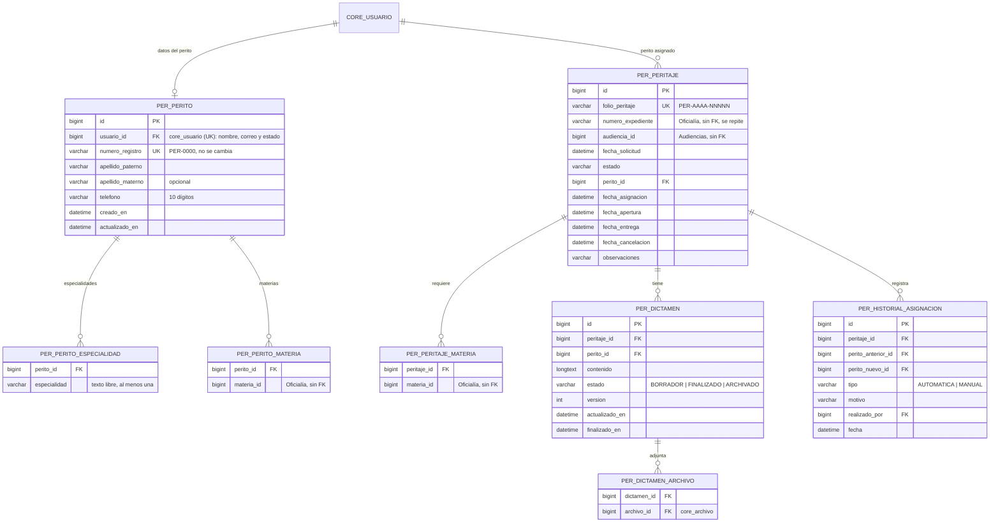
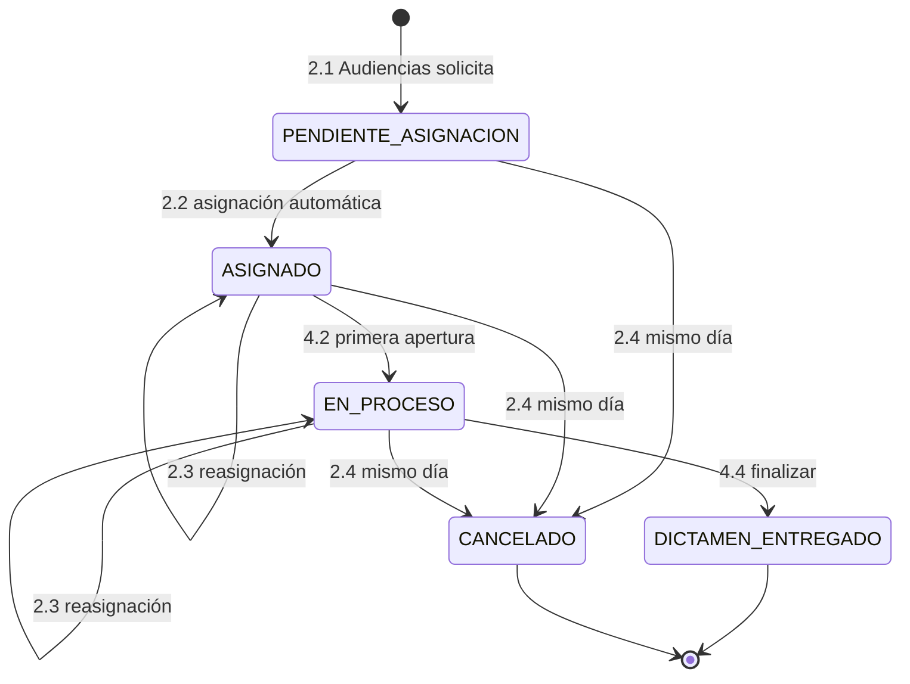

# Módulo de Peritajes — SGPJ, Gestión y Asignación de Peritajes

| Dato | Valor |
| :---- | :---- |
| Equipo | **Equipo 3** · rama `equipo-3` |
| Prefijo | Paquete `mx.edu.utez.sij.peritajes` · URLs `/peritajes/...` · vistas `templates/peritajes/` · tablas `per_` · roles `PERITAJES_*` |
| Fuente | DFR IEEE 830 v1.1 y BPMN v3 (`docs/modulos/peritajes/`) |
| Líder | Contreras Carbajal Marco Antonio |
| Project Manager | Escalona Ruiz Nathaly |
| Cliente | Narváez Figueroa José Christian |

> Sigue las reglas de `docs/ARQUITECTURA.md` y los contratos de `docs/CONTRATOS.md`.

---

## 1. Propósito

Mantener balanceada la carga de trabajo de los peritos. El módulo:

- recibe las solicitudes del **módulo de Audiencias** (Audiencias RF 6.1),
- asigna perito automáticamente por materia y menor carga,
- permite reasignar,
- y lleva el dictamen hasta "Dictamen Entregado".

El dictamen lo consultan Audiencias (RF 6.3) y Segunda Instancia (RF 6.1); se revisa en la audiencia.

---

## 2. Requerimientos y quién los implementa

| RF | Requerimiento | Implementación |
| :---- | :---- | :---- |
| 1.1 | Iniciar sesión | **Núcleo** (3 intentos, bloqueo de 15 min, recuperación por correo) |
| 1.2 | Cambio de contraseña | **Núcleo** (8 caracteres con mayúscula, minúscula y número) |
| 2.1 | Recepción de solicitud | Peritajes, con `SolicitudPeritajeApi.solicitar` (lo llama Audiencias) |
| 2.2 | Asignación automática | Peritajes |
| 2.3 | Asignación y reasignación manual | Peritajes |
| 2.4 | Cancelación | Peritajes, con `SolicitudPeritajeApi.cancelar` [Confirmar con Audiencias] |
| 3.1 – 3.4 | Catálogo de peritos | Peritajes (la cuenta se crea con `UsuarioService`). Diseño: bocetos de Figma (`Docs/figma/`) |
| 4.1 – 4.4 | Mis peritajes, expediente, realizar y finalizar dictamen | Peritajes (los documentos del expediente se leen con `ExpedienteApi`) |
| 4.5 | Consulta del dictamen por otros módulos | Peritajes, con `DictamenConsultaApi` (Audiencias 6.3 y Segunda 6.1) |
| 5.1 | Notificaciones | Peritajes decide cuándo; el núcleo muestra el aviso y envía el correo |
| 5.2 | Bitácora | Peritajes registra con `BitacoraService`; muestra solo la de su módulo |
| 5.3 | Panel de carga | Peritajes |

---

## 3. Roles

| Rol | Puede |
| :---- | :---- |
| `PERITAJES_ADMIN` | Ver todos los casos, reasignar, catálogo de peritos, bitácora y panel |
| `PERITAJES_PERITO_ADMIN` | Todo lo anterior + atender sus propios casos y hacer dictámenes |
| `PERITAJES_PERITO` | Solo sus propios casos y dictámenes |

Los peritos no pertenecen a ningún juzgado (lo confirma Audiencias 2.4 y 6.1).

---

## 4. Modelo de datos



**Cambios respecto a la versión anterior, por la integración con Audiencias:**
- **Folio propio.** El peritaje tiene su propio folio (`folio_peritaje`). El `numero_expediente` se puede repetir, porque un expediente puede pedir varios peritajes (Audiencias 6.4).
- **Expediente de Oficialía.** Ya no hay tabla de documentos del expediente: se leen de Oficialía con `ExpedienteApi.buscar(numeroExpediente)`.
- **Materias.** Vienen del catálogo de Oficialía (`CatalogoJudicialApi`); aquí solo se guarda el `materia_id`.

**Cambios por los bocetos de Figma y el DFR (RF 3.1 – 3.4)** [Propuesta, se ajusta al modelo relacional del equipo]:
- **Datos propios del perito** en `per_perito`: número de registro (el "identificador de perito" del DFR), apellidos paterno y materno, y teléfono. El nombre, el correo y el estado siguen en `core_usuario`.
- **Especialidad ≠ materia.** La *especialidad* es el área o los estudios del perito (Psicología, Criminalística, …): texto libre, puede tener varias (`per_perito_especialidad`). La *materia* (Civil, Familiar, Mercantil, Penal) es la rama del derecho en la que interviene y es la que usa la asignación automática (`per_perito_materia`).
- [Confirmar con integradores] `core_usuario` tiene un solo campo `apellidos`: el núcleo decide si guarda ahí "paterno materno" o si agrega los dos campos.

Se mantiene:
- **Perito = usuario del núcleo** con rol `PERITAJES_PERITO` o `PERITAJES_PERITO_ADMIN`.
- **`@Version` en el dictamen**, para el autoguardado.

---

## 5. Estados



**Cómo los ve Audiencias** (RF 6.4):

| Peritajes | Audiencias |
| :---- | :---- |
| `PENDIENTE_ASIGNACION` | pendiente |
| `ASIGNADO`, `EN_PROCESO` | asignado |
| `DICTAMEN_ENTREGADO` | dictaminado |
| `CANCELADO` | cancelado |

---

## 6. Reglas de negocio en el código

### 6.1 Carga activa
**Asignado + En Proceso**, calculada en un solo método del repositorio:

```java
@Query("SELECT COUNT(p) FROM Peritaje p WHERE p.peritoId = :peritoId AND p.estado IN ('ASIGNADO','EN_PROCESO')")
long contarCargaActiva(@Param("peritoId") Long peritoId);
```

### 6.2 Recepción y asignación automática (2.1, 2.2) — `SolicitudPeritajeService implements SolicitudPeritajeApi`

Método `synchronized` y `@Transactional`:

1. **Validar la solicitud:**
   - el expediente existe (`expedienteApi.buscar`),
   - hay al menos una materia,
   - no hay otra solicitud **activa** para la misma audiencia y materia [Propuesta].
2. **Guardar** el peritaje en `PENDIENTE_ASIGNACION` con un folio nuevo `PER-AAAA-NNNNN`.
3. **Buscar candidatos:** peritos activos con al menos una de las materias.
   - Si no hay ninguno: `ReglaNegocioException("No hay peritos disponibles en esta materia")`, y no se guarda nada (Audiencias 6.1).
4. **Elegir perito:** el de menor carga activa; si hay empate, uno al azar.
5. **Asignar:** el peritaje pasa a `ASIGNADO` y se registra en el historial (`AUTOMATICA`).
6. **Avisar:** notificación al perito y registro en la bitácora con `origen: AUDIENCIAS`.
7. **Responder:** devuelve el folio, el estado y el nombre del perito.

### 6.3 Asignación y reasignación manual (2.3)
- **Validaciones del nuevo perito:** activo, con al menos una materia del peritaje y distinto del actual.
- **Motivo:** obligatorio (mínimo 10 caracteres [Propuesta]).
- **Carga:** no se valida.
- **Estado:** solo en `ASIGNADO` o `EN_PROCESO`, y **no cambia**.
- **Avisos:** al perito nuevo ("Se le asignó el peritaje X") y al descartado ("Ya no tiene asignado el peritaje X").
- **Registro:** bitácora con el motivo e historial `MANUAL`.

### 6.4 Cancelación (2.4)
- Solo si la fecha de solicitud es **hoy** (zona `America/Mexico_City`). Si no: "El peritaje solo puede cancelarse el mismo día de su solicitud".
- Pasa a `CANCELADO`; no se borra. Se avisa al perito.
- No se cancela uno en `DICTAMEN_ENTREGADO` [Propuesta].

### 6.5 Expediente (4.2)
- **Al abrirlo:** si está `ASIGNADO`, pasa a `EN_PROCESO` y se guarda `fecha_apertura`.
- **Contenido:** los datos y documentos de la demanda se leen con `expedienteApi.buscar(numeroExpediente)`.
- **Descarga de documentos:** por la ruta de Peritajes, que valida que el caso sea del perito.

### 6.6 Dictamen (4.3, 4.4)
- **Editor:** Quill por CDN.
- **Autoguardado:** cada 30 segundos y al salir [Propuesta], con `fetch` y la `version`. Si no coincide, 409 y aviso "Hay cambios más recientes en otra ventana".
- **Contenido:** se limpia con `Jsoup.clean(html, Safelist.relaxed())`.
- **Archivos:** con `archivoService.guardar("PERITAJES", archivo, [PDF, DOC, DOCX, PNG, JPG], 25)`. Se pueden quitar mientras siga en borrador. Son opcionales [Confirmar].
- **Finalizar:**
  - El contenido no puede estar vacío.
  - En una sola transacción: dictamen `FINALIZADO` y peritaje `DICTAMEN_ENTREGADO`.
  - Después ya no se modifica.
- **Visibilidad:** desde ese momento, el dictamen aparece en `DictamenConsultaApi`.

### 6.7 Peritos (3.1 – 3.4)

Solo `PERITAJES_ADMIN` y `PERITAJES_PERITO_ADMIN`.

**Datos del perito**

| Campo | Obligatorio | Regla |
| :---- | :---- | :---- |
| Número de registro | Sí | Formato `PER-0000`, único. **No se cambia** después del registro |
| Nombre(s) | Sí | Máximo 80 caracteres |
| Apellido paterno | Sí | Máximo 60 |
| Apellido materno | No | Máximo 60 |
| Correo institucional | Sí | Formato válido, único, sin dominio obligatorio. **No se cambia** después del registro |
| Teléfono de contacto | Sí | 10 dígitos (se muestra `777 000 0000`) |
| Especialidades | Sí, al menos una | Texto libre, máximo 100 caracteres cada una; se quitan las vacías y las repetidas |
| Materias de intervención | Sí, al menos una | Del catálogo de Oficialía |

- **Registro (3.1):**
  - Con el núcleo: `usuarioService.crear(nombre, correo, "PERITAJES_PERITO")`. El núcleo genera la contraseña temporal y la envía, por eso el formulario no pide contraseña.
  - Siempre empieza en **Activo**.
  - Duplicado por número de registro o correo: "El perito ya existe: hay un perito registrado con el número PER-0000" (o "con el correo ...").
  - Sin especialidad: "La especialidad es un campo obligatorio: capture al menos una".
  - Éxito: aviso "Registro exitoso".
- **Consulta (3.2):**
  - Búsqueda por nombre o número de registro; filtros por especialidad, materia y estado.
  - 25 por página; el administrador puede elegir 10, 25, 50 o 100.
  - Muestra el total general, de activos, de inactivos y por materia.
  - Sin coincidencias: "No se encontraron peritos".
- **Edición (3.3):** todo menos el correo y el número de registro. Cambiar especialidades o materias no afecta los casos ya asignados. Éxito: "Datos actualizados correctamente".
- **Baja y reactivación (3.4):** desde la pantalla de edición, con confirmación.
  - Se bloquea si la carga activa (Asignado + En Proceso) es mayor que 0: "El perito tiene N peritajes activos (folios). Primero deben reasignarse para poder darlo de baja".
  - Si procede, `usuarioService.quitarRol(...)`. Reactivación con `usuarioService.agregarRol(...)`.
- **Bitácora (5.2):** alta, edición y cambio de estado con `bitacoraService` (pendiente del núcleo).

---

## 7. Contratos

**Ofrece** (detalle en `docs/CONTRATOS.md`):

| Contrato | Lo usan | Métodos |
| :---- | :---- | :---- |
| `SolicitudPeritajeApi` | Audiencias | `solicitar`, `cancelar`, `solicitudesDeExpediente` |
| `DictamenConsultaApi` | Audiencias, Segunda Instancia | `dictamen(folio)`, `dictamenesDeExpediente(numeroExpediente)` |

**Necesita:**

| De | Contrato | Para qué |
| :---- | :---- | :---- |
| Oficialía | `ExpedienteApi` | Validar el expediente y mostrar sus documentos (4.2) |
| Oficialía | `CatalogoJudicialApi` | Materias para las especialidades y los peritajes |
| Núcleo | `UsuarioService`, `SesionService`, `NotificacionService`, `BitacoraService`, `ArchivoService` | Cuentas, sesión, avisos, bitácora, archivos |

---

## 8. Rutas (`/peritajes`)

**Roles:** `ADM` = PERITAJES_ADMIN · `PA` = PERITAJES_PERITO_ADMIN · `PER` = PERITAJES_PERITO

| Método | URL | Roles | Vista / acción |
| :---- | :---- | :---- | :---- |
| GET | `/peritajes` | ADM, PA, PER | Inicio según rol |
| GET | `/peritajes/casos` | ADM, PA | Lista: filtros por estado, materia, perito y folio; 25 por página |
| GET | `/peritajes/casos/{id}` | ADM, PA | Detalle, historial y formulario de reasignación |
| POST | `/peritajes/casos/{id}/reasignar` | ADM, PA | `peritoId`, `motivo` |
| GET | `/peritajes/peritos` | ADM, PA | Catálogo `?q&especialidad&materiaId&estado&page&size` |
| GET / POST | `/peritajes/peritos/nuevo` | ADM, PA | Registro |
| GET / POST | `/peritajes/peritos/{id}/editar` | ADM, PA | Edición, carga activa y estado (no hay vista de detalle aparte) |
| POST | `/peritajes/peritos/{id}/estado` | ADM, PA | Baja o reactivación (`activo` = `true` o `false`) |
| GET | `/peritajes/mis-casos` | PER, PA | Solo los suyos |
| GET | `/peritajes/mis-casos/{id}` | PER, PA | Expediente (la primera apertura pasa a En Proceso) |
| GET | `/peritajes/mis-casos/{id}/documentos/{archivoId}` | PER, PA | Descargar un documento del expediente |
| GET | `/peritajes/mis-casos/{id}/dictamen` | PER, PA | Editor |
| POST | `/peritajes/mis-casos/{id}/dictamen/autoguardado` | PER, PA | **JSON** `{contenido, version}` |
| POST | `/peritajes/mis-casos/{id}/dictamen/archivos` | PER, PA | Subir archivo |
| POST | `/peritajes/mis-casos/{id}/dictamen/archivos/{archivoId}/eliminar` | PER, PA | Quitar archivo |
| POST | `/peritajes/mis-casos/{id}/dictamen/finalizar` | PER, PA | Entregar |
| GET | `/peritajes/bitacora` | ADM, PA | Bitácora del módulo |
| GET | `/peritajes/panel` | ADM, PA | Carga por perito y por materia |

---

## 9. Estructura de carpetas

```text
peritajes/
├── controller/   CasoController, PeritoController, MisCasosController, DictamenController,
│                 BitacoraPeritajesController, PanelController
├── service/      SolicitudPeritajeService (implements SolicitudPeritajeApi), AsignacionService,
│                 PeritajeService, PeritoService, DictamenService,
│                 DictamenConsultaService (implements DictamenConsultaApi)
├── repository/   PeritoRepository, PeritajeRepository, DictamenRepository, HistorialAsignacionRepository
├── model/        Perito, Peritaje, EstadoPeritaje (enum), Dictamen, EstadoDictamen (enum), HistorialAsignacion, ...
├── dto/          PeritoForm, CargaPerito, PeritajeActivoDto, ReasignacionForm, FiltroCasos
└── DatosInicialesPeritajes.java
templates/peritajes/  fragmentos.html  casos/  peritos/ (lista, registro, editar)  mis-casos/  bitacora.html  panel.html
static/peritajes/  css/peritajes.css  js/peritos.js  js/dictamen.js      templates/correo/peritajes/
```

**Temporal mientras no hay base de datos ni núcleo** (cada clase lo dice en su comentario):
- `PeritoRepositoryMemoria`: guarda en memoria. Se borra cuando `PeritoRepository` extienda `JpaRepository` (los pasos y las `@Query` están en la interfaz).
- `CatalogoMateriasTemporal` y `dto/MateriaDto`: se cambian por `CatalogoJudicialApi`.
- `service/ReglaNegocioException`: se cambia por la del núcleo.
- `templates/peritajes/fragmentos.html` y `controller/PeritajesVistasAdvice`: layout del módulo hasta que exista el del núcleo.

---

## 10. Correcciones sugeridas al DFR

| Sección | Hoy dice | Sugerencia |
| :---- | :---- | :---- |
| 1, 2.1, 2.4, 3.1 | Depende del "Sistema de Gestión y Control de Audiencias" ya existente | "Se integra con el **módulo de Audiencias (SGCA)** del Sistema Judicial Integral" |
| 2.1 y 2.4 (actor) | Sistema | Módulo de Audiencias |
| 2.1 Datos de entrada | Folio de la demanda | Número de expediente\*, Audiencia\*, Materia(s)\* (es lo que envía Audiencias 6.1). El sistema genera el **folio del peritaje** |
| 2.5 Suposiciones | Siempre hay un perito disponible | "Si no hay perito activo de la materia, se informa 'No hay peritos disponibles en esta materia'" (lo pide Audiencias 6.1) |
| 2.4 Cancelación | La pide el sistema externo | Confirmar con el Equipo 2: hoy su DFR no tiene ese requerimiento (pendiente 10) |
| 1.1 y 1.2 | Requerimientos propios | Nota: "Se implementan con el control de acceso común". Las reglas comunes: 3 intentos, bloqueo de 15 min, contraseña de 8 caracteres |
| 3.1 Interfaces | Interfaz con un sistema externo | Interfaces internas `SolicitudPeritajeApi` y `DictamenConsultaApi` |
| 4.5 | Opcional, por confirmar | Confirmado: lo usan Audiencias 6.3 y Segunda 6.1 |
| 3.3.8 Tecnologías | Vacío | Java 21, Spring Boot 3 (MVC), Thymeleaf, Bootstrap 5, Spring Security, Spring Data JPA, MySQL 8 |
| Materias | Civil, Familiar, Mercantil, Penal | Vienen del catálogo de Oficialía (pendiente 2) |
| Carga activa (2.2, 2.3, 3.4, 5.3, Glosario) | Solo "Asignado" | "Asignado y En Proceso" |
| 2.4 Cancelación | "Se elimina del sistema" | Pasa a "Cancelado" y se conserva |
| 3.1 Datos de entrada | Identificador de perito\*, Nombre completo\*, Especialidad(es)\*, Correo\*, Contraseña\*, Materia\* | Número de registro (PER-0000)\*, Nombre(s)\*, Apellido paterno\*, Apellido materno, Correo institucional\*, Teléfono de contacto\*, Especialidad(es)\*, Materia(s)\*. **Sin contraseña:** el núcleo genera una temporal y la envía por correo; se cambia en el primer inicio de sesión |
| 3.1 Reglas | "Contraseña segura, especificar" | Se quita: la contraseña la maneja el control de acceso común (8 caracteres con mayúscula, minúscula y número) |
| 3.1, 3.3 y 2.2 | Usa "especialidad" y "materia" como sinónimos | **Especialidad:** área o estudios del perito, texto libre, una o varias. **Materia:** Civil, Familiar, Mercantil o Penal; es la que usa la asignación |
| 3.1 Criterios | "sin asignarle al menos una especialidad" | Se exige al menos una especialidad **y** al menos una materia |
| 3.3 Datos de entrada | Id\*, Nombre completo\*, Especialidad(es)\*, Correo\* | El **correo y el número de registro no se editan**. Se editan nombre, apellidos, teléfono, especialidades y materias. Quitar "el correo no puede repetirse con otro perito" (ya no cambia) |
| 3.2 Datos de entrada | Nombre, Id de perito, Especialidad | Agregar filtros por materia y por estado (Activo/Inactivo), como en el boceto |
| 3.4 Reglas | Se bloquea con peritajes "Asignado" | "Asignado" o "En Proceso" (regla de negocio 8 del mismo DFR) |
| 3.4 | Sin pantalla definida | La baja y la reactivación se hacen desde la pantalla de edición, con confirmación (3.3.10) |

## 11. Pendientes

- Modelo relacional definitivo de `per_perito` (lo entrega el equipo) y cómo se guardan los apellidos en `core_usuario`.
- Mensajes de confirmación de 3.1, 3.3 y 3.4: el DFR no da el texto exacto; hoy se usan los de la sección 6.7.
- Borrador al reasignar un caso En Proceso: ¿se transfiere o se archiva? (hoy se archiva).
- ¿Al menos un anexo obligatorio al finalizar? (hoy son opcionales).
- Cancelación de solicitudes con el Equipo 2 (pendiente 10).
