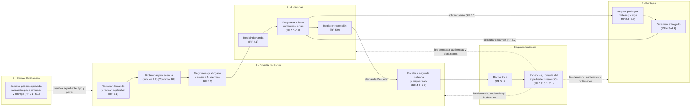
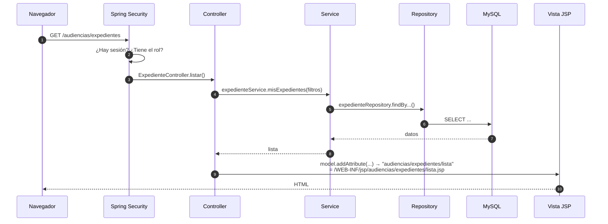
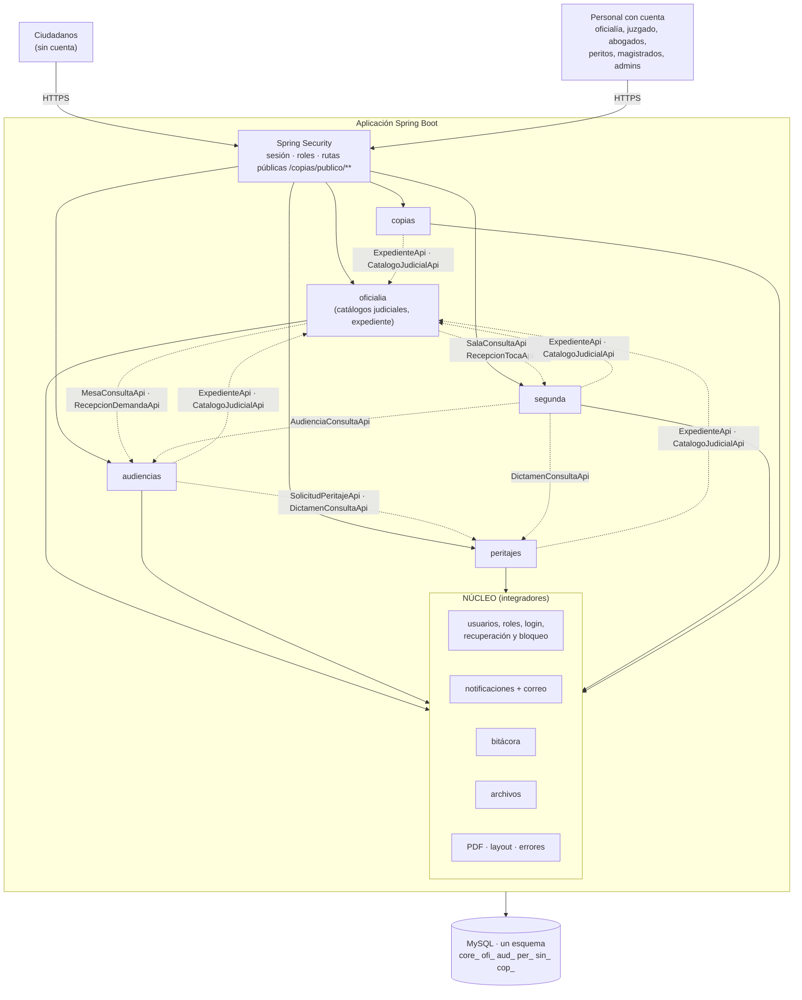
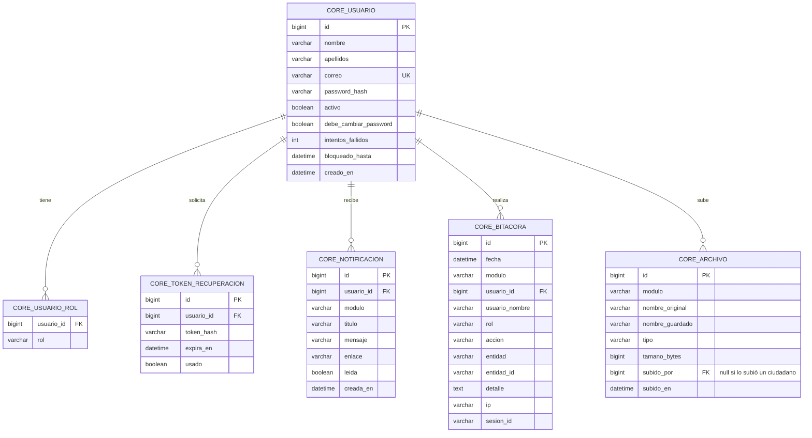

# Arquitectura del Sistema Judicial Integral

Versión 5.1 · 04/11/2026 · Basada en los DFR de los cinco módulos

> **Cambio de la versión 5.0:** las pantallas se hacen con **JSP** en la carpeta **`front-end/`** de la raíz (sección 16). Lo demás no cambia.
>
> **Cambio de la versión 5.1:** la sección 16 describe el front-end **ya construido**: layout con menú lateral, menú por módulo (`menu.jsp`), componentes de `tags/nucleo/` y configuración real para Spring Boot 4.

> **Nombre provisional.** No se tiene el nombre oficial del sistema completo. Aquí se usa **"Sistema Judicial Integral" (SIJ)**, el repositorio `sistema-judicial` y el paquete Java `mx.edu.utez.sij`. Cambiarlos antes de crear el repo.
>
> **Marcas que se usan en todos los documentos:**
> - **[Propuesta]**: idea de este documento que deben aprobar los integradores (un representante por equipo + líder).
> - **[Confirmar]**: algo que los DFR no dicen o dicen distinto entre sí. Lo resuelve el equipo dueño con el cliente.
>
> **Criterio:** tecnologías básicas vistas en la carrera (Java, Spring Boot MVC, JSP y una base de datos relacional).

---

## Índice

1. Qué es este proyecto
2. Módulos y equipos
3. Recorrido de una demanda por el sistema
4. Tecnologías
5. Cómo funciona una petición (MVC)
6. Arquitectura general
7. El núcleo común
8. Reglas para que los módulos convivan
9. Contratos entre módulos
10. Seguridad
11. Base de datos
12. Árbol del repositorio
13. GitHub
14. Sprint 0
15. Decisiones pendientes entre equipos
16. Front-end con JSP (carpeta `front-end/`)

---

## 1. Qué es este proyecto

Un solo sistema judicial con **5 módulos**, uno por equipo, dentro de **un solo proyecto Spring Boot y un solo repositorio de GitHub**. Todos los módulos comparten:

- el mismo inicio de sesión,
- la misma base de datos,
- el mismo diseño de pantallas.

Se comunican entre sí por **contratos** (interfaces de Java). Así, al final no hay que "unir" nada.

| Documento | Para qué |
| :---- | :---- |
| `docs/ARQUITECTURA.md` | Lo común a todo el sistema (este documento) |
| `docs/CONTRATOS.md` | Las interfaces exactas entre módulos |
| `docs/modulos/<modulo>.md` | Lo propio de cada módulo, a partir de su DFR |
| `docs/GUIA_PANTALLAS.md` | Cómo hacer las pantallas de tu módulo, explicado fácil |
| `docs/FLUJO_DE_TRABAJO.md` | Reglas de Git y reglas para asistentes de IA |
| `docs/GUIA_GITHUB.md` | Tutorial paso a paso de GitHub para todos los integrantes |

---

## 2. Módulos y equipos

| Equipo | Módulo | Nombre en su DFR | Líder (según DFR) | Prefijo |
| :---- | :---- | :---- | :---- | :---- |
| Equipo 1 | Oficialía de Partes | Sistema de Gestión y Recepción de Demandas para Oficialías de Partes | Flores Pérez Valeria Jatziry | `oficialia` / `ofi_` |
| Equipo 2 | Audiencias | SGCA – Sistema de Gestión y Control de Audiencias | Hernández Bautista Jimena | `audiencias` / `aud_` |
| Equipo 3 | Peritajes | SGPJ – Sistema para Gestión de Peritajes Judiciales | Contreras Carbajal Marco Antonio | `peritajes` / `per_` |
| Equipo 4 | Segunda Instancia | SSI – Sistema de Gestión de Tocas de Segunda Instancia | Modesto Cruz Bastián Azael | `segunda` / `sin_` |
| Equipo 5 | Copias Certificadas | SGCC – Sistema de Gestión de Copias Certificadas | Sánchez Muñoz Emilio | `copias` / `cop_` |
| Integradores | Núcleo común | — | Un representante por equipo + líder general: **Contreras Carbajal Marco Antonio** | `nucleo` / `core_` |

Cliente de los cinco módulos: **Narváez Figueroa José Christian**.

El **prefijo** se usa siempre igual:

| Dónde | Regla | Ejemplo |
| :---- | :---- | :---- |
| Paquete Java | `mx.edu.utez.sij.<prefijo>` | `mx.edu.utez.sij.audiencias` |
| URL | `/<prefijo>/...` | `/audiencias/agenda` |
| Vistas (JSP) | `front-end/WEB-INF/jsp/<prefijo>/` | `front-end/WEB-INF/jsp/audiencias/agenda.jsp` |
| CSS, JS e imágenes | `front-end/recursos/<prefijo>/` | `front-end/recursos/audiencias/js/agenda.js` |
| Tablas | `<pre>_<nombre>` | `aud_audiencia` |
| Roles | `<PREFIJO>_<ROL>` | `AUDIENCIAS_ABOGADO` |

---

## 3. Recorrido de una demanda por el sistema

Así se conectan los cinco DFR. Cada paso dice qué módulo lo hace y con qué requerimiento (RF).



**Primera instancia**

1. **Oficialía** registra la demanda y el sistema busca posibles duplicados. El personal del juzgado decide si es procedente o improcedente.
2. **Oficialía** pide a Audiencias las mesas de la materia con sus abogados, elige uno y le envía la demanda.
3. **Audiencias** recibe la demanda en el listado del abogado y programa las audiencias que hagan falta (con su acta descargable y su acta firmada).
4. **Audiencias** puede pedir un perito del sistema. **Peritajes** asigna al perito de menor carga, y cuando el perito entrega el dictamen, Audiencias lo consulta.
5. **Audiencias** registra la resolución y la demanda queda finalizada en primera instancia.

**Segunda instancia**

6. Si hay inconformidad, **Oficialía** marca la demanda "En Segunda Instancia" y le asigna una sala (que administra Segunda Instancia).
7. **Segunda Instancia** genera la toca. El magistrado registra ponencias, consulta el expediente completo de los otros tres módulos y emite su resolución.

**En cualquier momento**

8. Cualquier persona puede pedir **copias certificadas** en un portal público, sin cuenta:
   - si la demanda es **pública**, pasa directo al pago (simulado);
   - si es **privada**, el personal del juzgado valida que el solicitante sea parte de la demanda.

   Después el juez o el personal del juzgado registra la entrega física.

---

## 4. Tecnologías

| Para qué | Tecnología | Nota |
| :---- | :---- | :---- |
| Lenguaje | **Java 21** | |
| Framework | **Spring Boot 4.x** (hoy 4.1.2) con **Spring MVC** | Un solo proyecto Maven |
| Pantallas | **JSP** + **JSTL** + **Bootstrap 5** | En la carpeta `front-end/` de la raíz (sección 16). HTML generado en el servidor; Bootstrap por CDN |
| Seguridad en las pantallas | **Spring Security Taglibs** | Mostrar u ocultar opciones del menú según el rol |
| Plantillas de PDF y correo | **Thymeleaf** (solo interno) | No se usa para pantallas. Solo para el HTML que se convierte en PDF o se envía por correo |
| Base de datos | **MySQL 8** [Propuesta] | Cualquier relacional sirve; solo cambian el driver y la URL |
| Acceso a datos | **Spring Data JPA** (Hibernate) | |
| Seguridad | **Spring Security** con formulario y sesión | |
| Validaciones | **Bean Validation** | `@NotBlank`, `@Email`, `@Size`, `@Pattern` |
| Correo | **Spring Mail** (SMTP) | Recuperación de contraseña y avisos. Apagado en desarrollo |
| PDF | **OpenHTMLtoPDF** [Propuesta] | Solo dentro del núcleo (`PdfService`). Convierte una plantilla HTML en PDF. Lo usan Audiencias (acta) y Copias (papeleta y comprobante) |
| Menos código repetido | **Lombok** | Opcional |
| Limpiar HTML | **Jsoup** | Solo para el texto del editor del dictamen (Peritajes) |
| Editor de texto | **Quill** por CDN | Solo Peritajes (dictamen) |
| Calendario | **FullCalendar** por CDN [Propuesta] | Solo Audiencias (agenda). Opcional: también sirve una tabla por día |
| Pruebas | **JUnit 5** | Viene con Spring Boot |

**Spring Initializr:** empaquetado **War**, y las dependencias Spring Web, Spring Security, Spring Data JPA, MySQL Driver, Validation, Java Mail Sender, Lombok y Spring Boot DevTools. A mano en el `pom.xml`: las de JSP y la librería `org.thymeleaf:thymeleaf` (sección 16.7), `jsoup` y OpenHTMLtoPDF.

**No se usa:** Vue/React/Angular, JWT, Docker, Flyway, microservicios, API REST entre módulos ni pasarelas de pago reales.

> **Sobre las "API REST" de los DFR.** Varios DFR dicen que los módulos se comunican "mediante API REST con JSON". Como todos viven en el mismo proyecto, esa comunicación se hace con **interfaces de Java** (sección 9), que son más simples y no necesitan servidores separados. En cada documento de módulo está el texto sugerido para corregir su DFR.

---

## 5. Cómo funciona una petición (MVC)



| Capa | Paquete | Qué hace | Qué NO hace |
| :---- | :---- | :---- | :---- |
| Controller | `controller` | Recibe la petición, valida el formulario, llama al service y elige la vista | Reglas de negocio ni consultas |
| Service | `service` | Reglas de negocio del DFR, `@Transactional` | Saber de HTML |
| Repository | `repository` | Interfaces `JpaRepository` | Reglas |
| Model | `model` | Entidades `@Entity` y `enum` de estados | — |
| DTO | `dto` | Formularios y datos para las vistas | — |
| Vista | `front-end/WEB-INF/jsp/<prefijo>/` | HTML con JSP, JSTL y EL | Lógica ni código Java (*scriptlets*) |

---

## 6. Arquitectura general

**Monolito modular:** una aplicación Spring Boot dividida en paquetes por módulo.



Cada flecha punteada es un contrato. Va **del módulo que lo usa al que lo implementa** (detalle en `docs/CONTRATOS.md`).

---

## 7. El núcleo común (`nucleo`)

Lo que **todos** los DFR piden se hace una sola vez. Ningún módulo hace su propio login, su tabla de usuarios, sus correos, su bitácora, su subida de archivos ni su generación de PDF.

| Servicio | Qué ofrece | Lo piden |
| :---- | :---- | :---- |
| Control de acceso | Login, cerrar sesión, recuperar y cambiar contraseña, bloqueo por intentos | Los 5 DFR (RF 1.x) |
| `UsuarioService` | Crear usuarios, dar y quitar roles, desactivar y reactivar | Todos los que dan de alta personal |
| `SesionService` | Usuario en sesión: id, nombre, roles | Todos |
| `NotificacionService` | Aviso en la campana + correo | Peritajes, Segunda Instancia (los demás lo pospusieron) |
| `BitacoraService` | Registro inalterable con usuario, rol, acción, entidad, fecha e IP | Peritajes 5.2, Audiencias 7.1–7.2, Segunda 6.2 |
| `ArchivoService` | Subir con validación de tipo y tamaño, descargar con permiso | Todos |
| `PdfService` | Plantilla Thymeleaf → PDF descargable | Audiencias 5.7, Copias 2.3 y 4.1 |
| Layout (`front-end/WEB-INF/tags/`) | Menú por rol, campana, mensajes, diseño institucional, layout público, paginación | Todos |

### 7.1 Control de acceso unificado

Los cinco DFR describen su propio login con reglas parecidas pero no iguales. Como el login es uno solo, se unifican así:

| Regla | Valor unificado | De dónde sale |
| :---- | :---- | :---- |
| Datos de entrada | Correo electrónico y contraseña | Todos (Copias también menciona "usuario"; se usa el correo) |
| Quién entra | Solo usuarios registrados y **activos** | Todos |
| Mensajes | "Credenciales incorrectas" · "Cuenta inactiva" · "Cuenta bloqueada temporalmente" | Audiencias 1.1 |
| Intentos fallidos | **3 intentos → bloqueo de 15 minutos** | Audiencias, Segunda, Copias |
| Recuperar contraseña | Enlace por correo, **vigente 15 minutos y de un solo uso** | Audiencias 1.2, Copias 1.3, Segunda 1.2 |
| Mensaje si el correo no existe | **Mismo mensaje en ambos casos:** "Si el correo está registrado, recibirás las instrucciones" [Propuesta] | Segunda 1.2 lo pide así por seguridad; Audiencias y Copias piden decir que no existe (ver sección 15) |
| Nueva contraseña | Mínimo **8 caracteres**, una mayúscula, una minúscula y un número; **distinta a la actual**; confirmación igual | Audiencias 1.3, Copias 1.3 |
| Cerrar sesión | Invalida la sesión. El botón "Atrás" no muestra páginas privadas | Audiencias 1.4, Copias 1.2 |
| Sesión inactiva | **30 minutos** por defecto; **configurable por rol** (`SEGUNDA_MAGISTRADO` = 8 horas) [Propuesta] | Audiencias 1.4; Segunda pide sesión extendida por las ponencias |
| Primer inicio de sesión | Si la cuenta se creó con contraseña temporal, obliga a cambiarla | Peritajes, Segunda 4.1 |
| Ciudadanos | **No tienen cuenta**: usan el portal público de Copias | Decisión del grupo |

En desarrollo el correo está apagado: el enlace de recuperación y la contraseña temporal **se imprimen en la consola** para poder probar.

### 7.2 Roles

Un usuario puede tener roles de varios módulos. En el menú solo ve los módulos de sus roles.

| Rol | Módulo | Quién es (según su DFR) |
| :---- | :---- | :---- |
| `SISTEMA_ADMIN` | Núcleo / Oficialía | **Administrador Mayor** de Oficialía: configura materias, distritos, juzgados y oficialías, y da de alta a los administradores de cada módulo [Propuesta] |
| `OFICIALIA_PERSONAL` | Oficialía | Personal de Oficialía de Partes |
| `OFICIALIA_REVISOR` | Oficialía | Personal del juzgado / revisor de procedencia |
| `AUDIENCIAS_ADMIN` | Audiencias | Administrador de audiencias |
| `AUDIENCIAS_ABOGADO` | Audiencias | Abogado de audiencia (equivalente al juez) |
| `PERITAJES_ADMIN` | Peritajes | Administrador |
| `PERITAJES_PERITO_ADMIN` | Peritajes | Perito Administrador |
| `PERITAJES_PERITO` | Peritajes | Perito |
| `SEGUNDA_ADMIN` | Segunda Instancia | Administrador de salas y magistrados |
| `SEGUNDA_MAGISTRADO` | Segunda Instancia | Magistrado |
| `COPIAS_PERSONAL` | Copias | Personal administrativo del juzgado (visto bueno) |
| `COPIAS_JUEZ` | Copias | Juez / autoridad (registra la entrega) |

### 7.3 Quién da de alta a quién

| Quién | Crea usuarios con rol | Dónde (según su DFR) |
| :---- | :---- | :---- |
| `SISTEMA_ADMIN` | Administradores de cada módulo, `COPIAS_PERSONAL`, `COPIAS_JUEZ` y el primer `OFICIALIA_PERSONAL` de cada oficialía | `/admin/usuarios` (núcleo) |
| `OFICIALIA_PERSONAL` | `OFICIALIA_PERSONAL` y `OFICIALIA_REVISOR` **solo de su propia oficialía** | Oficialía RF 2.3 |
| `AUDIENCIAS_ADMIN` | `AUDIENCIAS_ABOGADO` | Audiencias RF 3.1 |
| `PERITAJES_ADMIN` / `PERITAJES_PERITO_ADMIN` | `PERITAJES_PERITO` | Peritajes RF 3.1 |
| `SEGUNDA_ADMIN` | `SEGUNDA_MAGISTRADO` | Segunda RF 4.1 |

Cada módulo crea las cuentas con `usuarioService.crear(...)` del núcleo. Solo puede dar **roles de su propio módulo**. Al dar de baja a alguien en un módulo se le quita ese rol, y si ya no le queda ninguno, su cuenta se desactiva.

### 7.4 Bitácora

Una sola tabla (`core_bitacora`) con columna `modulo`. Cada módulo muestra solo sus registros.

- **Datos de cada registro:**
  - fecha y hora del servidor,
  - módulo,
  - usuario (id y nombre),
  - rol,
  - acción,
  - entidad y su id,
  - detalle,
  - IP,
  - id de sesión.

  Son los seis datos obligatorios de Audiencias 7.1, más el módulo.
- **Inalterable:** no existen métodos ni pantallas para editar o borrar registros.
- **Si no se puede registrar, la acción no se completa** (Audiencias 7.1). `bitacoraService.registrar(...)` se llama dentro del mismo `@Transactional` del service: si falla, se revierte todo.
- **Llamadas entre módulos:** cuando un módulo actúa por otro (por ejemplo, Oficialía envía una demanda a Audiencias), se registra con el usuario en sesión y en el detalle `origen: OFICIALIA`.

### 7.5 Archivos

`archivoService.guardar(modulo, archivo, tiposPermitidos, tamanoMaximoMB)`:
- valida la extensión y el tipo del archivo,
- guarda el archivo con un nombre aleatorio fuera de las carpetas públicas (nunca en `front-end/recursos/`),
- y devuelve el id de `core_archivo`.

Cada módulo define sus propios límites:

| Módulo | Archivo | Tipos | Tamaño máximo |
| :---- | :---- | :---- | :---- |
| Oficialía | Documentos de la demanda | [Confirmar] (propuesta: PDF, JPG, PNG) | [Confirmar] (propuesta: 10 MB) |
| Audiencias | Acta firmada | PDF o imagen | 5 MB |
| Peritajes | Documentos del dictamen | PDF, Word, PNG, JPEG | 25 MB |
| Segunda Instancia | Apelación y resolución | PDF | [Confirmar] (propuesta: 10 MB) |
| Copias | Identificación oficial (INE) | JPG, PNG, PDF | [Confirmar] (propuesta: 5 MB) |

**Para descargar** se usa siempre una ruta del módulo que muestra el archivo. Esa ruta revisa el permiso y luego llama a `archivoService.descargar(id)`. No existe una ruta pública de archivos.

### 7.6 Rutas del núcleo

| Método | URL | Quién | Qué hace |
| :---- | :---- | :---- | :---- |
| GET / POST | `/login` | Público | Iniciar sesión |
| POST | `/logout` | Con sesión | Cerrar sesión |
| GET / POST | `/recuperar` | Público | Pedir enlace de recuperación |
| GET / POST | `/recuperar/{token}` | Público | Escribir la nueva contraseña |
| GET / POST | `/cuenta/password` | Con sesión | Cambiar contraseña |
| GET | `/` | Con sesión | Inicio con una tarjeta por módulo al que tiene acceso |
| GET | `/notificaciones` | Con sesión | Sus notificaciones |
| POST | `/notificaciones/{id}/leida` | Con sesión | Marcar como leída |
| GET / POST | `/admin/usuarios/**` | `SISTEMA_ADMIN` | Administración general de usuarios |

### 7.7 Tablas del núcleo



Las **materias, distritos, municipios y juzgados** no están en el núcleo. Son de Oficialía, porque su DFR (RF 2.1 y 2.2) dice que el Administrador Mayor los configura. Los demás módulos los consultan con `CatalogoJudicialApi`.

---

## 8. Reglas para que los módulos convivan

1. **Paquete:** todo tu código Java va en `mx.edu.utez.sij.<prefijo>`.
2. **URLs:** todas tus rutas empiezan con `/<prefijo>/`. Solo Copias tiene rutas públicas, en `/copias/publico/**`.
3. **Vistas** en `front-end/WEB-INF/jsp/<prefijo>/` y CSS, JS e imágenes en `front-end/recursos/<prefijo>/` (sección 16).
4. **Tablas:** `@Table(name = "<pre>_<nombre>")`.
5. **Nunca** uses un `Repository`, `Service` o entidad de otro módulo. Solo el núcleo y los contratos (`docs/CONTRATOS.md`).
6. **Relaciones entre tablas:**
   - Con tablas `core_*`, sí.
   - Con otro módulo, no: guarda solo su identificador (por ejemplo, `numero_expediente` o `materia_id`) como columna simple, sin `@ManyToOne`.
7. **Identificador común:** el **número de expediente** que genera Oficialía. Todos los módulos lo llaman `numeroExpediente` en Java y `numero_expediente` en la base.
8. **Permisos:** `@PreAuthorize` en cada controller. Nadie edita `SecurityConfig`.
9. **Formularios:** `GET` para ver y `POST` para guardar, cambiar o borrar.
10. **Mensajes al usuario:** `RedirectAttributes.addFlashAttribute("exito" | "error", texto)`, con los textos exactos de los criterios de aceptación del DFR.
11. **Errores de contratos:** todos los errores de negocio extienden `ReglaNegocioException` (núcleo). Quien llama un contrato atrapa esa excepción y muestra `e.getMessage()`.
12. **Fechas:** `LocalDate` / `LocalDateTime` con la zona `America/Mexico_City`.
13. **Paginación:** `Pageable` con el tamaño que diga cada DFR (Audiencias 10, Peritajes 25).
14. **Nombres en español**, sin acentos en el código.

---

## 9. Contratos entre módulos

Un **contrato** es una interfaz de Java en `nucleo/contratos/<modulo>/`. El módulo dueño la implementa y los demás la usan por inyección (`private final MesaConsultaApi mesaConsultaApi;`). El detalle completo, con métodos y datos, está en **`docs/CONTRATOS.md`**.

| Contrato | Lo implementa | Lo usa | Para qué (RF) |
| :---- | :---- | :---- | :---- |
| `CatalogoJudicialApi` | Oficialía | Todos | Materias, distritos y juzgados (Oficialía 2.1, 2.2; Segunda 2.1) |
| `ExpedienteApi` | Oficialía | Audiencias, Peritajes, Segunda, Copias | Datos de la demanda, partes, tipo público/privado, documentos y cambio de estado |
| `MesaConsultaApi` | Audiencias | Oficialía | Mesas activas de una materia con sus abogados (Audiencias 3.3) |
| `RecepcionDemandaApi` | Audiencias | Oficialía | Enviar la demanda al abogado elegido (Audiencias 4.1; Oficialía 5.1) |
| `AudienciaConsultaApi` | Audiencias | Segunda | Audiencias, actas y resolución de primera instancia (Segunda 6.1) |
| `SolicitudPeritajeApi` | Peritajes | Audiencias | Pedir y cancelar peritajes y ver su estado (Peritajes 2.1–2.4; Audiencias 6.1, 6.4) |
| `DictamenConsultaApi` | Peritajes | Audiencias, Segunda | Leer dictámenes entregados (Peritajes 4.5; Audiencias 6.3; Segunda 6.1) |
| `SalaConsultaApi` | Segunda | Oficialía | Salas activas con su magistrado (Oficialía 5.2) |
| `RecepcionTocaApi` | Segunda | Oficialía | Crear la toca (Segunda 5.1; Oficialía 4.1, 5.2) |

Copias no ofrece contratos: solo usa los de Oficialía.

---

## 10. Seguridad

| Tema | Cómo se hace |
| :---- | :---- |
| Inicio de sesión | `formLogin` de Spring Security con sesión |
| Contraseñas | `BCryptPasswordEncoder`; nunca en texto plano ni en logs |
| Bloqueo | 3 intentos fallidos → 15 minutos (`intentos_fallidos`, `bloqueado_hasta`) |
| Recuperación | Token aleatorio guardado como hash, 15 minutos, un solo uso |
| CSRF | Activado. Todo formulario `POST` lleva el token: con `<form:form>` se agrega solo; con `<form>` normal se agrega `<n:csrf/>` (también en el portal público) |
| Permisos | `@EnableMethodSecurity` + `@PreAuthorize("hasRole('...')")` en cada controller |
| Menú por rol | `<sec:authorize access="hasRole('...')">` en las JSP |
| Datos propios | El service filtra por el usuario en sesión: el abogado ve sus expedientes, el perito sus casos, el magistrado sus tocas y Oficialía su adscripción. Si alguien pide algo ajeno, ve el mensaje del DFR o la página 404 |
| Usuario desactivado | No inicia sesión; el núcleo cierra sus sesiones abiertas |
| Portal público (Copias) | Solo `/copias/publico/**`. Sin datos de otros: con un folio se ve solo el estado del trámite. Los folios llevan una parte aleatoria para que no se puedan adivinar |
| Datos privados | La INE y el RFC de los solicitantes solo los ve `COPIAS_PERSONAL`. Los expedientes privados nunca se muestran en el portal |
| XSS | En JSP, `${...}` **no escapa**: todo dato se muestra con `<c:out value="${...}"/>`. Sin escapar solo el HTML ya limpiado con Jsoup (dictamen) |
| Inyección SQL | Spring Data JPA y `@Query` con parámetros |
| Archivos | Validación de tipo y tamaño, nombre aleatorio, fuera de `front-end/`, descarga solo con permiso |
| Bitácora | Sin edición ni borrado |
| Contraseñas del proyecto | En `application-local.properties`, que no se sube a GitHub |
| HTTPS | En el servidor de entrega. En local, `http://localhost:8080` |

---

## 11. Base de datos

- **Un solo esquema** `sij`.
- **JPA crea las tablas** a partir de las entidades (`spring.jpa.hibernate.ddl-auto=update`). No se escriben scripts.
- **Datos de prueba:** cada módulo tiene su clase `DatosIniciales<Modulo>` (`CommandLineRunner`) que inserta solo si sus tablas están vacías. No se usa `data.sql`, porque los cinco equipos lo editarían al mismo tiempo.
- **Orden de los datos de prueba:**
  1. Núcleo: usuarios con un rol de cada módulo.
  2. Oficialía: materias, distritos, juzgados y algunas demandas.
  3. Los demás módulos.

  Se ordena con `@Order` en cada clase.
- Si renombras o quitas un atributo de una entidad, avísalo en tu PR: JPA no borra columnas viejas.
- Antes de la entrega, los integradores exportan el esquema final a `docs/bd/esquema.sql`.

---

## 12. Árbol del repositorio

```text
sistema-judicial/
├── .github/
│   ├── CODEOWNERS
│   ├── pull_request_template.md
│   ├── copilot-instructions.md              # "Lee AGENTS.md"
│   ├── ISSUE_TEMPLATE/ (requerimiento.md, bug.md, contrato.md)
│   └── workflows/ci.yml
│
├── docs/
│   ├── ARQUITECTURA.md      CONTRATOS.md      FLUJO_DE_TRABAJO.md      GUIA_GITHUB.md
│   ├── bd/esquema.sql                         # al final
│   └── modulos/
│       ├── _PLANTILLA_MODULO.md
│       ├── oficialia.md   audiencias.md   peritajes.md   segunda-instancia.md   copias-certificadas.md
│       └── <prefijo>/                         # DFR y BPMN originales de cada equipo
│
├── src/main/java/mx/edu/utez/sij/
│   ├── SijApplication.java                    # hoy: mx/edu/utez/integradora/IntegradoraApplication.java (escanea mx.edu.utez.sij)
│   ├── nucleo/                                # INTEGRADORES
│   │   ├── config/            # SecurityConfig, FrontEndConfig, ZonaHorariaConfig, SesionPorRolHandler
│   │   ├── acceso/            # login, recuperación, cambio de contraseña, bloqueo
│   │   ├── usuarios/  notificaciones/  bitacora/  archivos/  pdf/
│   │   ├── web/               # InicioController (/), VistasComunesAdvice (datos del layout), ModuloSistema
│   │   ├── util/              # FechaUtil (zona horaria y fechas como texto para las JSP)
│   │   └── contratos/         # ReglaNegocioException + una carpeta por módulo
│   │       └── oficialia/  audiencias/  peritajes/  segunda/
│   ├── oficialia/             # EQUIPO 1
│   ├── audiencias/            # EQUIPO 2
│   ├── peritajes/             # EQUIPO 3
│   ├── segunda/               # EQUIPO 4
│   └── copias/                # EQUIPO 5
│       # cada módulo: controller/ service/ repository/ model/ dto/ DatosIniciales<Modulo>.java
│
├── src/main/resources/
│   ├── application.properties                 # INTEGRADORES
│   ├── application-local.example.properties   # ejemplo (sí se sube)
│   └── templates/             # SOLO plantillas internas (no son pantallas)
│       ├── correo/<prefijo>/  # correos de cada módulo
│       └── pdf/<prefijo>/     # HTML que se convierte a PDF
│
├── front-end/                                 # PANTALLAS (JSP) · sección 16
│   ├── WEB-INF/
│   │   ├── jsp/
│   │   │   ├── nucleo/        # INTEGRADORES: login, recuperar, inicio, cuenta, notificaciones, admin
│   │   │   ├── error/         # INTEGRADORES: 403.jsp, 404.jsp, 500.jsp
│   │   │   ├── oficialia/     # EQUIPO 1
│   │   │   ├── audiencias/    # EQUIPO 2
│   │   │   ├── peritajes/     # EQUIPO 3
│   │   │   ├── segunda/       # EQUIPO 4
│   │   │   └── copias/        # EQUIPO 5
│   │   └── tags/
│   │       ├── layout.tag             # INTEGRADORES: plantilla con menú
│   │       ├── layout-publico.tag     # INTEGRADORES: plantilla del portal de Copias
│   │       ├── nucleo/                # INTEGRADORES: mensajes, paginación, estado, confirmar, archivo
│   │       └── <prefijo>/             # (opcional) componentes propios de cada equipo
│   ├── recursos/
│   │   ├── nucleo/            # INTEGRADORES: css/estilos.css, js/comun.js, img/logo.png
│   │   └── oficialia/  audiencias/  peritajes/  segunda/  copias/   # css/ js/ img/ de cada equipo
│   └── README.md              # cómo hacer una pantalla nueva
│
├── src/test/java/mx/edu/utez/sij/             # misma estructura
├── pom.xml   mvnw   mvnw.cmd   .mvn/          # INTEGRADORES
├── .gitignore   .gitattributes
├── AGENTS.md   CLAUDE.md   README.md
```

`application.properties` (solo lo editan los integradores):

```properties
spring.application.name=sij
spring.profiles.active=local
# Pantallas JSP (sección 16)
spring.mvc.view.prefix=/WEB-INF/jsp/
spring.mvc.view.suffix=.jsp
server.servlet.session.tracking-modes=cookie
spring.datasource.url=jdbc:mysql://localhost:3306/sij?createDatabaseIfNotExist=true&serverTimezone=America/Mexico_City
spring.jpa.hibernate.ddl-auto=update
spring.jpa.open-in-view=false
spring.servlet.multipart.max-file-size=25MB
spring.servlet.multipart.max-request-size=50MB
server.servlet.session.timeout=30m
sij.archivos.ruta=${user.home}/sij-archivos
sij.correo.habilitado=false
sij.acceso.intentos-maximos=3
sij.acceso.minutos-bloqueo=15
sij.acceso.minutos-token-recuperacion=15
sij.sesion.minutos-por-rol.SEGUNDA_MAGISTRADO=480
```

`application-local.properties` (cada quien el suyo; **no se sube**):

```properties
spring.datasource.username=root
spring.datasource.password=tu_password
```

**Correr el proyecto:** copia el ejemplo como `application-local.properties`, ejecuta `./mvnw spring-boot:run` y abre `http://localhost:8080`.

---

## 13. GitHub

- Cómo se configura el repositorio y cómo trabaja cada integrante: **`docs/GUIA_GITHUB.md`**.
- Las reglas obligatorias para personas y asistentes de IA: **`docs/FLUJO_DE_TRABAJO.md`**.

Resumen del modelo de ramas:

```text
main  ←  develop  ←  equipo-N  ←  equipo-N/<tarea>
(entrega)  (los 5 módulos)  (cada equipo)  (cada integrante)
```

---

## 14. Sprint 0 (integradores)

1. Proyecto de Spring Initializr con las dependencias de la sección 4 y los paquetes vacíos de los 5 módulos.
2. Núcleo funcionando:
   - login,
   - recuperación y cambio de contraseña,
   - bloqueo por intentos,
   - usuarios y roles,
   - notificaciones,
   - bitácora,
   - archivos,
   - PDF,
   - layout privado y público (`layout.tag`, `layout-publico.tag`) y los componentes de `tags/nucleo/`,
   - páginas de error.
3. Usuarios de prueba con un rol de cada módulo.
4. Todas las interfaces de `docs/CONTRATOS.md`, cada una con una clase de **datos de prueba** en el módulo dueño (`// TODO equipo N`).
5. Página `/` con tarjetas por módulo, y una página de inicio vacía en cada módulo (`front-end/WEB-INF/jsp/<prefijo>/inicio.jsp`) que sirva de ejemplo para copiar.
6. `pom.xml` en War con las dependencias de JSP, `FrontEndConfig` y las propiedades de JSP (sección 16.7). Comprobar que `./mvnw spring-boot:run` muestra las JSP desde IntelliJ y desde la terminal.
7. `SecurityConfig` con `/copias/publico/**` y `/recursos/**` como rutas públicas, y las JSP permitidas (sección 16.7).
8. `.gitignore`, ejemplo de `application-local`, CI, CODEOWNERS, plantilla de PR, `AGENTS.md` y `docs/`.
9. Cada equipo revisa su `docs/modulos/<modulo>.md` y su sección de "Correcciones sugeridas al DFR".

**Avance (04/11/2026):**

| Punto | Estado |
| :---- | :---- |
| 2. Layout privado y público, componentes de `tags/nucleo/` y páginas de error | ✅ Hecho |
| 5. Página `/` con tarjetas e `inicio.jsp` + `menu.jsp` en cada módulo | ✅ Hecho |
| 6. `pom.xml` en War, `FrontEndConfig` y propiedades de JSP | ✅ Hecho |
| 8. `AGENTS.md` y `docs/` | ✅ Hecho |
| 2. Login, usuarios, notificaciones, bitácora, archivos y PDF | Pendiente |
| 3, 4 y 7. Usuarios de prueba, contratos y `SecurityConfig` | Pendiente |
| Base de datos | Pendiente: hoy `application.properties` desactiva la conexión y Peritajes guarda en memoria |

---

## 15. Decisiones pendientes entre equipos

Son puntos donde dos o más DFR no coinciden o les falta algo para conectarse. Cada uno tiene una sugerencia; lo deciden los equipos involucrados (con el cliente si hace falta) y después se actualizan sus DFR.

| # | Tema | Qué dice cada DFR | Sugerencia | Equipos |
| :---- | :---- | :---- | :---- | :---- |
| 1 | Comunicación entre módulos | Audiencias, Segunda y Copias piden "API REST con JSON" | Interfaces de Java dentro del mismo proyecto (sección 9). Corregir 3.1 y 3.3.6 de cada DFR | Todos |
| 2 | Catálogo de materias | Peritajes: Civil, Familiar, Mercantil, Penal. Segunda: civil, familiar, mercantil, "judicial". Oficialía: ejemplos Familiar, Laboral, Civil | Un solo catálogo que administra el Administrador Mayor (Oficialía 2.1). Datos iniciales: Civil, Familiar, Mercantil y Penal. Confirmar con el cliente si existe Laboral; "judicial" parece un error | 1, 2, 3, 4 |
| 3 | Mensaje al recuperar contraseña | Segunda: mensaje genérico. Audiencias y Copias: "el correo no está registrado" | Mensaje genérico, porque así nadie puede averiguar qué correos existen | 2, 4, 5 |
| 4 | ¿Mesa o abogado? | Oficialía 5.1: "asignar automáticamente una mesa" (y luego dice que el usuario la selecciona). Audiencias 3.2 y RN 3: Oficialía **elige al abogado** de una mesa de la materia | Oficialía elige mesa **y** abogado entre los que devuelve `MesaConsultaApi`, de forma manual. Corregir Oficialía 5.1 | 1, 2 |
| 5 | Tipo de demanda y partes | Audiencias 2.5 y Copias 2.2 necesitan saber si la demanda es **pública o privada** y quiénes son las partes (con RFC). Oficialía 3.1 no captura el tipo, el RFC del demandado ni los abogados, y deja opcionales los nombres | Agregar a Oficialía 3.1: Tipo (pública/privada)\*, Nombre del demandante\*, RFC del demandante\*, Nombre del demandado\*, RFC del demandado, Abogados de las partes | 1, 2, 5 |
| 6 | Número de expediente | Todos lo usan; nadie dice su formato ni cuándo se genera | Lo genera Oficialía al registrar la demanda, con formato `EXP-AAAA-NNNNN` [Propuesta]. Solo las procedentes llegan a Audiencias | 1 |
| 7 | Dictaminar procedencia | Oficialía lo pone en su alcance y en 2.2, pero no tiene RF en 3.2 | Agregar un RF "Dictaminar procedencia (Personal del juzgado)" con motivo obligatorio si es improcedente | 1 |
| 8 | ¿Siempre hay perito? | Peritajes 2.5: siempre hay perito disponible. Audiencias 6.1: "No hay peritos disponibles en esta materia" | Peritajes devuelve ese mensaje si no hay perito activo de la materia (no cuesta nada). Ajustar la suposición en el DFR de Peritajes | 2, 3 |
| 9 | Varios peritajes por expediente | Peritajes usa el folio de la demanda como único. Audiencias 6.4 habla de **varias** solicitudes por expediente | Peritajes genera su propio folio por solicitud y guarda el número de expediente (que se puede repetir) | 2, 3 |
| 10 | Cancelar una solicitud de peritaje | Peritajes 2.4: la cancela Audiencias el mismo día. Audiencias no tiene ese RF | Agregar a Audiencias un RF "Cancelar solicitud de peritaje" (el mismo día), o quitar 2.4 de Peritajes | 2, 3 |
| 11 | Estados del peritaje | Audiencias 6.4: pendiente / asignado / dictaminado. Peritajes: Pendiente, Asignado, En Proceso, Dictamen Entregado, Cancelado | `SolicitudPeritajeApi` traduce: Asignado y En Proceso → "asignado"; Dictamen Entregado → "dictaminado"; además "cancelado" | 2, 3 |
| 12 | Materia de las salas | Oficialía RN 2: la sala debe ser de la misma materia que la demanda. Segunda 3.1: las salas no tienen materia, solo distrito | Agregar Materia\* a la sala en Segunda 3.1, o quitar esa parte de la RN 2 de Oficialía | 1, 4 |
| 13 | Documento de apelación | Segunda 5.1 lo exige (PDF). Oficialía 4.1 solo pide el número de expediente | Agregar a Oficialía 4.1: Documento de apelación (PDF)\* | 1, 4 |
| 14 | Reasignar tocas | Segunda 4.5: hay que reasignar tocas antes de desactivar a un magistrado. Segunda RN 7: la asignación es exclusiva de Oficialía | Segunda permite reasignar la sala de una toca solo para ese caso, o Oficialía la reasigna. Lo decide el Equipo 4 | 1, 4 |
| 15 | Estado de la demanda | Oficialía usa "En Trámite", "Programada para Audiencia", "Resuelta" y "En Segunda Instancia", pero esos cambios ocurren en otros módulos | Audiencias avisa con `ExpedienteApi.cambiarEstado(...)`: En Trámite al recibirla, Resuelta al registrar la resolución. Confirmar si se necesita "Programada para Audiencia" y qué estado queda tras la resolución de segunda instancia | 1, 2, 4 |
| 16 | Avisos a las partes | Segunda 7.1: "se envía notificación por correo a las partes". Las partes no tienen cuenta ni correo capturado | Quitarlo de 7.1 (las notificaciones a las partes están pospuestas en Audiencias y en Segunda 2.6), o capturar el correo de las partes en Oficialía | 1, 4 |
| 17 | Tarifa de copias | Copias habla de "tarifa vigente" y de un panel de tarifas, pero no hay RF | Agregar un RF "Configurar tarifa" (`COPIAS_PERSONAL` o `SISTEMA_ADMIN`) o fijar un precio único inicial | 5 |
| 18 | ¿El personal de Copias es de un juzgado? | Copias no dice si el personal valida solicitudes de cualquier juzgado o solo del suyo | Confirmar con el cliente. Si es por juzgado, Copias guarda la adscripción como Oficialía | 5 |

---

## 16. Front-end con JSP (carpeta `front-end/`)

### 16.1 Qué cambia y qué no

Las pantallas se hacen con **JSP + JSTL** en una carpeta **`front-end/`** en la raíz del repositorio, separada del código Java.

| Se queda igual | Cambia |
| :---- | :---- |
| Los módulos, paquetes Java, contratos, base de datos, roles y seguridad | Las pantallas pasan de `src/main/resources/templates/` a `front-end/WEB-INF/jsp/` |
| Los controllers devuelven el nombre de la vista igual que antes (`"peritajes/peritos/lista"`) | El CSS, JS e imágenes pasan de `static/` a `front-end/recursos/` |
| URLs, formularios `GET`/`POST`, mensajes con `RedirectAttributes` | El proyecto se empaqueta como **War** en lugar de Jar (lo exige JSP en Spring Boot) |
| Los PDF y correos (`templates/pdf/` y `templates/correo/`) | Thymeleaf queda **solo** para esas plantillas internas, nunca para pantallas |

### 16.2 Quién es dueño de qué dentro de `front-end/`

| Carpeta | Dueño | Qué va ahí |
| :---- | :---- | :---- |
| `WEB-INF/jsp/nucleo/` | Integradores | Login, recuperar contraseña, inicio, cuenta, notificaciones, administración de usuarios |
| `WEB-INF/jsp/error/` | Integradores | `403.jsp`, `404.jsp`, `500.jsp` |
| `WEB-INF/tags/layout.tag`, `layout-publico.tag` | Integradores | Plantilla común: menú lateral, encabezado, mensajes, pie (16.4) |
| `WEB-INF/tags/nucleo/` | Integradores | Componentes reutilizables (16.6) |
| `WEB-INF/jsp/<prefijo>/` | Equipo del módulo | Todas las pantallas del módulo, su `inicio.jsp` y su `menu.jsp` (menú lateral, 16.4) |
| `WEB-INF/tags/<prefijo>/` | Equipo del módulo | (Opcional) componentes propios del módulo |
| `recursos/nucleo/` | Integradores | `css/estilos.css` (colores institucionales), `js/comun.js`, `img/` |
| `recursos/<prefijo>/` | Equipo del módulo | `css/`, `js/` e `img/` propios (por ejemplo, `recursos/peritajes/js/dictamen.js`) |

**Por qué `WEB-INF`:** lo que está dentro de `WEB-INF/` no se puede abrir directo desde el navegador. Así nadie entra a una JSP sin pasar por su controller, que es donde se revisan los permisos.

### 16.3 Cómo se conecta un controller con una JSP

```java
@Controller
@RequestMapping("/peritajes/peritos")
@PreAuthorize("hasAnyRole('PERITAJES_ADMIN','PERITAJES_PERITO_ADMIN')")
@RequiredArgsConstructor
public class PeritoController {

    private final PeritoService peritoService;

    @GetMapping
    public String listar(@RequestParam(required = false) String q, Pageable pageable, Model model) {
        model.addAttribute("peritos", peritoService.buscar(q, pageable));
        return "peritajes/peritos/lista";      // → front-end/WEB-INF/jsp/peritajes/peritos/lista.jsp
    }
}
```

Spring le agrega `/WEB-INF/jsp/` al inicio y `.jsp` al final (propiedades de 16.7).

### 16.4 La plantilla común (`WEB-INF/tags/layout.tag`)

Toda pantalla con sesión usa esta plantilla, **ya hecha** en el repositorio. Da a los cinco módulos el mismo diseño:

```text
┌──────────────────┬───────────────────────────────────────────────────────┐
│ [emblema]        │ ☰  Sistema para Gestión de Peritajes Judiciales  fecha│ ← encabezado
│ Sistema Judicial │───────────────────────────────────────────────────────│
│ Integral         │ SGPJ / Catálogo de peritos              ← <n:migas>   │
│ (nombre módulo)  │ Catálogo de peritos      [+ Registrar]  ← <n:encabezado>
│                  │                                                       │
│ ESPACIO DE       │   contenido de la pantalla                            │
│ TRABAJO          │   (<n:tarjeta>, tablas, formularios...)               │
│  · Inicio        │                                                       │
│  · Catálogo  ◀── menú del módulo: WEB-INF/jsp/<prefijo>/menu.jsp         │
│ SISTEMA          │                                                       │
│  · Inicio del    │                                                       │
│    sistema       │                                                       │
│ [usuario]        │                                                       │
│ [Cerrar sesión]  │ Sistema Judicial Integral · Peritajes   ← pie         │
└──────────────────┴───────────────────────────────────────────────────────┘
```

En pantallas chicas el menú lateral se oculta y se abre con el botón ☰.

**Atributos:**

| Atributo | Obligatorio | Para qué |
| :---- | :---- | :---- |
| `titulo` | Sí | Texto de la pestaña del navegador |
| `modulo` | En las pantallas de un módulo | Prefijo (`oficialia`, `audiencias`, `peritajes`, `segunda`, `copias`). Muestra el nombre del módulo y su menú |
| `seccion` | No | Opción del menú que se marca como activa (la `clave` de `<n:menu-item>`) |
| `estilos` | No | `<link>` al CSS propio de la pantalla |
| `scripts` | No | `<script>` propios de la pantalla (se cargan después de Bootstrap y `comun.js`) |

Lo que la plantilla ya trae, para que ningún módulo lo repita:
- Bootstrap 5 por CDN, `recursos/nucleo/css/estilos.css` y `recursos/nucleo/js/comun.js`.
- Menú lateral con el menú del módulo, "Inicio del sistema", usuario y "Cerrar sesión".
- Encabezado con el nombre del módulo y la fecha.
- `<n:mensajes/>` (avisos de éxito y error) y la ventana de confirmación común.
- Las etiquetas `<meta name="_csrf">` para `fetch` (aparecen cuando exista Spring Security).

Los datos que necesita (módulos, fecha y usuario) los pone `nucleo/web/VistasComunesAdvice` en todas las vistas. Los nombres de los módulos están en `nucleo/web/ModuloSistema`.

`layout-publico.tag` es igual pero sin menú ni usuario. Lo usan el portal de Copias (`/copias/publico/**`) y las páginas de error.

**Menú del módulo (`WEB-INF/jsp/<prefijo>/menu.jsp`).** Cada equipo mantiene el suyo. La plantilla lo incluye cuando la pantalla usa `modulo="<prefijo>"`:

```jsp
<%@ page pageEncoding="UTF-8" %>
<%@ taglib prefix="n" tagdir="/WEB-INF/tags/nucleo" %>
<n:menu-item clave="inicio"  url="/peritajes"         texto="Inicio"              icono="inicio"/>
<n:menu-item clave="peritos" url="/peritajes/peritos" texto="Catálogo de peritos" icono="personas"/>
<n:menu-item clave="panel"                            texto="Panel de carga"      icono="grafica"/>
```

Una opción **sin `url`** aparece desactivada con la leyenda "Pendiente": así el menú ya muestra todas las pantallas del DFR aunque falten. Cuando exista Spring Security, cada opción se envuelve en `<sec:authorize access="hasRole('...')">`.

### 16.5 Página de ejemplo de un módulo

`front-end/WEB-INF/jsp/peritajes/peritos/lista.jsp` (resumida; la completa está en el repositorio):

```jsp
<%@ page contentType="text/html;charset=UTF-8" pageEncoding="UTF-8" %>
<%@ taglib prefix="c" uri="jakarta.tags.core" %>
<%@ taglib prefix="t" tagdir="/WEB-INF/tags" %>
<%@ taglib prefix="n" tagdir="/WEB-INF/tags/nucleo" %>

<t:layout titulo="Catálogo de peritos" modulo="peritajes" seccion="peritos">
  <n:migas>Catálogo de peritos</n:migas>
  <n:encabezado titulo="Catálogo de peritos" descripcion="Padrón institucional...">
    <a class="btn btn-primary" href="<c:url value='/peritajes/peritos/nuevo'/>">+ Registrar perito</a>
  </n:encabezado>

  <form method="get" action="<c:url value='/peritajes/peritos'/>" class="row g-2 my-3">
    <div class="col-sm-8">
      <input name="q" class="form-control" placeholder="Nombre o registro" value="<c:out value='${q}'/>">
    </div>
    <div class="col-sm-4"><button class="btn btn-sij-secundario w-100">Buscar</button></div>
  </form>

  <n:tarjeta sinRelleno="true">
    <table class="table sij-tabla align-middle mb-0">
      <thead><tr><th>Perito</th><th>Estado</th><th></th></tr></thead>
      <tbody>
        <c:forEach var="p" items="${pagina.content}">
          <tr>
            <td><c:out value="${p.nombreCompleto}"/></td>
            <td><n:estado valor="${p.activo ? 'Activo' : 'Inactivo'}"/></td>
            <td><a href="<c:url value='/peritajes/peritos/${p.id}/editar'/>">Editar</a></td>
          </tr>
        </c:forEach>
        <c:if test="${empty pagina.content}">
          <tr><td colspan="3" class="text-center text-muted">No se encontraron peritos</td></tr>
        </c:if>
      </tbody>
    </table>
  </n:tarjeta>

  <n:paginacion pagina="${pagina}" url="/peritajes/peritos"/>
</t:layout>
```

**Formulario con validaciones** (`registro.jsp`): se usa la librería de formularios de Spring, que muestra los errores de `@Valid` y, con Spring Security, agrega sola el token CSRF:

```jsp
<%@ taglib prefix="form" uri="http://www.springframework.org/tags/form" %>

<form:form method="post" modelAttribute="peritoForm" servletRelativeAction="/peritajes/peritos/nuevo">
  <n:tarjeta titulo="Datos de identificación">
    <form:label path="nombre" cssClass="form-label">Nombre(s) *</form:label>
    <form:input path="nombre" cssClass="form-control" cssErrorClass="form-control is-invalid"/>
    <form:errors path="nombre" cssClass="invalid-feedback" element="div"/>
  </n:tarjeta>
  <button class="btn btn-primary">Guardar</button>
</form:form>
```

**Página con CSS o JavaScript propio:**

```jsp
<t:layout titulo="Dictamen" modulo="peritajes" seccion="mis-casos">
  <jsp:attribute name="estilos">
    <link rel="stylesheet" href="https://cdn.jsdelivr.net/npm/quill@2.0.2/dist/quill.snow.css">
  </jsp:attribute>
  <jsp:attribute name="scripts">
    <script src="https://cdn.jsdelivr.net/npm/quill@2.0.2/dist/quill.js"></script>
    <script src="<c:url value='/recursos/peritajes/js/dictamen.js'/>"></script>
  </jsp:attribute>
  <jsp:body>
    <div id="editor"></div>
  </jsp:body>
</t:layout>
```

Cuando se usa `<jsp:attribute>`, el contenido de la página va dentro de `<jsp:body>`.

### 16.6 Componentes del núcleo (`WEB-INF/tags/nucleo/`)

Ya están hechos. Los equipos solo los usan, con `<%@ taglib prefix="n" tagdir="/WEB-INF/tags/nucleo" %>`. Cada archivo explica su uso en el comentario de arriba.

| Componente | Uso | Qué hace |
| :---- | :---- | :---- |
| `migas.tag` | `<n:migas><a href="...">Catálogo</a> / Registrar</n:migas>` | Migas de pan con la sigla del módulo (enlace a su inicio) |
| `encabezado.tag` | `<n:encabezado titulo="..." descripcion="...">botones</n:encabezado>` | Título y descripción de la pantalla, con los botones de acción a la derecha |
| `tarjeta.tag` | `<n:tarjeta titulo="Datos">...</n:tarjeta>` | Recuadro blanco con título. `sinRelleno="true"` para tablas de borde a borde |
| `mensajes.tag` | `<n:mensajes/>` (ya va en el layout) | `exito` (+ `exitoDetalle`) como aviso verde arriba a la derecha; `error` como alerta roja |
| `paginacion.tag` | `<n:paginacion pagina="${pagina}" url="/peritajes/peritos"/>` | "Mostrando 1–25 de 80" y los botones de página para un `Page` de Spring, conservando los filtros |
| `estado.tag` | `<n:estado valor="${p.estado}"/>` | Etiqueta con punto de color. El color sale del texto (Activo, Asignado, Cancelado…) o se fija con `color="verde\|ambar\|gris\|rojo\|azul"` |
| `confirmar.tag` | `<n:confirmar accion="/peritajes/casos/5/cancelar" texto="¿Cancelar?" boton="Cancelar"/>` | Formulario `POST` con la ventana de confirmación común y el token CSRF |
| `archivo.tag` | `<n:archivo nombre="acta" etiqueta="Acta firmada" tipos=".pdf,.jpg" maxMb="5"/>` | Campo para subir archivo con los tipos y el tamaño permitidos a la vista |
| `csrf.tag` | `<n:csrf/>` dentro de un `<form method="post">` | Token CSRF. Hoy no escribe nada; cuando se agregue Spring Security, ya funciona |
| `menu-item.tag` | `<n:menu-item clave="peritos" url="/peritajes/peritos" texto="..." icono="personas"/>` | Opción del menú lateral (16.4) |
| `icono.tag` | `<n:icono nombre="buscar" tamano="14"/>` | Íconos SVG del sistema, sin librerías: inicio, personas, persona, carpeta, documento, calendario, balanza, grafica, campana, bitacora, edificio, buscar, editar, mas, salir |

**Clases CSS comunes** (`recursos/nucleo/css/estilos.css`): `btn btn-primary` (botón principal, verde institucional), `btn btn-sij-secundario` (botón blanco), `sij-tabla`, `sij-contador`, `sij-texto-chico`, `sij-descripcion`, `sij-aviso` y `sij-aviso-advertencia`. Los colores están en variables `--sij-*`. Los equipos no editan este archivo: sus estilos van en `recursos/<prefijo>/css/` con clases que empiezan por su prefijo corto (`per-`, `aud-`, `ofi-`, `sin-`, `cop-`).

**JavaScript común** (`recursos/nucleo/js/comun.js`):

| Qué | Cómo se usa |
| :---- | :---- |
| Aplicar un filtro al cambiar una lista | `<select ... data-autoenvio>` |
| Pedir confirmación antes de enviar | `<form method="post" data-confirmar="¿Seguro?">` (o `<n:confirmar>`) |
| Confirmar desde JavaScript propio | `SIJ.confirmar('¿Seguro?').then(function (si) { ... })` |
| Token CSRF en `fetch` | `fetch(url, {method: 'POST', headers: Object.assign({'Content-Type': 'application/json'}, SIJ.encabezadosCsrf()), ...})` |
| Evitar el doble envío y quitar la marca roja al corregir un campo | Automático en todos los formularios |

Si un equipo necesita un componente que podría servir a todos, abre un issue para que los integradores lo agreguen aquí, en lugar de copiarlo en su módulo.

### 16.7 Configuración (integradores, ya hecha)

**1. `pom.xml`:** empaquetado War, dependencias de JSP y la carpeta `front-end/` como raíz del War.

```xml
<packaging>war</packaging>

<!-- Dentro de <dependencies> -->
<dependency>
  <groupId>org.apache.tomcat.embed</groupId>
  <artifactId>tomcat-embed-jasper</artifactId>
  <scope>provided</scope>
</dependency>
<dependency>
  <groupId>jakarta.servlet.jsp.jstl</groupId>
  <artifactId>jakarta.servlet.jsp.jstl-api</artifactId>
</dependency>
<dependency>
  <groupId>org.glassfish.web</groupId>
  <artifactId>jakarta.servlet.jsp.jstl</artifactId>
</dependency>
<!-- Thymeleaf SOLO para PDF y correo: la librería, NO el starter (el starter resolvería las pantallas) -->
<dependency>
  <groupId>org.thymeleaf</groupId>
  <artifactId>thymeleaf</artifactId>
</dependency>

<!-- Dentro de <build><plugins> -->
<plugin>
  <groupId>org.apache.maven.plugins</groupId>
  <artifactId>maven-war-plugin</artifactId>
  <configuration>
    <warSourceDirectory>front-end</warSourceDirectory>
  </configuration>
</plugin>
```

Las versiones las pone Spring Boot. La clase `ServletInitializer` (necesaria para el War) se deja como está.

> **Spring Boot 4:** la propiedad `spring.thymeleaf.enabled=false` ya no existe. Por eso se usa la librería `org.thymeleaf:thymeleaf` en lugar de `spring-boot-starter-thymeleaf`. **No agreguen el starter**: las pantallas dejarían de verse.

Cuando se agregue Spring Security, también va `org.springframework.security:spring-security-taglibs` (para `<sec:authorize>`).

**2. `nucleo/config/FrontEndConfig.java`:** hace que, al correr desde IntelliJ o con `./mvnw spring-boot:run`, las JSP se lean de `front-end/`, y elige las páginas de error.

```java
@Configuration
public class FrontEndConfig {

    @Bean
    public WebServerFactoryCustomizer<ConfigurableServletWebServerFactory> carpetaFrontEnd() {
        return factory -> {
            File carpeta = new File("front-end");
            if (carpeta.isDirectory()) {
                factory.setDocumentRoot(carpeta);   // en el .war empaquetado no hace falta
            }
        };
    }

    @Bean
    public ErrorViewResolver vistasDeError() {   // front-end/WEB-INF/jsp/error/*.jsp
        return (request, status, modelo) -> {
            String vista = switch (status.value()) {
                case 403 -> "error/403";
                case 404 -> "error/404";
                default -> "error/500";
            };
            Map<String, Object> datos = new HashMap<>(modelo);
            datos.remove("error");   // si no, <n:mensajes/> mostraría "Not Found" como alerta
            return new ModelAndView(vista, datos, status);
        };
    }
}
```

> El proyecto debe correrse **desde la carpeta raíz del repositorio**. En IntelliJ es lo normal; si una JSP da 404, revisa *Run → Edit Configurations → Working directory*.

**3. `application.properties`:**

```properties
spring.mvc.view.prefix=/WEB-INF/jsp/
spring.mvc.view.suffix=.jsp
# La sesión viaja solo en cookie (sin ";jsessionid=" en las URL)
server.servlet.session.tracking-modes=cookie
```

**4. `SecurityConfig` (pendiente: el proyecto todavía no tiene Spring Security).** Con JSP, Spring Security también revisa el paso interno del controller a la JSP. Al agregarlo hay que permitirlo, junto con los recursos:

```java
http.authorizeHttpRequests(auth -> auth
        .dispatcherTypeMatchers(DispatcherType.FORWARD, DispatcherType.INCLUDE, DispatcherType.ERROR).permitAll()   // JSP, menu.jsp y errores
        .requestMatchers("/login", "/recuperar/**", "/recursos/**", "/copias/publico/**").permitAll()
        .anyRequest().authenticated());
```

`INCLUDE` es necesario porque el layout incluye el `menu.jsp` de cada módulo.

**5. DevTools:** con Spring Boot DevTools, los cambios en una JSP, un `.tag`, el CSS o el JS se ven al recargar el navegador, sin reiniciar el proyecto.

### 16.8 Reglas obligatorias para las JSP

| Tema | Así sí ✅ | Así no ❌ | Por qué |
| :---- | :---- | :---- | :---- |
| Mostrar datos | `<c:out value="${p.nombre}"/>` | `${p.nombre}` suelto | En JSP, `${...}` **no escapa** el HTML: alguien podría meter un `<script>` en un nombre (XSS) |
| Lógica en la vista | `<c:if>`, `<c:forEach>`, `<c:choose>` | `<% ... %>` o `<%= ... %>` (*scriptlets*) | El código Java va en el controller o el service, no en la vista |
| Enlaces y recursos | `<c:url value='/peritajes/peritos'/>` | `href="/peritajes/peritos"` | `c:url` agrega la ruta base si el sistema se publica en una subcarpeta del servidor |
| Formularios `POST` | `<form:form ...>` o `<form method="post">` + `<n:csrf/>` | `<form method="post">` sin token | Con Spring Security, sin el token responde 403 |
| `fetch` con `POST` (autoguardado) | `headers: SIJ.encabezadosCsrf()` (de `comun.js`) | `fetch` sin encabezado | Mismo motivo |
| Menú y botones por rol | `<sec:authorize access="hasRole('PERITAJES_ADMIN')">` (cuando exista Spring Security) | Ocultar con CSS o JS | Solo `sec:authorize` no manda el HTML al navegador. El permiso real siempre está en el controller |
| Fechas | El DTO trae la fecha ya formateada como texto | `<fmt:formatDate value="${localDateTime}"/>` | `fmt:formatDate` no funciona con `LocalDate` ni `LocalDateTime` |
| Datos de un `record` | `${carga.total()}` para métodos; `${m.nombre}` solo para sus campos | `${usuario.iniciales}` sobre un `record` con `getIniciales()` | En EL, de un `record` solo se leen sus campos; los demás métodos se llaman con `()` |
| HTML del dictamen | `${dictamen.contenidoHtml}` sin `c:out`, solo porque ya viene limpio con Jsoup | Mostrar sin escapar cualquier otro texto | Es la única excepción a la primera regla |
| Plantilla | Toda página usa `<t:layout>` o `<t:layout-publico>`, con `<n:migas>` y `<n:encabezado>` | Copiar el encabezado y el menú en cada JSP | El diseño cambia en un solo lugar |
| Estilos | Clases de Bootstrap y `sij-*`; lo propio en `recursos/<prefijo>/css/` | Estilos en línea o editar `estilos.css` del núcleo | Todos los módulos se ven igual |
| Ubicación | `front-end/WEB-INF/jsp/<prefijo>/...` | JSP fuera de `WEB-INF` o en otra carpeta de módulo | Fuera de `WEB-INF` se pueden abrir sin pasar por el controller |
| Nombres | `lista.jsp`, `formulario.jsp`, `detalle.jsp`, en minúsculas y con guiones | `ListaPeritos2.jsp` | Todos los equipos nombran igual |
| Espacios | Sin `trimDirectiveWhitespaces` | `<%@ page trimDirectiveWhitespaces="true" %>` | Borra los espacios entre dos etiquetas ("7resultados") |

### 16.9 PDF y correos

Los PDF (acta de Audiencias, papeleta y comprobante de Copias) y los correos siguen siendo plantillas HTML en `src/main/resources/templates/pdf/<prefijo>/` y `templates/correo/<prefijo>/`. Las procesa el núcleo con `PdfService` y `NotificacionService`. Solo se usan dos atributos sencillos:

```html
<p>Expediente: <span th:text="${numeroExpediente}">EXP-2026-00001</span></p>
<tr th:each="p : ${participantes}"><td th:text="${p.nombre}">Nombre</td></tr>
```

Solo los Equipos 2 y 5 (los que generan PDF) necesitan esto.

### 16.10 Problemas comunes con JSP

| Te pasa esto | Causa probable | Solución |
| :---- | :---- | :---- |
| Página en blanco o 404 al abrir una pantalla | La JSP no está en `front-end/WEB-INF/jsp/` con el nombre que devuelve el controller, o el proyecto no corre desde la raíz | Revisar el nombre y la carpeta; en IntelliJ, el *Working directory* |
| Se ve el texto `${p.nombre}` en lugar del valor | Falta la directiva `taglib` o la página no se procesó como JSP | Revisar los `<%@ taglib ... %>` al inicio y que el archivo termine en `.jsp` |
| 403 al enviar un formulario | Falta el token CSRF | Usar `<form:form>` o agregar `<n:csrf/>` |
| 403 justo después de iniciar sesión en todas las páginas | `SecurityConfig` no permite el `FORWARD` a la JSP | Revisar el punto 4 de 16.7 |
| No cargan el CSS o el JS del módulo | Ruta mal escrita o sin `c:url` | `<c:url value='/recursos/<prefijo>/...'/>`; `/recursos/**` debe estar permitido |
| Caracteres raros en acentos (é) | Falta `pageEncoding="UTF-8"` | Primera línea: `<%@ page contentType="text/html;charset=UTF-8" pageEncoding="UTF-8" %>` (en `menu.jsp`: `<%@ page pageEncoding="UTF-8" %>`) |
| La pantalla sale con el diseño viejo o "Error resolving template" | Quedaron archivos viejos en `target/` o alguien agregó `spring-boot-starter-thymeleaf` | `./mvnw clean` y volver a correr; revisar el `pom.xml` (16.7) |
| `PropertyNotFoundException` o `NoSuchMethodException` al mostrar un dato | El objeto es un `record` y se pidió algo que no es uno de sus campos | Llamarlo como método: `${carga.total()}` (16.8) |
| No aparece el menú del módulo | Falta `modulo="<prefijo>"` en `<t:layout>` o no existe `WEB-INF/jsp/<prefijo>/menu.jsp` | Revisar ambos |
