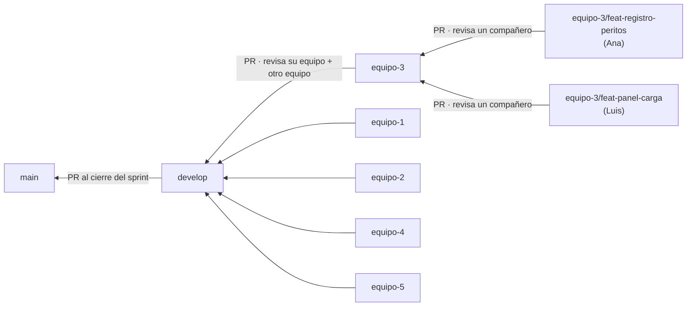

# Guía de GitHub para el Sistema Judicial Integral

> Para **todos los integrantes** de los 5 equipos (unas 25 personas) que trabajan en el mismo repositorio. No necesitas saber Git: aquí está todo, paso a paso.
>
> Las reglas obligatorias resumidas están en `docs/FLUJO_DE_TRABAJO.md`. Si algo de esta guía no te queda claro, pregunta en el grupo antes de improvisar con Git.

---

## Índice

1. Conceptos básicos
2. Cómo está organizado nuestro repositorio
3. Preparar tu computadora (una sola vez)
4. Configurar el repositorio (solo el administrador)
5. Tu día a día: hacer una tarea
6. Abrir un Pull Request
7. Revisar el Pull Request de alguien más
8. Integrar el trabajo del equipo a `develop`
9. Conflictos: qué son y cómo resolverlos
10. Issues y tablero
11. Errores comunes y cómo salir de ellos
12. Reglas de oro
13. Chuleta de comandos

---

## 1. Conceptos básicos

| Palabra | Qué es, en simple |
| :---- | :---- |
| **Repositorio (repo)** | La carpeta del proyecto con todo su historial de cambios. El nuestro vive en GitHub y cada quien tiene una copia en su computadora |
| **Commit** | Una "foto" de tus cambios con un mensaje que dice qué hiciste. Se guarda en tu computadora |
| **Rama (branch)** | Una línea de trabajo separada. Puedes cambiar cosas en tu rama sin afectar a nadie |
| **Push** | Subir tus commits de tu computadora a GitHub |
| **Pull** | Bajar a tu computadora lo que otros subieron a GitHub |
| **Fetch** | Preguntarle a GitHub qué hay de nuevo, sin cambiar todavía tus archivos |
| **Merge** | Juntar los cambios de una rama con otra |
| **Pull Request (PR)** | Una solicitud en GitHub para meter los cambios de una rama en otra. Ahí otra persona revisa antes de juntar |
| **Conflicto** | Cuando dos personas cambiaron la misma parte de un archivo y Git no sabe con cuál quedarse. Lo decide una persona |
| **Issue** | Una tarea o un error anotado en GitHub. Cada requerimiento (RF) es un issue |
| **`origin`** | El nombre con el que tu computadora llama al repositorio de GitHub |

---

## 2. Cómo está organizado nuestro repositorio

### 2.1 Las ramas



| Rama | Qué tiene | Quién la cambia |
| :---- | :---- | :---- |
| `main` | La versión que se entrega | El líder general, desde `develop`, al final de cada sprint |
| `develop` | Los 5 módulos juntos | Los integradores, con PR desde `equipo-N` |
| `equipo-1` … `equipo-5` | Lo terminado de cada equipo | El propio equipo, con PR desde las ramas personales |
| `equipo-N/<tarea>` | Lo que estás haciendo **tú** | Solo tú |

**La regla principal:** nunca trabajas directo en `main`, `develop` ni `equipo-N`. Siempre en **tu rama personal**, y llegas a las demás con Pull Requests. GitHub lo bloquea de todas formas.

### 2.2 Nombres de ramas personales

`equipo-N/<tipo>-<descripcion-corta>`, en minúsculas, sin acentos ni espacios:

| Tipo | Para | Ejemplo |
| :---- | :---- | :---- |
| `feat` | Algo nuevo | `equipo-2/feat-programar-audiencia` |
| `fix` | Corregir un error | `equipo-1/fix-duplicidad-rfc` |
| `docs` | Documentación | `equipo-5/docs-correcciones-dfr` |
| `refactor` | Ordenar código sin cambiar lo que hace | `equipo-4/refactor-sala-service` |

### 2.3 Roles de las personas

| Rol | Quién | Qué hace |
| :---- | :---- | :---- |
| **Líder general / administrador del repo** | Marco Antonio Contreras Carbajal (también líder del Equipo 3) | Crea y configura el repo (sección 4), aprueba los PR a `main` y crea las versiones |
| **Integrador** | Una persona por equipo (5) + el líder general | Mantiene el núcleo y los contratos, sincroniza su equipo con `develop`, abre el PR de su equipo a `develop` y hace los merges en `develop` |
| **Integrante** | Todos (unas 25 personas) | Hace sus tareas en ramas personales, abre PR a `equipo-N` y revisa los PR de sus compañeros |

### 2.4 Qué carpetas son de tu equipo

| Equipo | Módulo | Carpetas |
| :---- | :---- | :---- |
| 1 | Oficialía de Partes | `.../sij/oficialia/`, `front-end/WEB-INF/jsp/oficialia/`, `front-end/recursos/oficialia/` |
| 2 | Audiencias | `.../sij/audiencias/`, `front-end/WEB-INF/jsp/audiencias/`, `front-end/recursos/audiencias/` |
| 3 | Peritajes | `.../sij/peritajes/`, `front-end/WEB-INF/jsp/peritajes/`, `front-end/recursos/peritajes/` |
| 4 | Segunda Instancia | `.../sij/segunda/`, `front-end/WEB-INF/jsp/segunda/`, `front-end/recursos/segunda/` |
| 5 | Copias Certificadas | `.../sij/copias/`, `front-end/WEB-INF/jsp/copias/`, `front-end/recursos/copias/` |

Si necesitas cambiar algo **fuera** de tus carpetas, abre un issue y avisa a los integradores. Ver `docs/FLUJO_DE_TRABAJO.md`, sección 2.

---

## 3. Preparar tu computadora (una sola vez)

### 3.1 Cuenta de GitHub
1. Crea tu cuenta en [github.com](https://github.com) si no tienes. Usa un nombre de usuario reconocible (por ejemplo, `ana-lopez-utez`).
2. Opcional pero recomendado: solicita el **GitHub Student Developer Pack** con tu correo de la universidad.
3. Pásale tu usuario al administrador del repo. Te llegará una **invitación a la organización** por correo: acéptala.

### 3.2 Instalar Git
- **Windows:** descarga Git desde [git-scm.com](https://git-scm.com) e instálalo con las opciones por defecto. Trae *Git Credential Manager*, que te pedirá iniciar sesión en el navegador la primera vez que hagas push.
- **macOS:** en la Terminal escribe `git --version`; si no lo tienes, el sistema ofrecerá instalarlo.
- **Linux:** `sudo apt install git` (o el gestor de tu distribución).

### 3.3 Decirle a Git quién eres

En una terminal (Git Bash en Windows):

```bash
git config --global user.name "Ana López"
git config --global user.email "el-correo-de-tu-cuenta@ejemplo.com"
git config --global pull.rebase false
git config --global init.defaultBranch main
```

Usa **el mismo correo de tu cuenta de GitHub**, para que tus commits aparezcan con tu nombre.

### 3.4 Clonar el repositorio

```bash
cd ruta/donde/guardas/tus/proyectos
git clone https://github.com/ORG/sistema-judicial.git
cd sistema-judicial
git switch equipo-3          # la rama de TU equipo
```

En IntelliJ IDEA también puedes hacerlo con *File → New → Project from Version Control* y pegar la URL. IntelliJ puede iniciar sesión en GitHub por ti (*Settings → Version Control → GitHub*).

### 3.5 Configurar y correr el proyecto
1. Instala **Java 21** y **MySQL 8**, y crea un usuario de MySQL (o usa `root`).
2. Copia `src/main/resources/application-local.example.properties` como `application-local.properties` en la misma carpeta y pon tu usuario y contraseña de MySQL.
   > Ese archivo **nunca se sube** (está en `.gitignore`).
3. Corre `./mvnw spring-boot:run` (Windows: `mvnw.cmd spring-boot:run`), o usa el botón Run de IntelliJ.
4. Abre `http://localhost:8080` e inicia sesión con un usuario de prueba (están en el `README.md`).

---

## 4. Configurar el repositorio (solo el administrador)

Esta sección la hace **una sola persona**, una vez. Los demás pueden saltarla.

### 4.1 ¿Público o privado?

Las protecciones de ramas que necesitamos son **gratis en repositorios públicos** de una organización. En repositorios **privados** se requiere un plan de pago (GitHub Team).

| Opción | Qué implica |
| :---- | :---- |
| **Organización + repo público** (recomendado) | Todo funciona gratis. El código queda visible, así que no se sube ninguna contraseña ni datos reales |
| Organización + repo privado | Las reglas no se aplican sin plan de pago. Pregunten al docente si la universidad tiene beneficios de GitHub Education para organizaciones |
| Repo en una cuenta personal con GitHub Pro (Student Pack) | Hay protección de ramas, pero no hay *teams*: CODEOWNERS y permisos se configuran persona por persona |

### 4.2 Organización y equipos
1. En GitHub: **+ → New organization → Free**. Nombre sugerido: `sij-utez-2026` [Propuesta].
2. **Invita** a los ~25 integrantes (*People → Invite member*).
3. En **Teams**, crea estos equipos y agrega a sus miembros:

| Team | Miembros |
| :---- | :---- |
| `equipo-1` … `equipo-5` | Los integrantes de cada equipo |
| `integradores` | Un representante por equipo + el líder general |
| `lideres` | El líder general (y el docente, si lo desean) |

### 4.3 Crear el repositorio
1. **New repository** dentro de la organización: `sistema-judicial`, público y con README.
2. Sube a `main` el esqueleto del Sprint 0 (`docs/ARQUITECTURA.md`, sección 14). Es el **único** push directo a `main`.
3. Crea las ramas:
   ```bash
   git switch main && git pull
   git switch -c develop && git push -u origin develop
   for n in 1 2 3 4 5; do git switch develop && git switch -c equipo-$n && git push -u origin equipo-$n; done
   ```
   En Windows, si el `for` no funciona, repite las dos últimas órdenes cinco veces cambiando el número.
4. **Settings → Collaborators and teams:**

| Team | Permiso |
| :---- | :---- |
| `equipo-1` … `equipo-5` | **Write** |
| `integradores` | **Maintain** |
| `lideres` | **Admin** |

### 4.4 Ajustes generales
**Settings → General:**

| Ajuste | Valor |
| :---- | :---- |
| Default branch | `develop` |
| Allow merge commits | ✅ |
| Allow squash merging | ❌ |
| Allow rebase merging | ❌ |
| Always suggest updating pull request branches | ✅ |
| Automatically delete head branches | ❌ (las ramas personales se borran a mano con el botón del PR) |

> **Por qué solo "merge commit":** las ramas `equipo-N` duran todo el proyecto. Con *squash*, los cambios ya integrados reaparecen en el siguiente PR y causan conflictos falsos.

### 4.5 Protección de ramas

**Settings → Branches → Add classic branch protection rule.** Crea **7 reglas**: `main`, `develop`, `equipo-1`, `equipo-2`, `equipo-3`, `equipo-4` y `equipo-5`.

> Escribe cada nombre completo. No uses `equipo-*`, para no confundir con las ramas personales `equipo-N/...`.

| Opción | `main` | `develop` | `equipo-N` |
| :---- | :----: | :----: | :----: |
| Require a pull request before merging | ✅ | ✅ | ✅ |
| · Require approvals | 2 | 2 | 1 |
| · Dismiss stale pull request approvals when new commits are pushed | ✅ | ✅ | ✅ |
| · Require review from Code Owners | ❌ | ✅ | ❌ |
| · Require approval of the most recent reviewable push | ✅ | ✅ | ❌ |
| Require status checks to pass before merging (`build`) | ✅ | ✅ | ✅ |
| · Require branches to be up to date before merging | ✅ | ✅ | ❌ |
| Require conversation resolution before merging | ✅ | ✅ | ✅ |
| Restrict who can push to matching branches | `lideres` | `integradores` | El `equipo-N` correspondiente |
| Do not allow bypassing the above settings | ✅ | ✅ | ✅ |
| Allow force pushes | ❌ | ❌ | ❌ |
| Allow deletions | ❌ | ❌ | ❌ |

Qué logra esto:
- **Equipos:** nadie puede subir directo a `equipo-N`, y solo los de ese equipo pueden hacer merge ahí.
- **`develop`:**
  - un compañero del equipo debe aprobar (Code Owner),
  - hacen falta 2 aprobaciones (la otra es del revisor de la rotación),
  - y solo los integradores pueden hacer merge. Antes de hacerlo, revisan que uno de los aprobadores sea del equipo de la rotación, porque GitHub no puede exigirlo por sí solo.
- **`main`:** solo los líderes.
- **Calidad:** nada entra si el proyecto no compila (CI).

> El check `build` solo aparece en la lista **después** de que el CI corra por primera vez. Crea un PR de prueba, espera a que termine y regresa a marcarlo.

### 4.6 Archivos de configuración (se suben en el Sprint 0)

**`.github/CODEOWNERS`** (cambiar `ORG` por el nombre de la organización):

```text
*                                                    @ORG/integradores

# Núcleo y archivos compartidos
/src/main/java/mx/edu/utez/sij/nucleo/               @ORG/integradores
/front-end/                                          @ORG/integradores
/front-end/WEB-INF/jsp/nucleo/                       @ORG/integradores
/front-end/WEB-INF/jsp/error/                        @ORG/integradores
/front-end/WEB-INF/tags/                             @ORG/integradores
/front-end/recursos/nucleo/                          @ORG/integradores
/src/main/resources/application*.properties          @ORG/integradores
/pom.xml                                             @ORG/integradores
/docs/ARQUITECTURA.md                                @ORG/integradores
/docs/CONTRATOS.md                                   @ORG/integradores
/docs/FLUJO_DE_TRABAJO.md                            @ORG/lideres
/docs/GUIA_GITHUB.md                                 @ORG/lideres
/.github/                                            @ORG/lideres
/AGENTS.md                                           @ORG/lideres

# Módulos (código, vistas, estáticos, correo, PDF y documentación)
/src/main/java/mx/edu/utez/sij/oficialia/            @ORG/equipo-1
/front-end/WEB-INF/jsp/oficialia/                    @ORG/equipo-1
/front-end/recursos/oficialia/                       @ORG/equipo-1
/front-end/WEB-INF/tags/oficialia/                   @ORG/equipo-1
/src/main/resources/templates/correo/oficialia/      @ORG/equipo-1
/src/main/resources/templates/pdf/oficialia/         @ORG/equipo-1
/src/test/java/mx/edu/utez/sij/oficialia/            @ORG/equipo-1
/docs/modulos/oficialia*                             @ORG/equipo-1

/src/main/java/mx/edu/utez/sij/audiencias/           @ORG/equipo-2
/front-end/WEB-INF/jsp/audiencias/                   @ORG/equipo-2
/front-end/recursos/audiencias/                      @ORG/equipo-2
/front-end/WEB-INF/tags/audiencias/                  @ORG/equipo-2
/src/main/resources/templates/correo/audiencias/     @ORG/equipo-2
/src/main/resources/templates/pdf/audiencias/        @ORG/equipo-2
/src/test/java/mx/edu/utez/sij/audiencias/           @ORG/equipo-2
/docs/modulos/audiencias*                            @ORG/equipo-2

/src/main/java/mx/edu/utez/sij/peritajes/            @ORG/equipo-3
/front-end/WEB-INF/jsp/peritajes/                    @ORG/equipo-3
/front-end/recursos/peritajes/                       @ORG/equipo-3
/front-end/WEB-INF/tags/peritajes/                   @ORG/equipo-3
/src/main/resources/templates/correo/peritajes/      @ORG/equipo-3
/src/main/resources/templates/pdf/peritajes/         @ORG/equipo-3
/src/test/java/mx/edu/utez/sij/peritajes/            @ORG/equipo-3
/docs/modulos/peritajes*                             @ORG/equipo-3

/src/main/java/mx/edu/utez/sij/segunda/              @ORG/equipo-4
/front-end/WEB-INF/jsp/segunda/                      @ORG/equipo-4
/front-end/recursos/segunda/                         @ORG/equipo-4
/front-end/WEB-INF/tags/segunda/                     @ORG/equipo-4
/src/main/resources/templates/correo/segunda/        @ORG/equipo-4
/src/main/resources/templates/pdf/segunda/           @ORG/equipo-4
/src/test/java/mx/edu/utez/sij/segunda/              @ORG/equipo-4
/docs/modulos/segunda*                               @ORG/equipo-4

/src/main/java/mx/edu/utez/sij/copias/               @ORG/equipo-5
/front-end/WEB-INF/jsp/copias/                       @ORG/equipo-5
/front-end/recursos/copias/                          @ORG/equipo-5
/front-end/WEB-INF/tags/copias/                      @ORG/equipo-5
/src/main/resources/templates/correo/copias/         @ORG/equipo-5
/src/main/resources/templates/pdf/copias/            @ORG/equipo-5
/src/test/java/mx/edu/utez/sij/copias/               @ORG/equipo-5
/docs/modulos/copias*                                @ORG/equipo-5

# Contratos: dueño del módulo + integradores
/src/main/java/mx/edu/utez/sij/nucleo/contratos/oficialia/   @ORG/equipo-1 @ORG/integradores
/src/main/java/mx/edu/utez/sij/nucleo/contratos/audiencias/  @ORG/equipo-2 @ORG/integradores
/src/main/java/mx/edu/utez/sij/nucleo/contratos/peritajes/   @ORG/equipo-3 @ORG/integradores
/src/main/java/mx/edu/utez/sij/nucleo/contratos/segunda/     @ORG/equipo-4 @ORG/integradores
```

> En CODEOWNERS gana la **última** línea que coincide. Por eso las reglas generales van arriba y las específicas abajo.

**`.github/pull_request_template.md`:**

```markdown
## Qué es este PR
- [ ] Tarea personal → `equipo-N`
- [ ] Sincronización `develop` → `equipo-N`
- [ ] Integración `equipo-N` → `develop`
- [ ] Versión `develop` → `main`

## Equipo, módulo y requerimientos
- Equipo / módulo: <!-- equipo-3 / peritajes -->
- RF del DFR: <!-- 3.1, 3.2 -->
- Issues: <!-- "Relacionado con #12" en PR a equipo-N · "Closes #12" en PR a develop -->

## Qué cambia

## Cómo probarlo
<!-- usuario de prueba, URL y pasos -->

## Checklist
- [ ] Traje lo último de la rama destino y no hay conflictos
- [ ] `./mvnw verify` pasa y lo probé en el navegador
- [ ] Solo modifiqué archivos de mi módulo (si no, lo explico abajo)
- [ ] No uso Repository, Service ni entidades de otro módulo
- [ ] URLs con `/<mi-prefijo>/`, tablas con `<pre>_`, `@PreAuthorize` en controllers
- [ ] Si renombré o quité atributos de una entidad, lo aviso aquí
- [ ] Actualicé `docs/modulos/<mi-modulo>.md` si cambié rutas, tablas o contratos
- [ ] No subí `application-local.properties`, contraseñas, `target/` ni `.idea/`

## Archivos fuera de mi módulo (si aplica)
```

**`.github/workflows/ci.yml`:** compila y corre las pruebas en cada PR, con un MySQL temporal que GitHub levanta solo.

```yaml
name: ci
on:
  pull_request:
jobs:
  build:
    runs-on: ubuntu-latest
    services:
      mysql:
        image: mysql:8.0
        env:
          MYSQL_ROOT_PASSWORD: root
          MYSQL_DATABASE: sij
        ports: ['3306:3306']
        options: >-
          --health-cmd="mysqladmin ping -proot"
          --health-interval=10s --health-timeout=5s --health-retries=10
    env:
      SPRING_DATASOURCE_URL: jdbc:mysql://localhost:3306/sij?serverTimezone=America/Mexico_City
      SPRING_DATASOURCE_USERNAME: root
      SPRING_DATASOURCE_PASSWORD: root
    steps:
      - uses: actions/checkout@v4
      - uses: actions/setup-java@v4
        with:
          distribution: temurin
          java-version: '21'
          cache: maven
      - run: chmod +x mvnw && ./mvnw -B verify
```

**`.gitignore`** (además del que genera Spring Initializr):

```text
target/
.idea/
*.iml
.vscode/
.DS_Store
application-local.properties
```

**`.gitattributes`** (evita conflictos falsos por los finales de línea de Windows y Mac):

```text
* text=auto
mvnw text eol=lf
*.cmd text eol=crlf
```

### 4.7 Seguridad, etiquetas y tablero
1. **Settings → Code security:** activar *Dependabot alerts*, *Secret scanning* y *Push protection*. Esta última bloquea un push si detecta una contraseña o clave.
2. **Issues → Labels:** `oficialia`, `audiencias`, `peritajes`, `segunda`, `copias`, `nucleo`, `contrato`, `bug`, `bloqueante`, `docs`.
3. **Projects → New project → Board**, con las columnas *Por hacer · En progreso · En revisión · En develop · En main*. Agrega el repo al proyecto.
4. Crea **un issue por cada RF** de cada DFR (o que cada equipo cree los suyos), con la etiqueta de su módulo.

---

## 5. Tu día a día: hacer una tarea

Ejemplo: Ana, del Equipo 3, va a hacer el RF 3.1 "Registro de peritos" (issue #12).

### Paso 1 · Elige tu tarea
En el tablero, asígnate el issue (*Assignees → tú*) y muévelo a **En progreso**.

### Paso 2 · Actualiza la rama de tu equipo y crea tu rama

```bash
git switch equipo-3
git pull
git switch -c equipo-3/feat-registro-peritos
```

> En IntelliJ: en el selector de ramas (arriba a la izquierda o abajo a la derecha), elige `equipo-3` → **Update**. Luego **New Branch** → `equipo-3/feat-registro-peritos`.

### Paso 3 · Programa y guarda con commits pequeños

```bash
git status                      # ¿qué cambié?
git add src/main/java/mx/edu/utez/sij/peritajes/ front-end/WEB-INF/jsp/peritajes/
git commit -m "feat(peritajes): formulario de registro de peritos (RF 3.1)"
```

- Un commit por cada avance que funcione. Mejor 5 commits pequeños que 1 enorme.
- Revisa con `git status` qué vas a subir. **No uses `git add .` sin revisar.**
- En IntelliJ: **Commit** (`Ctrl+K`): marca los archivos, escribe el mensaje y confirma.

### Paso 4 · Sube tu rama (puedes hacerlo varias veces al día)

```bash
git push -u origin equipo-3/feat-registro-peritos     # la primera vez
git push                                              # las siguientes
```

Subir seguido es tu respaldo: si tu computadora falla, tu trabajo está en GitHub.

### Paso 5 · Antes del PR, trae lo nuevo de tu equipo

```bash
git fetch origin
git merge origin/equipo-3
./mvnw verify
git push
```

Si aparece un conflicto, ve a la sección 9.

### Paso 6 · Abre el PR hacia `equipo-3`
Sección 6.

### Paso 7 · Cuando se integre, limpia
1. En el PR, haz clic en **Delete branch**.
2. En tu computadora:

```bash
git switch equipo-3
git pull
git branch -d equipo-3/feat-registro-peritos
```

Para la siguiente tarea, vuelve al Paso 2.

---

## 6. Abrir un Pull Request

1. Entra al repo en GitHub. Normalmente aparece un aviso amarillo **"Compare & pull request"** de tu rama: dale clic. Si no aparece: **Pull requests → New pull request**.
2. **Revisa las ramas** (lo más importante):
   - **base:** `equipo-3` ← **compare:** `equipo-3/feat-registro-peritos`.
   - Si la base dice `develop`, cámbiala. `develop` es la rama por defecto y GitHub la pone sola.
3. **Título:** igual que tu commit principal: `feat(peritajes): registro de peritos (RF 3.1)`.
4. **Descripción:** llena la plantilla. En el PR a tu equipo escribe `Relacionado con #12`.
5. **Reviewers:** elige a un compañero de tu equipo.
6. **Create pull request.** Espera a que el CI (check `build`) salga en verde ✅.
7. Si te piden cambios, hazlos en **la misma rama**, commit y push. El PR se actualiza solo y la aprobación se vuelve a pedir.
8. Con la aprobación y el check en verde: **Merge pull request → Create a merge commit → Confirm**. Después, **Delete branch**.

> Las palabras `Closes #12` solo cierran el issue cuando el PR entra a `develop` (la rama por defecto). Por eso se escriben en el PR del equipo a `develop`, no en el tuyo.

---

## 7. Revisar el Pull Request de alguien más

Revisar es tan importante como programar: es lo que evita que algo roto llegue a los demás equipos.

1. Abre el PR → pestaña **Files changed**.
2. Lee los cambios. Puedes comentar una línea con el **+** azul a su lado.
3. Revisa con la lista de `docs/FLUJO_DE_TRABAJO.md`, sección 5:
   - ¿cumple el RF?,
   - ¿toca solo su módulo?,
   - ¿tiene `@PreAuthorize`?,
   - ¿los mensajes son los del DFR?
4. **Pruébalo** si puedes:
   ```bash
   git fetch origin
   git switch equipo-3/feat-registro-peritos
   ./mvnw spring-boot:run
   ```
   Al terminar, regresa a tu rama: `git switch equipo-3/mi-tarea`.
5. Arriba a la derecha, **Review changes**:
   - **Approve:** está bien.
   - **Request changes:** hay algo que corregir (explica qué y por qué).
   - **Comment:** solo dudas.
6. Sé claro y amable: "Aquí falta validar que el correo sea único (RF 3.1)" es mejor que "Está mal".

---

## 8. Integrar el trabajo del equipo a `develop`

Esto lo hace **el integrador de cada equipo**, normalmente una vez por semana.

### 8.1 Sincronizar `develop` → `equipo-N`

Sirve para traer lo que integraron los otros equipos (sugerencia: martes y viernes [Propuesta]).

1. **Pull requests → New pull request**, con **base:** `equipo-3` ← **compare:** `develop`.
2. Título: `chore: sincronizar develop en equipo-3`.
3. Un compañero aprueba y se hace el merge con **Create a merge commit**.
4. **Si GitHub dice que hay conflictos** y no deja hacer merge:
   ```bash
   git switch equipo-3 && git pull
   git switch -c equipo-3/sync-develop
   git merge origin/develop          # resuelve los conflictos (sección 9)
   ./mvnw verify
   git push -u origin equipo-3/sync-develop
   ```
   Luego abre el PR `equipo-3/sync-develop → equipo-3` y cierra el anterior.
5. Avisa a tu equipo que hagan `git merge origin/equipo-3` en sus ramas personales.

### 8.2 PR `equipo-N` → `develop`
1. Asegúrate de que `equipo-3` ya tiene lo último de `develop` (8.1).
2. Arranca el proyecto desde `equipo-3` y prueba tu módulo. Revisa también que los demás módulos al menos abran.
3. **New pull request:** base `develop` ← compare `equipo-3`.
4. Título: `feat(peritajes): integración sprint 2 (RF 3.1, 3.2, 3.4)`. En la descripción, `Closes #12`, `Closes #15`, etc.
5. **Reviewers:** un compañero de tu equipo y alguien del **equipo de la rotación**:

| PR desde | Revisa |
| :---- | :---- |
| equipo-1 | Equipo 2 |
| equipo-2 | Equipo 3 |
| equipo-3 | Equipo 4 |
| equipo-4 | Equipo 5 |
| equipo-5 | Equipo 1 |

6. Con las 2 aprobaciones y el CI en verde, **un integrador** hace el merge (*Create a merge commit*). **Nunca se borra** la rama `equipo-N`.

### 8.3 Versión a `main` (líder general)
Al cierre del sprint:
1. PR `develop → main` con 2 aprobaciones, y merge.
2. Etiqueta de la versión:
   ```bash
   git switch main && git pull
   git tag -a v0.1.0 -m "Sprint 1"
   git push origin v0.1.0
   ```

---

## 9. Conflictos: qué son y cómo resolverlos

Un conflicto pasa cuando tú y otra persona cambiaron **las mismas líneas** de un archivo. Git no adivina: te muestra las dos versiones y tú decides.

**Así se ve en el archivo:**

```text
<<<<<<< HEAD
    private String nombre;          // lo que tienes tú
=======
    private String nombreCompleto;  // lo que viene de la otra rama
>>>>>>> origin/equipo-3
```

**Cómo resolverlo:**
1. Haz `git merge origin/<rama>` en **tu rama personal**. Git dice `CONFLICT (content): Merge conflict in ...`.
2. Abre cada archivo en conflicto.
   - En **IntelliJ** aparece la ventana *Merge Conflicts*: elige el archivo → **Merge…**. Verás tu versión a la izquierda, la otra a la derecha y el resultado en medio.
3. Deja el código como debe quedar (muchas veces **los dos cambios** juntos) y borra las marcas `<<<<<<<`, `=======` y `>>>>>>>`.
4. Termina:
   ```bash
   git add <archivo>
   git commit -m "merge: resuelve conflictos con equipo-3"
   ./mvnw verify
   git push
   ```

**Reglas:**
- Si el conflicto está en un archivo **de otro módulo o del núcleo**, no lo resuelvas solo: pregunta al equipo dueño o a los integradores.
- Si te perdiste y quieres empezar de nuevo, deshaz el merge con `git merge --abort` y pide ayuda.
- Para tener menos conflictos: ramas cortas, trae lo de tu equipo seguido y no edites archivos de otros.

---

## 10. Issues y tablero

- **Un issue por RF.** Título: `[Peritajes] RF 3.1 Registro de peritos`. Etiqueta del módulo. En la descripción, pega la historia de usuario y los criterios de aceptación del DFR.
- **Bugs:** usa la plantilla `bug`. Di qué hiciste, qué esperabas y qué pasó.
- **Necesito algo de otro módulo:** issue con la etiqueta `contrato` (ver `docs/CONTRATOS.md`).
- **Tablero:** mueve tu issue a *En progreso* al empezar y a *En revisión* al abrir tu PR. Pasa a *En develop* cuando entra a `develop`; ahí GitHub lo cierra solo si el PR decía `Closes #N`.

---

## 11. Errores comunes y cómo salir de ellos

| Te pasa esto | Qué significa | Qué hacer |
| :---- | :---- | :---- |
| `! [rejected] ... (fetch first)` o `non-fast-forward` al hacer push | Alguien subió algo a esa rama antes que tú | `git pull` y luego `git push` |
| `protected branch hook declined` | Intentaste subir directo a `equipo-N`, `develop` o `main` | Crea tu rama personal (fila siguiente) y sube ahí |
| Programaste en `equipo-3` sin crear rama (sin commit) | Los cambios están en tu carpeta | `git switch -c equipo-3/feat-mi-tarea`: los cambios se van contigo |
| Ya hiciste commit en `equipo-3` local | Tu `equipo-3` local quedó adelantado | `git switch -c equipo-3/feat-mi-tarea` (tu commit queda aquí) y luego `git branch -f equipo-3 origin/equipo-3` para regresar `equipo-3` a como está en GitHub |
| `Your local changes would be overwritten` al cambiar de rama | Tienes cambios sin guardar | Haz commit, o guárdalos un momento: `git stash`, cambias de rama y luego `git stash pop` |
| El PR muestra muchísimos archivos que no tocaste | La **base** del PR está mal (casi siempre `develop` en vez de `equipo-N`) | En el PR, **Edit** junto al título y cambia la base |
| El check `build` sale en rojo ❌ | El proyecto no compila o falló una prueba | **Details** → lee el error, corrige en tu rama y haz push |
| Subiste `application-local.properties` o una contraseña | Quedó visible en GitHub | Avisa de inmediato a un integrador. `git rm --cached src/main/resources/application-local.properties`, commit y push, **y cambia esa contraseña** (el historial la conserva) |
| `./mvnw: Permission denied` | El archivo perdió el permiso de ejecución | `chmod +x mvnw`. Para que no vuelva a pasar, un integrador ejecuta una vez `git update-index --chmod=+x mvnw` y lo sube |
| Después de traer `develop` el proyecto no arranca por la base de datos | Alguien cambió una entidad | Revisa el PR que lo avisó. En local puedes borrar tu base (`DROP DATABASE sij;`) para que JPA la cree limpia |
| Te equivocaste en el mensaje del último commit (aún sin push) | — | `git commit --amend -m "nuevo mensaje"`. Si ya hiciste push, déjalo así |
| No sabes en qué rama estás | — | `git branch --show-current` o `git status` |

**Nunca uses** `git push --force`, `git reset --hard` ni `git rebase` en ramas compartidas para "arreglar" algo. Si algo se ve muy mal, **detente y pide ayuda**: casi todo en Git tiene arreglo si no lo empeoras.

---

## 12. Reglas de oro

1. **Siempre en tu rama personal.** Nunca en `main`, `develop` ni `equipo-N`.
2. **Una rama por tarea**, corta (1 a 3 días).
3. **Antes de empezar:** `git switch equipo-N` + `git pull`. **Antes del PR:** `git merge origin/equipo-N`.
4. **Commits pequeños** con el formato `tipo(modulo): qué hace (RF x.y)`.
5. **Solo tus carpetas.** Lo de otros módulos o del núcleo se pide con un issue.
6. **Nada entra sin revisión** ni con el CI en rojo.
7. **No subas** contraseñas ni `application-local.properties`.
8. **Si dudas, pregunta.** Es más rápido que deshacer un error.
9. **Si usas una IA** (Copilot, Claude, ChatGPT…), pídele que lea `AGENTS.md` y revisa lo que te propone antes de hacer commit.

---

## 13. Chuleta de comandos

| Quiero… | Comando |
| :---- | :---- |
| Ver en qué rama estoy y qué cambié | `git status` |
| Ver mis ramas | `git branch` |
| Cambiar de rama | `git switch <rama>` |
| Crear una rama y cambiarme a ella | `git switch -c equipo-N/feat-algo` |
| Bajar lo nuevo de mi rama | `git pull` |
| Ver qué hay de nuevo en GitHub | `git fetch origin` |
| Traer lo de mi equipo a mi rama | `git merge origin/equipo-N` |
| Preparar archivos para commit | `git add <archivo o carpeta>` |
| Hacer commit | `git commit -m "feat(modulo): ... (RF x.y)"` |
| Subir mi rama la primera vez | `git push -u origin equipo-N/feat-algo` |
| Subir cambios después | `git push` |
| Guardar cambios un momento sin commit | `git stash` · recuperarlos: `git stash pop` |
| Cancelar un merge con conflictos | `git merge --abort` |
| Ver el historial corto | `git log --oneline --graph -15` |
| Borrar mi rama local ya integrada | `git branch -d equipo-N/feat-algo` |
| Compilar y probar | `./mvnw verify` |
| Correr el proyecto | `./mvnw spring-boot:run` |
