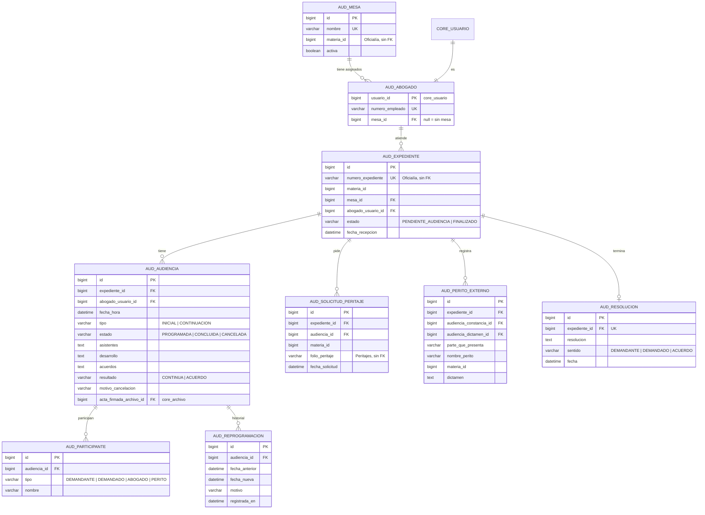
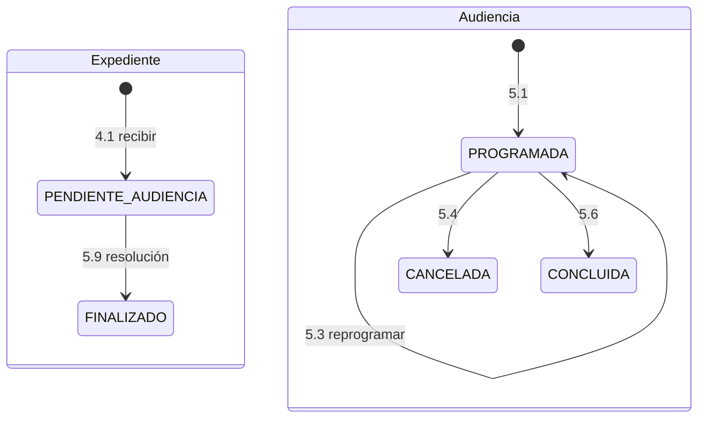

# Módulo de Audiencias — SGCA, Sistema de Gestión y Control de Audiencias

| Dato | Valor |
| :---- | :---- |
| Equipo | **Equipo 2** · rama `equipo-2` |
| Prefijo | Paquete `mx.edu.utez.sij.audiencias` · URLs `/audiencias/...` · vistas `front-end/WEB-INF/jsp/audiencias/` · tablas `aud_` · roles `AUDIENCIAS_*` |
| Fuente | DFR SGCA v1.0 (15/10/2026) |
| Líder | Hernández Bautista Jimena |
| Cliente | Narváez Figueroa José Christian |

> Sigue las reglas de `docs/ARQUITECTURA.md` y los contratos de `docs/CONTRATOS.md`.

---

## 1. Propósito

Organiza las mesas de audiencia por materia y sus abogados. Lleva las audiencias de las demandas que envía Oficialía, desde su programación hasta la resolución en primera instancia. Puede pedir peritos al módulo de Peritajes.

---

## 2. Requerimientos y quién los implementa

| RF | Requerimiento | Implementación |
| :---- | :---- | :---- |
| 1.1 – 1.4 | Iniciar sesión, recuperar y cambiar contraseña, cerrar sesión | **Núcleo** (mismas reglas: 3 intentos, 15 min de bloqueo, enlace de 15 min, 8 caracteres, sesión de 30 min) |
| 2.1 – 2.3 | Registrar, consultar y editar mesas | Audiencias |
| 3.1 | Registrar abogado de audiencia | Audiencias (la cuenta se crea con `UsuarioService`) |
| 3.2 | Asignar abogados a una mesa | Audiencias |
| 3.3 | Poner mesas y abogados a disposición de Oficialía | Audiencias, con el contrato `MesaConsultaApi` |
| 3.4 | Consultar y activar o desactivar abogados | Audiencias |
| 4.1 | Recibir demanda asignada | Audiencias, con el contrato `RecepcionDemandaApi` |
| 4.2 – 4.3 | Listado y detalle de expedientes | Audiencias (los datos de la demanda se leen con `ExpedienteApi`) |
| 5.1 – 5.6 | Programar, agenda, reprogramar, cancelar, registrar desarrollo y concluir | Audiencias |
| 5.7 | Generar acta en PDF | Audiencias, con `PdfService` del núcleo |
| 5.8 | Cargar acta firmada | Audiencias, con `ArchivoService` (PDF o imagen, 5 MB) |
| 5.9 | Registrar resolución y finalizar | Audiencias; avisa a Oficialía con `ExpedienteApi.cambiarEstado(RESUELTA)` |
| 6.1 | Solicitar perito del sistema | Audiencias, llamando a `SolicitudPeritajeApi.solicitar` (Peritajes) |
| 6.2 | Registrar perito externo y su dictamen | Audiencias |
| 6.3 | Consultar dictamen del perito | Audiencias, llamando a `DictamenConsultaApi` (Peritajes) |
| 6.4 | Consultar solicitudes de peritaje | Audiencias, llamando a `SolicitudPeritajeApi.solicitudesDeExpediente` |
| 7.1 – 7.2 | Bitácora de auditoría | Audiencias registra con `BitacoraService`; muestra solo sus registros |

---

## 3. Roles

| Rol | Puede |
| :---- | :---- |
| `AUDIENCIAS_ADMIN` | Mesas, abogados, asignación de abogados a mesas y bitácora |
| `AUDIENCIAS_ABOGADO` | Solo **sus** expedientes: audiencias, actas, peritajes y resolución |

---

## 4. Modelo de datos



Notas:
- **El abogado es un usuario del núcleo** con rol `AUDIENCIAS_ABOGADO`. `aud_abogado` solo agrega el número de empleado y la mesa. Activo/inactivo es el campo `activo` del núcleo.
- `aud_expediente` guarda solo la referencia y el abogado. Las partes, el tipo y las pruebas se leen de Oficialía con `ExpedienteApi.buscar` (detalle de solo lectura, RF 4.3).
- **El estado de las solicitudes de peritaje no se guarda aquí:** se consulta a Peritajes para que siempre esté al día (RF 6.4).

---

## 5. Estados



---

## 6. Reglas de negocio en el código

### 6.1 Mesas (2.1 – 2.3) — `MesaService`
- Nombre o clave único. **Una sola materia** por mesa: en el formulario es un `select` simple, no múltiple. Toda mesa nueva se crea activa.
- Lista paginada de **10** por página, con materia, estado y abogados.
- **No se puede desactivar** si tiene audiencias programadas: "No es posible desactivar una mesa con audiencias programadas".
- **No se puede cambiar la materia** si sus abogados tienen expedientes o audiencias pendientes: "No es posible cambiar la materia de una mesa con expedientes pendientes".
- Una mesa inactiva no aparece en `MesaConsultaApi`.

### 6.2 Abogados (3.1, 3.2, 3.4) — `AbogadoService`
- **Alta:** correo y número de empleado únicos. Se crea con `usuarioService.crear(..., "AUDIENCIAS_ABOGADO")`, activo y sin mesa.
- **Asignación a mesa:**
  - Un abogado está en **una sola mesa** a la vez.
  - Para cambiarlo de mesa, primero se libera de la actual, y solo si no tiene audiencias programadas.
  - Solo se asignan abogados activos a mesas activas.
  - Mensajes: "El abogado ya está asignado a otra mesa" · "No es posible reasignar a un abogado con audiencias programadas" · "La mesa no tiene abogados asignados".
- **Desactivar:** bloqueado si tiene audiencias programadas. Si procede, `usuarioService.quitarRol(id, "AUDIENCIAS_ABOGADO")`.

### 6.3 Recibir demanda (4.1) — `RecepcionDemandaService implements RecepcionDemandaApi`
1. Valida con `expedienteApi.buscar` que el expediente exista, esté `PROCEDENTE` y tenga sus datos obligatorios. Si no: `ReglaNegocioException`, que Oficialía muestra (cumple el criterio "lo informa a Oficialía de Partes").
2. Valida que el abogado sea activo y esté en una mesa activa de esa materia.
3. Crea `aud_expediente` en `PENDIENTE_AUDIENCIA` y llama a `expedienteApi.cambiarEstado(..., EN_TRAMITE, "AUDIENCIAS")`.

### 6.4 Expedientes (4.2, 4.3)
- **Listado:** solo los del abogado en sesión, 10 por página. Si no hay resultados: "No se encontraron expedientes".
- **Detalle de solo lectura:** demanda (de Oficialía), audiencias, peritajes y resolución. Si el expediente no es suyo: "No tiene permiso para consultar este expediente".

### 6.5 Audiencias (5.1 – 5.6) — `AudienciaService`
- **Programar:**
  - Solo sobre expedientes propios y no finalizados.
  - No en fechas pasadas.
  - El abogado no puede tener otra audiencia en la misma fecha y hora: "Ya existe una audiencia en ese horario".
  - **No se captura ubicación.**
- **Agenda:** día, semana o mes, solo del abogado (`front-end/recursos/audiencias/js/agenda.js`). Las canceladas se muestran con otro color.
- **Reprogramar:** solo en `PROGRAMADA`, con las mismas validaciones. Guarda la fecha anterior y el motivo en `aud_reprogramacion`.
- **Cancelar:** solo en `PROGRAMADA`, con motivo obligatorio ("Ingrese el motivo de cancelación"). Nunca se borra.
- **Registrar desarrollo:** solo de audiencias de hoy o anteriores. Se guarda como borrador mientras no se concluya.
- **Concluir:**
  - Requiere el desarrollo: "Registre el desarrollo antes de concluir".
  - Después ya no se edita.
  - Si el resultado es `CONTINUA`, muestra el botón "Programar siguiente audiencia".

### 6.6 Actas (5.7, 5.8)
- **PDF:** solo de audiencias `CONCLUIDA`: `pdfService.generar("pdf/audiencias/acta", modelo)`. Incluye fecha, hora, participantes, desarrollo, acuerdos y resultado. Si no está concluida: "Concluya la audiencia para generar el acta".
- **Acta firmada:**
  - `archivoService.guardar("AUDIENCIAS", archivo, [PDF, JPG, PNG], 5)`.
  - **No se puede reemplazar**: si ya hay una, el botón no aparece y el service lo rechaza.
  - Si el formato no es válido: "Formato de archivo no permitido".

### 6.7 Resolución (5.9) — `ResolucionService`
- Requiere al menos una audiencia concluida: "No es posible resolver sin una audiencia concluida".
- Guarda la resolución, pasa el expediente a `FINALIZADO` (solo lectura) y llama a `expedienteApi.cambiarEstado(..., RESUELTA, "AUDIENCIAS")`.

### 6.8 Peritajes (6.1 – 6.4)
- **Solicitar:**
  - `solicitudPeritajeApi.solicitar(new SolicitudPeritajeDto(numeroExpediente, audienciaId, Set.of(materiaId), null))`.
  - Guarda el `folio_peritaje` devuelto y muestra el perito asignado.
  - Si Peritajes responde "No hay peritos disponibles en esta materia", se muestra ese mensaje.
- **Perito externo:**
  - Primero se registra la constancia en una audiencia.
  - En otra audiencia se registra el dictamen.
  - Este perito no tiene acceso al sistema.
- **Dictamen:** `dictamenConsultaApi.dictamen(folio)`. Si viene vacío: "Dictamen pendiente".
- **Solicitudes:** `solicitudPeritajeApi.solicitudesDeExpediente(numeroExpediente)`. Si no hay: "No hay solicitudes de peritaje".

### 6.9 Bitácora (7.1, 7.2)
- **Qué se registra:** cada **consulta, creación, edición y finalización** de mesas, abogados, expedientes y audiencias, con `bitacoraService.registrar("AUDIENCIAS", accion, entidad, id, detalle)` dentro del service.
- **Si falla el registro:** la acción se revierte y se muestra "No fue posible registrar la acción en la bitácora".
- **Cuando la llamada viene de Oficialía:** por `RecepcionDemandaApi` o `MesaConsultaApi`, el detalle lleva `origen: OFICIALIA`.
- **Consulta:** solo `AUDIENCIAS_ADMIN`; 10 por página, del más reciente al más antiguo. La propia consulta también se registra.

---

## 7. Contratos

**Ofrece:** `MesaConsultaApi` y `RecepcionDemandaApi` (los usa Oficialía), y `AudienciaConsultaApi` (la usa Segunda Instancia).

**Necesita:**

| De | Contrato | Para qué |
| :---- | :---- | :---- |
| Oficialía | `ExpedienteApi` | Datos de la demanda (4.1, 4.3) y avisar los cambios de estado |
| Oficialía | `CatalogoJudicialApi` | Materias de las mesas |
| Peritajes | `SolicitudPeritajeApi`, `DictamenConsultaApi` | RF 6.1, 6.3, 6.4 |
| Núcleo | `UsuarioService`, `SesionService`, `BitacoraService`, `ArchivoService`, `PdfService` | Cuentas, sesión, bitácora, acta firmada, acta PDF |

---

## 8. Rutas (`/audiencias`)

| Método | URL | Roles | Vista / acción |
| :---- | :---- | :---- | :---- |
| GET | `/audiencias` | ADMIN, ABOGADO | Inicio según rol |
| GET | `/audiencias/mesas` | ADMIN | Listado con filtros (2.2) |
| GET / POST | `/audiencias/mesas/nueva` · `/audiencias/mesas/{id}` | ADMIN | Alta y edición (2.1, 2.3) |
| POST | `/audiencias/mesas/{id}/estado` | ADMIN | Activar / desactivar |
| GET / POST | `/audiencias/mesas/{id}/abogados` | ADMIN | Asignar y liberar abogados (3.2) |
| GET | `/audiencias/abogados` | ADMIN | Listado (3.4) |
| GET / POST | `/audiencias/abogados/nuevo` | ADMIN | Alta (3.1) |
| POST | `/audiencias/abogados/{id}/estado` | ADMIN | Activar / desactivar |
| GET | `/audiencias/expedientes` | ABOGADO | Mis expedientes (4.2) |
| GET | `/audiencias/expedientes/{id}` | ABOGADO | Detalle (4.3) |
| GET / POST | `/audiencias/expedientes/{id}/audiencias/nueva` | ABOGADO | Programar (5.1) |
| GET | `/audiencias/agenda` | ABOGADO | Agenda `?vista=dia\|semana\|mes&desde&hasta&estado` (5.2) |
| POST | `/audiencias/audiencias/{id}/reprogramar` | ABOGADO | 5.3 |
| POST | `/audiencias/audiencias/{id}/cancelar` | ABOGADO | 5.4 |
| GET / POST | `/audiencias/audiencias/{id}/desarrollo` | ABOGADO | Registrar y guardar borrador (5.5) |
| POST | `/audiencias/audiencias/{id}/concluir` | ABOGADO | 5.6 |
| GET | `/audiencias/audiencias/{id}/acta.pdf` | ABOGADO | Descargar acta (5.7) |
| POST | `/audiencias/audiencias/{id}/acta-firmada` | ABOGADO | Cargar acta firmada (5.8) |
| GET | `/audiencias/audiencias/{id}/acta-firmada` | ABOGADO | Ver acta firmada |
| GET / POST | `/audiencias/expedientes/{id}/resolucion` | ABOGADO | 5.9 |
| POST | `/audiencias/expedientes/{id}/peritajes` | ABOGADO | Solicitar perito (6.1) |
| GET / POST | `/audiencias/expedientes/{id}/peritos-externos` | ABOGADO | 6.2 |
| GET | `/audiencias/expedientes/{id}/peritajes` | ABOGADO | Solicitudes y dictámenes (6.3, 6.4) |
| GET | `/audiencias/bitacora` | ADMIN | 7.2 |

---

## 9. Estructura de carpetas

```text
audiencias/
├── controller/   MesaController, AbogadoController, ExpedienteController, AudienciaController,
│                 ActaController, ResolucionController, PeritajeAudienciaController, BitacoraAudienciasController
├── service/      MesaService, MesaConsultaService (implements MesaConsultaApi),
│                 AbogadoService, RecepcionDemandaService (implements RecepcionDemandaApi),
│                 ExpedienteAudienciaService, AudienciaService, ActaService, ResolucionService,
│                 AudienciaConsultaService (implements AudienciaConsultaApi), PeritajeAudienciaService
├── repository/   MesaRepository, AbogadoRepository, ExpedienteAudienciaRepository, AudienciaRepository, ...
├── model/        Mesa, Abogado, ExpedienteAudiencia, Audiencia, EstadoAudiencia (enum), ...
├── dto/          MesaForm, AbogadoForm, ProgramarAudienciaForm, DesarrolloForm, ResolucionForm
└── DatosInicialesAudiencias.java
front-end/WEB-INF/jsp/audiencias/   templates/pdf/audiencias/acta.html   front-end/recursos/audiencias/js/agenda.js
```

---

## 10. Correcciones sugeridas al DFR

| Sección | Hoy dice | Sugerencia |
| :---- | :---- | :---- |
| 2.1 y 3.1 Interfaces de software | "mediante servicios web" | "Mediante interfaces internas del Sistema Judicial Integral (`MesaConsultaApi`, `RecepcionDemandaApi`, `SolicitudPeritajeApi`, `DictamenConsultaApi`)" |
| 3.1 Interfaces de comunicación y 3.3.6 | "API REST en formato JSON" | Igual que arriba; HTTPS solo entre el navegador y el servidor |
| 2.5 | Los sistemas externos "se identifican con un servicio o cuenta propia" | "Las acciones de otros módulos se registran con el usuario que las hizo y el módulo de origen" |
| RF 1.1 – 1.4 | Requerimientos propios | Nota: "Se implementan con el control de acceso común del sistema" |
| RF 1.2 | "El correo ingresado no está registrado" | Confirmar el mensaje genérico (pendiente 3) |
| RF 6.1 | Datos: Expediente, Audiencia, Materia | Correcto. Agregar que el folio de peritaje lo genera Peritajes |
| RF 6.4 | Estados pendiente / asignado / dictaminado | Agregar "cancelado" |
| Falta | — | Si se mantiene Peritajes 2.4: nuevo RF "Cancelar solicitud de peritaje (solo el mismo día)" (pendiente 10) |
| 4.1 | "Si falta algún dato obligatorio, el sistema rechaza la demanda" | Correcto: los datos obligatorios dependen de que Oficialía los capture (pendiente 5) |
| 3.3.8 | "Stack definido por la academia" | Java 21, Spring Boot 4 (MVC), JSP + JSTL, Bootstrap 5, Spring Security, Spring Data JPA, MySQL 8 |

## 11. Pendientes

- Si el expediente necesita un estado intermedio "En audiencias" o "Programada para audiencia" (pendiente 15).
- Si la agenda usa FullCalendar o una tabla por día.
- Participantes: ¿se eligen de las partes que manda Oficialía o se escriben a mano?
