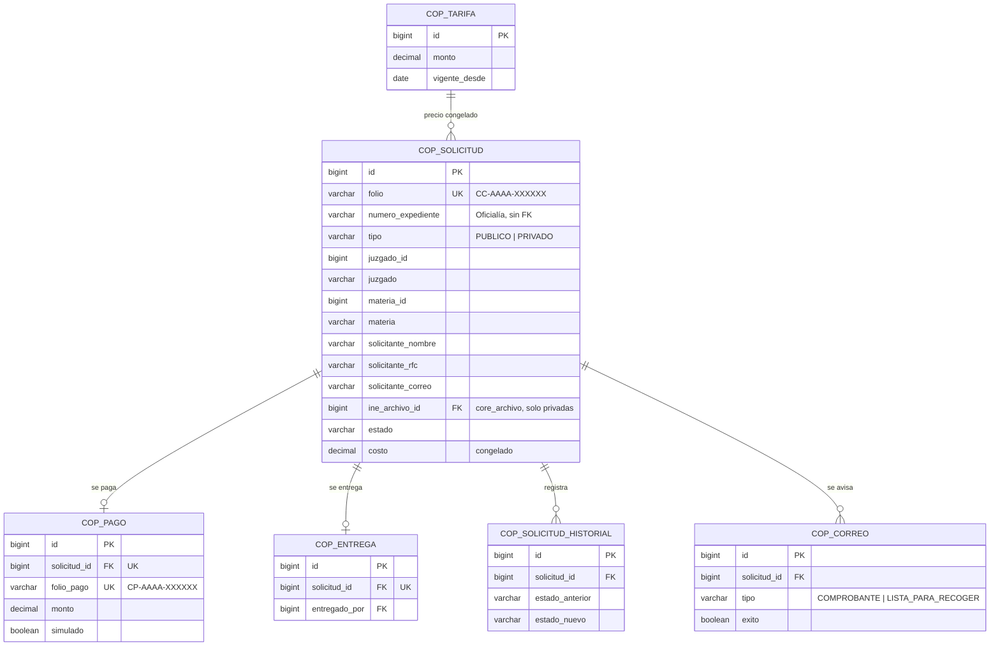
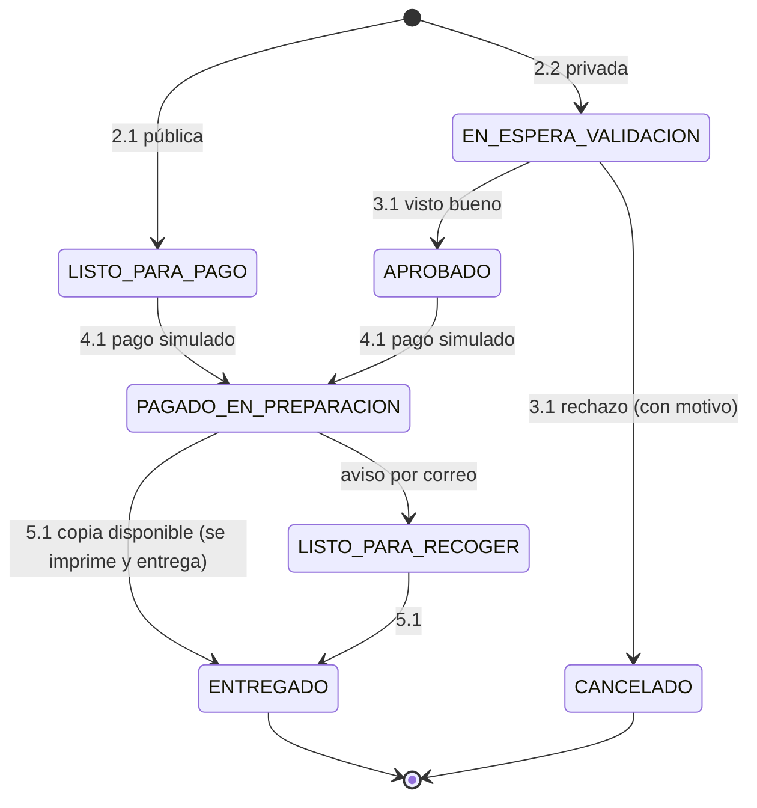

# Módulo de Copias Certificadas — SGCC

| Dato | Valor |
| :---- | :---- |
| Equipo | **Equipo 5** · rama `equipo-5` |
| Prefijo | Paquete `mx.edu.utez.sij.copias` · URLs `/copias/...` · vistas `front-end/WEB-INF/jsp/copias/` · tablas `cop_` · roles `COPIAS_*` |
| Fuente | DFR SGCC v1.0 (23/10/2026) + decisiones del equipo (06/11/2026) |
| Líder | Sánchez Muñoz Emilio |
| Integrantes (DFR) | Corona Hernández Sergio Ethan · Martínez Reyes Rodrigo · Ramírez Jirón Erisbel Sarahí · Soto Valladares Andrés Manuel |
| Cliente | Narváez Figueroa José Christian |

> Sigue las reglas de `docs/ARQUITECTURA.md` y los contratos de `docs/CONTRATOS.md`.
> Tablas y columnas: **`docs/modulos/copias-diccionario-datos.md`**.

---

## 1. Propósito

Digitaliza la captura, validación, cobro y entrega de copias certificadas de demandas.

**Decisiones del equipo (06/11/2026):**

- **No hay portal ciudadano.** El solicitante no usa el sistema: le da sus datos al **trabajador de Copias**, que los captura, valida, cobra y entrega.
- **Dos accesos:** el trabajador (`COPIAS_PERSONAL`) y el administrador del área (`COPIAS_ADMIN`). `COPIAS_JUEZ` se quitó (fue un error).
- **Siempre se registra quién solicitó**, sea el expediente público o privado.
- **Demanda pública:** se capturan los datos del solicitante y pasa directo al pago.
- **Demanda privada:** se capturan los datos y la INE; el trabajador valida que el solicitante sea parte del expediente y aprueba o rechaza. Solo con visto bueno se puede pagar (RN-01).
- **Comprobante:** se envía por correo al solicitante y también se puede imprimir. Lleva solo datos esenciales, **nunca la INE**.
- **Entrega:** si la copia está disponible, se imprime y se entrega al momento ("Entregado"). Si no, queda pendiente; cuando esté lista se le avisa por correo y se entrega cuando llegue.
- El **pago es simulado** y la copia se entrega **solo de forma física** (RN-04).
- Los trabajadores atienden solicitudes de **cualquier juzgado** (pendiente 18, por ahora abierto).

---

## 2. Requerimientos y quién los implementa

| RF | Requerimiento | Implementación |
| :---- | :---- | :---- |
| 1.1 – 1.3 | Iniciar sesión, cerrar sesión, recuperar contraseña | **Núcleo**, para `COPIAS_PERSONAL` y `COPIAS_ADMIN` |
| 2.1 | Solicitud de copia de demanda pública | Copias: el trabajador captura (`/copias/solicitudes/nueva`) |
| 2.2 | Solicitud de copia de demanda privada | Copias: el trabajador captura con la INE |
| 2.3 | Consultar estado de la solicitud | Copias: registro y detalle (`/copias/solicitudes`) |
| 3.1 | Validar solicitud privada (visto bueno) | Copias (`COPIAS_PERSONAL`) |
| 4.1 | Efectuar pago | Copias, pago **simulado**; comprobante imprimible y por correo |
| 5.1 | Registrar entrega | Copias (`COPIAS_PERSONAL`), con aviso por correo si la copia no está lista |
| 6.1 | Gestión de usuarios y roles | `COPIAS_ADMIN` da de alta a los trabajadores del área con el `UsuarioService` del núcleo |
| — | Colores del área [Decisión del grupo] | `COPIAS_ADMIN` cambia los colores de las pantallas de Copias |

---

## 3. Usuarios y roles

| Usuario | Cómo entra | Puede |
| :---- | :---- | :---- |
| Solicitante (ciudadano, parte, abogado) | **No entra al sistema** | Da sus datos en ventanilla y recibe el comprobante y el aviso por correo |
| `COPIAS_PERSONAL` (trabajador o juzgado) | Login | Capturar solicitudes, validar privadas (ve la INE), registrar el pago, imprimir o enviar el comprobante, avisar y registrar la entrega |
| `COPIAS_ADMIN` (administrador del área) | Login | Dar de alta, desactivar y reactivar trabajadores; cambiar los colores de Copias |

---

## 4. Modelo de datos

Detalle de cada columna en `docs/modulos/copias-diccionario-datos.md`.



`cop_color` (colores del área) no se relaciona con las demás.

Notas:
- Del expediente solo se guardan los **datos esenciales**: número, tipo, juzgado y materia. Las partes y los documentos se consultan con `ExpedienteApi` al validar y **no se guardan**.
- El **tipo** no lo elige nadie: lo dice Oficialía con `ExpedienteApi.buscar(...).tipo()`.
- Los trabajadores y administradores son cuentas del núcleo (`core_usuario`): Copias no tiene tabla de usuarios.

---

## 5. Estados de la solicitud



| Valor | Texto en pantalla (DFR 2.3) | Se puede pagar | Pendiente de entrega |
| :---- | :---- | :---- | :---- |
| `EN_ESPERA_VALIDACION` | En espera de validación | No | No |
| `APROBADO` | Aprobado | Sí | No |
| `LISTO_PARA_PAGO` | Listo para pago | Sí | No |
| `CANCELADO` | Cancelado | Nunca | No |
| `PAGADO_EN_PREPARACION` | Pagado y en preparación | Ya pagada | Sí |
| `LISTO_PARA_RECOGER` | Lista para recoger [Propuesta] | Ya pagada | Sí |
| `ENTREGADO` | Entregado | Folio inhabilitado | No |

---

## 6. Reglas de negocio en el código

### 6.1 Captura (2.1 y 2.2) — `SolicitudCopiaService`
1. El trabajador busca el expediente con `expedienteApi.buscar(numeroExpediente)`. Si no existe: "El expediente no fue encontrado".
2. Captura los datos del solicitante, **los mismos en público y privado**:
   - nombre completo*, RFC* (12 o 13 caracteres) y correo* (para el comprobante y el aviso);
   - el juzgado y la materia salen del expediente.
3. **Privado:** además la INE*, con `archivoService.guardar("COPIAS", ine, [PDF, JPG, PNG], 5)`. Si falta: "El expediente es privado: adjunte la identificación oficial (INE) del solicitante". Queda `EN_ESPERA_VALIDACION`.
4. **Público:** no pide INE. Queda `LISTO_PARA_PAGO` y se abre el pago.
5. En los dos casos: folio `CC-AAAA-XXXXXX` aleatorio y costo congelado con la tarifa vigente.

### 6.2 Registro y consulta (2.3)
- `/copias/solicitudes` muestra todas las solicitudes con su estado, con búsqueda por folio, expediente o nombre y filtro por estado. 10 por página (10, 25 o 50).
- El detalle muestra los datos, el siguiente paso según el estado, el historial y los correos enviados.

### 6.3 Visto bueno (3.1) — `ValidacionService`
- **Bandeja:** privadas `EN_ESPERA_VALIDACION`, las más antiguas primero.
- **Apoyo para validar:** junto a los datos y la INE se muestran las partes del expediente; se marca la parte cuyo RFC coincide con el del solicitante.
- **Aprobar** → `APROBADO` (se habilita el pago). **Rechazar** → `CANCELADO` con **motivo obligatorio** (máx. 500) [Propuesta]; bloquea el pago para siempre.

### 6.4 Pago simulado (4.1) — `PagoService`
1. Solo `LISTO_PARA_PAGO` o `APROBADO`. Si está en espera: "Debe esperar la aprobación antes de pagar". Si está cancelada: "La solicitud fue cancelada y no se puede pagar".
2. Resumen con la leyenda "Pago simulado — no se realiza ningún cargo".
3. Al confirmar se crea `cop_pago` con folio `CP-AAAA-XXXXXX`, el estado pasa a `PAGADO_EN_PREPARACION` y **el comprobante se envía por correo**.
4. **Sin pagos dobles:** `cop_pago.solicitud_id` es único.

### 6.5 Comprobante
- Se imprime desde `/copias/pagos/{id}/comprobante` (al imprimir solo sale el comprobante) y se puede **reenviar por correo**.
- **Datos esenciales:** folio del comprobante y de la solicitud, expediente, juzgado, materia, nombre, RFC y correo del solicitante, fecha, importe, estado y la leyenda de pago simulado.
- **Nunca** la INE, las partes ni los documentos del expediente.

### 6.6 Entrega (5.1) — `EntregaService`
- **Pendientes:** `PAGADO_EN_PREPARACION` y `LISTO_PARA_RECOGER`.
- **Copia disponible:** "Imprimir y entregar" → `ENTREGADO` con quién y cuándo. Puede ser justo después del pago.
- **Copia no disponible:** se deja pendiente. Cuando esté lista, "Avisar que está lista" envía el correo y pasa a `LISTO_PARA_RECOGER` (el aviso se puede reenviar). Si el correo falla, no cambia el estado.
- Antes de entregar se pide "Verifique la identificación del solicitante en ventanilla".
- Al entregar, el folio queda **inhabilitado** (RN-03): ya no se puede pagar, avisar ni entregar.

### 6.7 Administración del área (`COPIAS_ADMIN`)
- **Trabajadores** (`PersonalCopiasService`): alta con nombre y correo, desactivar y reactivar. El correo no se puede repetir.
- **Colores** (`ColoresCopiasService`): seis colores de la paleta institucional (Bosque, Tierra, Bugambilia, Dorado, Piedra y Caña). Solo cambian las pantallas de Copias: `tags/copias/estilos.tag` los escribe encima de las variables del núcleo, sin tocar su `estilos.css`. Solo se aceptan colores `#RRGGBB`. Se pueden restablecer.

### 6.8 Seguridad
- No hay rutas públicas: todo `/copias/**` pide sesión.
- La INE solo se ve en `/copias/validacion/{id}/ine` (`COPIAS_PERSONAL`), se sirve con su tipo según la extensión ya validada y sin caché.
- Todo dato en las JSP con `<c:out>`; formularios `POST` con `<form:form>` o `<n:confirmar>`.
- TODO núcleo: `@PreAuthorize` en cada controller (ya marcado con `// TODO`) y bitácora en cada cambio de estado (`HistorialService`).

---

## 7. Contratos

**Ofrece:** ninguno.

**Necesita:**

| De | Contrato | Para qué |
| :---- | :---- | :---- |
| Oficialía | `ExpedienteApi` | Existencia, tipo pública/privada, juzgado, materia y partes del expediente |
| Núcleo | `UsuarioService`, `SesionService` | Trabajadores del área y usuario en sesión |
| Núcleo | `ArchivoService` | La INE |
| Núcleo | Correo | Comprobante y aviso al solicitante (no tiene cuenta) |
| Núcleo | `PdfService` | Comprobante en PDF adjunto al correo (después) |
| Núcleo | `BitacoraService` | Registro de cada acción |

Ya no se necesita `CatalogoJudicialApi`: el juzgado y la materia vienen del expediente.

---

## 8. Rutas (`/copias`, todas con sesión)

| Método | URL | Rol | Vista / acción |
| :---- | :---- | :---- | :---- |
| GET | `/copias` | PERSONAL, ADMIN | Inicio: por validar, sin pagar, por entregar y últimas solicitudes |
| GET | `/copias/solicitudes` | PERSONAL | Registro con búsqueda, filtro por estado y paginación |
| GET | `/copias/solicitudes/nueva?expediente=` | PERSONAL | Buscar expediente y capturar al solicitante |
| POST | `/copias/solicitudes/nueva` | PERSONAL | Registrar la solicitud (multipart, con INE si es privado) |
| GET | `/copias/solicitudes/{id}` | PERSONAL | Detalle, siguiente paso, historial y correos |
| GET | `/copias/validacion` | PERSONAL | Bandeja de privadas en espera |
| GET | `/copias/validacion/{id}` | PERSONAL | Datos, INE y partes del expediente |
| GET | `/copias/validacion/{id}/ine` | PERSONAL | La INE (inline) |
| POST | `/copias/validacion/{id}/aprobar` · `/rechazar` | PERSONAL | Visto bueno (rechazar con `motivo`) |
| GET / POST | `/copias/pagos/{id}` | PERSONAL | Resumen y pago simulado |
| GET | `/copias/pagos/{id}/comprobante` | PERSONAL | Comprobante imprimible y qué sigue |
| POST | `/copias/pagos/{id}/comprobante/enviar` | PERSONAL | Reenviar el comprobante por correo |
| GET | `/copias/entregas` | PERSONAL | Pagadas pendientes de entrega |
| POST | `/copias/entregas/{id}/avisar` | PERSONAL | Correo "lista para recoger" |
| POST | `/copias/entregas/{id}/entregar` | PERSONAL | Registrar la entrega |
| GET / POST | `/copias/admin/personal` | ADMIN | Trabajadores: lista y alta |
| POST | `/copias/admin/personal/{id}/estado` | ADMIN | Desactivar o reactivar (`activo`) |
| GET / POST | `/copias/admin/colores` | ADMIN | Colores del área |
| POST | `/copias/admin/colores/restablecer` | ADMIN | Volver a la paleta institucional |

---

## 9. Estructura de carpetas

```text
src/main/java/mx/edu/utez/sij/copias/
├── controller/   InicioCopiasController, SolicitudController, ValidacionController, PagoController,
│                 EntregaController, AdminCopiasController, CopiasVistasAdvice (colores en todas las vistas)
├── service/      SolicitudCopiaService, ValidacionService, PagoService, EntregaService, CorreoCopiasService,
│                 HistorialService, FolioService, TarifaService, PersonalCopiasService, ColoresCopiasService
├── repository/   interfaces con nombres de Spring Data JPA
│   └── memoria/  TEMPORAL: implementaciones en memoria (se borran con la base de datos)
├── model/        SolicitudCopia, Pago, Entrega, HistorialSolicitud, CorreoEnviado, Tarifa, ColorArea (@Entity),
│                 EstadoSolicitud, TipoCorreo, Formatos
├── dto/          SolicitudForm, PersonalForm, ColoresForm
├── temporal/     TEMPORAL: lo que darán el núcleo y Oficialía (ExpedienteApi, archivos, correo, sesión, usuarios)
└── DatosInicialesCopias.java

front-end/WEB-INF/jsp/copias/   inicio, menu, solicitudes/, validacion/, pagos/, entregas/, admin/
front-end/WEB-INF/tags/copias/  estilos.tag (CSS de Copias + colores del área)
front-end/recursos/copias/      css/copias.css, js/copias.js
src/test/java/mx/edu/utez/sij/copias/service/   pruebas de los services
```

---

## 10. Listo para la base de datos y el núcleo

Todo lo temporal tiene un comentario `TEMPORAL` o `TODO`. Cuando lleguen:

| Cuando exista | Qué se hace | Qué no cambia |
| :---- | :---- | :---- |
| MySQL (integradores quitan la exclusión en `application.properties`) | Cada `...Repository` pasa a `extends JpaRepository<..., Long>`, se borran los métodos que ya trae, `buscar` lleva la `@Query` de su comentario y se borra `repository/memoria/` | Entidades (ya tienen `@Entity`, `@Table` y `@Column`), services, controllers y JSP |
| `ExpedienteApi` de Oficialía | Cambiar los import a `nucleo.contratos.oficialia` y borrar `temporal/ExpedienteApi*` | Lo demás |
| Servicios del núcleo | Cambiar `ArchivoServiceTemporal`, `CorreoTemporal`, `SesionTemporal`, `UsuarioServiceTemporal` y `ReglaNegocioException` por los del núcleo | Services y controllers (mismos métodos) |
| Spring Security | Poner los `@PreAuthorize` de los `// TODO` y `sec:authorize` en `menu.jsp` | Lo demás |
| `PdfService` | Plantilla `templates/pdf/copias/comprobante.html` y adjuntarlo al correo | La pantalla del comprobante |

`@Transactional` ya está en los services: hoy no hace nada porque no hay base de datos.

---

## 11. Cambios que se piden a los integradores

No son de nuestras carpetas; se piden con un issue `contrato`.

1. Quitar el portal público `/copias/publico/**` de `SecurityConfig` y de `docs/ARQUITECTURA.md`.
2. Cambiar `COPIAS_JUEZ` por `COPIAS_ADMIN` en ARQUITECTURA (7.2 y 7.3): `COPIAS_ADMIN` da de alta a `COPIAS_PERSONAL`.
3. Que cada área tenga un administrador que cambie los colores de su módulo (aquí se hace sin tocar `estilos.css`).
4. La paleta institucional acordada es distinta a la de `estilos.css` del núcleo.
5. Un servicio de correo para destinatarios sin cuenta, con adjunto (el `NotificacionService` es para usuarios).
6. Subir el límite de archivos en `application.properties` (hoy 1 MB por defecto) para la INE de 5 MB.

---

## 12. Correcciones sugeridas al DFR

| Sección | Hoy dice | Sugerencia |
| :---- | :---- | :---- |
| 2.1 Perspectiva | Base de datos de expedientes, pasarela de pagos y base de copias como sistemas externos | Los expedientes vienen del módulo de Oficialía; el pago es **simulado**; la copia física se entrega en ventanilla |
| 2.2 Inicio de sesión | Para ciudadano, abogado, personal y juez | Solo trabajador de Copias y administrador del área |
| 2.3 Usuarios | Ciudadano como usuario registrado | "Solicitante: no usa el sistema; el trabajador captura sus datos" |
| 2.4 Restricción operativa | "Credenciales activas dentro del sistema del solicitante" | "La entrega la registra el trabajador con su cuenta activa" |
| RF 1.1 – 1.3 | Todos los roles | Solo trabajador y administrador. "Se implementan con el control de acceso común" |
| RF 1.3 | "Correo no fue encontrado" | Mensaje genérico (pendiente 3) |
| RF 2.1 y 2.2 | El solicitante hace la solicitud | El trabajador la captura con los datos del solicitante (nombre, RFC, correo; INE si es privada) |
| RF 2.2 | "Tamaño máximo permitido" sin valor | 5 MB; PDF, JPG o PNG |
| RF 2.3 | "Cualquier usuario que cuente con un folio" | El trabajador consulta el estado en el registro de solicitudes |
| RF 3.1 | Rechazo sin motivo | Motivo obligatorio |
| RF 4.1 | Pasarela de pago | "Pago simulado: se registra el pago y se genera el comprobante (imprimible y por correo) sin cargo real" |
| RF 5.1 | Solo registrar la entrega | Agregar: si la copia no está lista, avisar por correo ("Lista para recoger") |
| RF 6.1 | Administrador asigna roles a ciudadanos y abogados | El administrador del área da de alta a los trabajadores y configura los colores |
| 3.1 Interfaces de usuario | "Panel de configuración de tarifas" | Agregar el RF correspondiente o quitarlo (pendiente 17) |
| 3.3.1 | Paleta "Material Design" | Paleta institucional acordada (Bosque, Tierra, Bugambilia, Dorado, Piedra, Caña) |
| 3.3.2 | Caché si se cae el módulo de expedientes | No aplica: es la misma aplicación |
| 3.3.3 | "Aprobado en menos de 1 semana" | Es un tiempo del proceso del juzgado, no del software; moverlo a reglas de negocio o quitarlo |
| 3.3.6 | REST/JSON con Expedientes | Interfaz interna `ExpedienteApi` |
| 3.3.8 | "Tecnologías web vistas en la materia" | Java 21, Spring Boot 4 (MVC), JSP + JSTL, Bootstrap 5, Spring Security, Spring Data JPA, MySQL 8 |
| Firmas | Nombre del cliente vacío | Narváez Figueroa José Christian |

## 13. Pendientes

- Quién configura la tarifa y si hay un precio por copia o por página (pendiente 17). Hoy: $320 fijos.
- Si el trabajador atiende solo su juzgado (pendiente 18). Hoy: cualquier juzgado; si se decide que no, se agrega `cop_adscripcion`.
- El formato del número de expediente (lo define Oficialía). Hoy: expedientes de prueba `EXP-2026-001` a `004`.
- Que Oficialía capture el tipo de demanda y el RFC de las partes, porque la validación depende de eso (pendiente 5).
