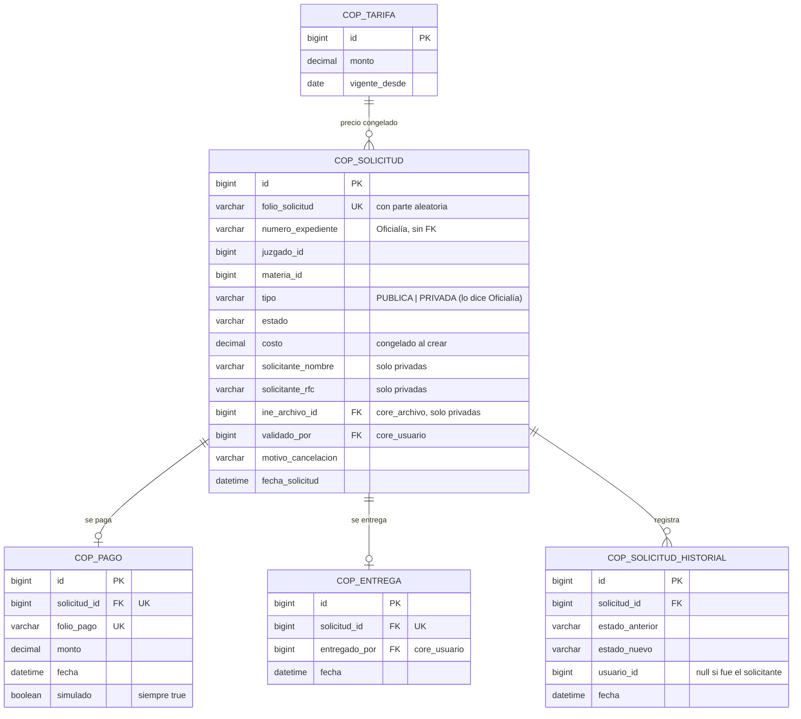
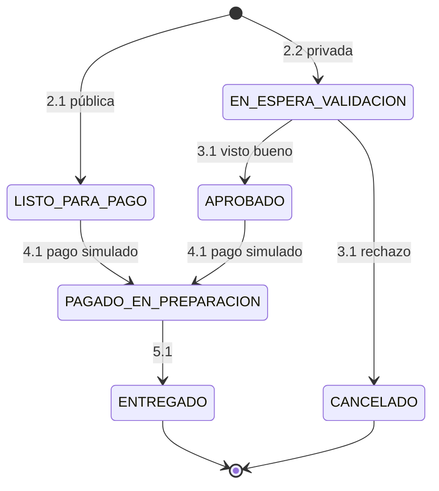

# Módulo de Copias Certificadas — SGCC

| Dato | Valor |
| :---- | :---- |
| Equipo | **Equipo 5** · rama `equipo-5` |
| Prefijo | Paquete `mx.edu.utez.sij.copias` · URLs `/copias/...` (públicas en `/copias/publico/...`) · vistas `front-end/WEB-INF/jsp/copias/` · tablas `cop_` · roles `COPIAS_*` |
| Fuente | DFR SGCC v1.0 (23/10/2026) |
| Líder | Sánchez Muñoz Emilio |
| Integrantes (DFR) | Corona Hernández Sergio Ethan · Martínez Reyes Rodrigo · Ramírez Jirón Erisbel Sarahí · Soto Valladares Andrés Manuel |
| Cliente | Narváez Figueroa José Christian |

> Sigue las reglas de `docs/ARQUITECTURA.md` y los contratos de `docs/CONTRATOS.md`.

---

## 1. Propósito

Digitaliza la solicitud, validación, cobro y entrega de copias certificadas de demandas:

- **Demanda pública:** cualquier persona la solicita y pasa directo al pago.
- **Demanda privada:** el solicitante captura sus datos y su identificación, y el personal del juzgado valida que sea parte del proceso antes de habilitar el pago.

La copia se entrega **solo de forma física** en el juzgado. No hay descarga digital del expediente (RN-04).

**Decisión del grupo:** los ciudadanos, abogados y partes **no tienen cuenta**. Usan un portal público y solo se capturan sus datos. El **pago es simulado**.

---

## 2. Requerimientos y quién los implementa

| RF | Requerimiento | Implementación |
| :---- | :---- | :---- |
| 1.1 – 1.3 | Iniciar sesión, cerrar sesión, recuperar contraseña | **Núcleo**, solo para `COPIAS_PERSONAL` y `COPIAS_JUEZ` |
| 2.1 | Solicitar copia de demanda pública | Copias, **portal público** |
| 2.2 | Solicitar copia de demanda privada | Copias, **portal público** |
| 2.3 | Consultar estado del folio y descargar papeleta | Copias, **portal público**; PDF con `PdfService` |
| 3.1 | Validar solicitud privada (visto bueno) | Copias (`COPIAS_PERSONAL`) |
| 4.1 | Efectuar pago | Copias, **portal público**, pago **simulado**; comprobante con `PdfService` |
| 5.1 | Registrar entrega | Copias (`COPIAS_JUEZ` y `COPIAS_PERSONAL`) |
| 6.1 | Gestión de usuarios y roles | **Núcleo** (`SISTEMA_ADMIN` crea las cuentas) + `@PreAuthorize` en Copias |

---

## 3. Usuarios y roles

| Usuario | Cómo entra | Puede |
| :---- | :---- | :---- |
| Solicitante (ciudadano, demandante, demandado, abogado) | **Sin cuenta**, por `/copias/publico` | Solicitar, consultar su folio, descargar papeleta y comprobante, pagar (simulado) |
| `COPIAS_PERSONAL` | Login | Ver solicitudes privadas pendientes con la INE, aprobar o cancelar, registrar entregas |
| `COPIAS_JUEZ` | Login | Validar el comprobante y registrar la entrega |

---

## 4. Modelo de datos



Notas:
- El **tipo** (pública o privada) no lo escoge el solicitante: lo dice Oficialía con `ExpedienteApi.buscar(...).tipo()`.
- Si es privada y el solicitante elige "pública", el sistema lo manda al flujo privado (criterio de RF 2.1).
- `cop_tarifa`: el DFR pide "congelar la tarifa vigente", pero no dice quién la configura [Confirmar] (pendiente 17). Mientras tanto, `DatosInicialesCopias` crea una tarifa fija de prueba.

---

## 5. Estados de la solicitud



Los textos que ve el usuario son los del DFR 2.3: "En espera de validación", "Aprobado", "Listo para pago", "Cancelado", "Pagado y en preparación" y "Entregado".

---

## 6. Reglas de negocio en el código

### 6.1 Solicitud pública (2.1) — `SolicitudCopiaService`
1. Con `expedienteApi.buscar(numeroExpediente)`:
   - si no existe: "El expediente no fue encontrado";
   - si es `PRIVADO`: redirige al formulario privado.
2. Si es `PUBLICO`:
   - no pide identificación,
   - congela el costo con la tarifa vigente,
   - genera el folio,
   - y deja la solicitud en `LISTO_PARA_PAGO`.
3. Muestra la papeleta con el folio y el botón "Pagar".

### 6.2 Solicitud privada (2.2)
1. **Obligatorios:** número de expediente, juzgado o materia, nombre completo, RFC e INE.
   - La INE se guarda con `archivoService.guardar("COPIAS", ine, [JPG, PNG, PDF], 5)`; el tamaño máximo es [Confirmar].
   - Si falta algo, se resalta el campo.
   - Si el archivo no es válido: alerta en pantalla.
2. **Estado:** `EN_ESPERA_VALIDACION`, con el mensaje "Debe esperar la aprobación antes de pagar".
3. **Pago:** no se permite hasta que haya visto bueno (RN-01).

### 6.3 Consulta de folio (2.3) — portal público
- **Cualquier persona con el folio** ve el estado y puede volver a descargar la papeleta en PDF.
- **Lo que se muestra:** solo folio, expediente, estado y fechas. **Nunca** las partes ni la INE.
- **Folio no adivinable:** formato `CC-AAAA-XXXXXX` con 6 caracteres aleatorios [Propuesta]. Si fuera consecutivo, cualquiera podría consultar los trámites de otros.
- Si el folio no existe: "No se encontraron registros".

### 6.4 Visto bueno (3.1) — `ValidacionService`
- **Bandeja:** solicitudes `EN_ESPERA_VALIDACION`, cada una con su INE (solo `COPIAS_PERSONAL` puede abrirla).
- **Apoyo para validar:** la pantalla muestra junto a los datos del solicitante las **partes del expediente** que devuelve `ExpedienteApi` (nombre, RFC y rol), para que el personal las compare.
- **Decisión:**
  - **Aprobar** → `APROBADO` (se habilita el pago).
  - **Cancelar** → `CANCELADO` (bloquea el pago para siempre). Se sugiere pedir un motivo.

### 6.5 Pago simulado (4.1) — `PagoService`
1. **Entrada:** el solicitante escribe su folio.
   - Si está en `EN_ESPERA_VALIDACION` o `CANCELADO`, no se permite y se dice por qué.
2. **Resumen:** expediente, costo congelado y la leyenda "Pago simulado — no se realiza ningún cargo".
3. **Pagar:** al confirmar se crea `cop_pago` con su propio folio de pago y el estado pasa a `PAGADO_EN_PREPARACION`.
4. **Comprobante:** se genera en PDF descargable e imprimible (`pdfService.generar("pdf/copias/comprobante", ...)`).
5. **Sin pagos dobles:** `cop_pago.solicitud_id` es único.

### 6.6 Entrega (5.1) — `EntregaService`
- Solo solicitudes `PAGADO_EN_PREPARACION`.
- Antes de confirmar, se muestra "Verifique la identificación del solicitante en ventanilla".
- Al confirmar: `ENTREGADO`, con quién y cuándo. El folio queda **inhabilitado** (RN-03): ya no se puede reimprimir ni pagar.

### 6.7 Seguridad del portal público
- Solo `/copias/publico/**` es público (configurado en el núcleo).
- Los formularios públicos llevan token CSRF (`<form:form>` o `<n:csrf/>`).
- La INE nunca tiene URL pública: solo se descarga desde `/copias/validacion/{id}/ine` con rol `COPIAS_PERSONAL`.
- La bitácora registra las acciones públicas con usuario nulo y la IP.

---

## 7. Contratos

**Ofrece:** ninguno.

**Necesita:**

| De | Contrato | Para qué |
| :---- | :---- | :---- |
| Oficialía | `ExpedienteApi` | Existencia, tipo pública/privada, juzgado, materia y partes del expediente |
| Oficialía | `CatalogoJudicialApi` | Listas de juzgados y materias en el formulario |
| Núcleo | `ArchivoService`, `PdfService`, `BitacoraService`, `SesionService` | INE, papeleta y comprobante, registro, sesión del personal |

---

## 8. Rutas (`/copias`)

### Portal público (sin sesión)

| Método | URL | Vista / acción |
| :---- | :---- | :---- |
| GET | `/copias/publico` | Inicio: buscar expediente o consultar folio |
| GET / POST | `/copias/publico/solicitud` | Busca el expediente y decide si el flujo es público o privado |
| GET / POST | `/copias/publico/solicitud/privada` | Formulario con datos e INE (2.2) |
| GET | `/copias/publico/folio` | Consultar estado `?folio=` (2.3) |
| GET | `/copias/publico/folio/{folio}/papeleta.pdf` | Papeleta (2.3) |
| GET / POST | `/copias/publico/pago` | Pago simulado (4.1) |
| GET | `/copias/publico/pago/{folioPago}/comprobante.pdf` | Comprobante |

### Juzgado (con sesión)

| Método | URL | Roles | Vista / acción |
| :---- | :---- | :---- | :---- |
| GET | `/copias` | PERSONAL, JUEZ | Inicio |
| GET | `/copias/validacion` | PERSONAL | Bandeja de privadas (3.1) |
| GET | `/copias/validacion/{id}` | PERSONAL | Detalle con INE y partes del expediente |
| GET | `/copias/validacion/{id}/ine` | PERSONAL | Ver la INE |
| POST | `/copias/validacion/{id}/aprobar` · `/cancelar` | PERSONAL | Visto bueno |
| GET | `/copias/entregas` | PERSONAL, JUEZ | Pagadas pendientes de entrega |
| POST | `/copias/entregas/{id}` | PERSONAL, JUEZ | Registrar entrega (5.1) |
| GET | `/copias/solicitudes` | PERSONAL, JUEZ | Consulta general |

---

## 9. Estructura de carpetas

```text
copias/
├── controller/   PortalPublicoController, PagoController, ValidacionController, EntregaController
├── service/      SolicitudCopiaService, FolioService, ValidacionService, PagoService, EntregaService, TarifaService
├── repository/   SolicitudRepository, PagoRepository, EntregaRepository, TarifaRepository
├── model/        SolicitudCopia, EstadoSolicitud (enum), TipoDemanda (enum), Pago, Entrega, Tarifa
├── dto/          SolicitudPublicaForm, SolicitudPrivadaForm, PagoForm
└── DatosInicialesCopias.java
front-end/WEB-INF/jsp/copias/  publico/  validacion/  entregas/      templates/pdf/copias/ (papeleta.html, comprobante.html)
```

Las vistas públicas usan `<t:layout-publico>` (sin menú de usuario).

---

## 10. Correcciones sugeridas al DFR

| Sección | Hoy dice | Sugerencia |
| :---- | :---- | :---- |
| 2.1 Perspectiva | Base de datos de expedientes, pasarela de pagos y base de copias como sistemas externos | Los expedientes vienen del módulo de Oficialía; el pago es **simulado** dentro del módulo; la copia física se entrega en ventanilla |
| 2.2 Inicio de sesión | Para ciudadano, abogado, personal y juez | Solo personal del juzgado y juez. Los solicitantes usan el portal público sin cuenta |
| 2.3 Usuarios | Ciudadano como usuario registrado | "Ciudadano / solicitante: no tiene cuenta; captura sus datos en el portal público" |
| 2.4 Restricción operativa | "Credenciales activas dentro del sistema del solicitante" | "La entrega la registra el juez o personal del juzgado con su cuenta activa" |
| RF 1.1 – 1.3 | Todos los roles | Solo personal y juez. Nota: "Se implementan con el control de acceso común" |
| RF 1.3 | "Correo no fue encontrado" | Mensaje genérico (pendiente 3) |
| RF 1.1 | Sin prioridad | Poner Alta |
| RF 2.3 | "Cualquier usuario que cuente con un folio" | "Cualquier persona con el folio; solo se muestra el estado, sin datos personales" |
| RF 2.2 | "Tamaño máximo permitido" sin valor | Definirlo (propuesta: 5 MB) |
| RF 4.1 | Pasarela de pago | "Pago simulado: el sistema registra el pago y genera el comprobante sin cargo real" |
| RF 6.1 | Administrador asigna roles a ciudadanos y abogados | Solo a personal y juez; lo hace el administrador del sistema (`SISTEMA_ADMIN`) |
| 3.1 Interfaces de usuario | "Panel de configuración de tarifas" | Agregar el RF correspondiente o quitarlo (pendiente 17) |
| 3.3.1 | Paleta "Material Design" | Usar el diseño común del sistema (Bootstrap con la paleta institucional) |
| 3.3.2 | Caché si se cae el módulo de expedientes | No aplica: es la misma aplicación |
| 3.3.3 | "Aprobado en menos de 1 semana" | Es un tiempo del proceso del juzgado, no del software; moverlo a reglas de negocio o quitarlo |
| 3.3.6 | REST/JSON con Expedientes | Interfaz interna `ExpedienteApi` |
| 3.3.8 | "Tecnologías web vistas en la materia" | Java 21, Spring Boot 4 (MVC), JSP + JSTL, Bootstrap 5, Spring Security, Spring Data JPA, MySQL 8 |
| Firmas | Nombre del cliente vacío | Narváez Figueroa José Christian |

## 11. Pendientes

- Quién configura la tarifa y si hay un precio por copia o por página (pendiente 17).
- Si el personal valida solicitudes de cualquier juzgado o solo del suyo (pendiente 18).
- Tamaño máximo de la INE.
- Que Oficialía capture el tipo de demanda y el RFC de las partes, porque la validación depende de eso (pendiente 5).
