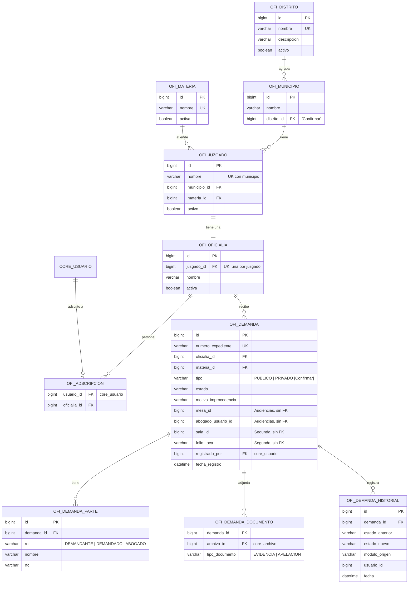
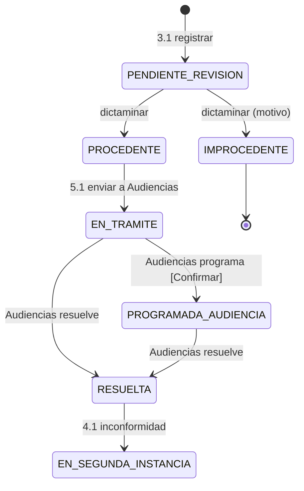

# Módulo de Oficialía de Partes — Recepción y Gestión de Demandas

| Dato | Valor |
| :---- | :---- |
| Equipo | **Equipo 1** · rama `equipo-1` |
| Prefijo | Paquete `mx.edu.utez.sij.oficialia` · URLs `/oficialia/...` · vistas `front-end/WEB-INF/jsp/oficialia/` · tablas `ofi_` · roles `OFICIALIA_*` |
| Fuente | DFR "Sistema de Gestión y Recepción de Demandas para Oficialías de Partes" v3.0 (22/10/2026) |
| Líder | Flores Pérez Valeria Jatziry |
| Cliente | Narváez Figueroa José Christian |

> Sigue las reglas de `docs/ARQUITECTURA.md` y los contratos de `docs/CONTRATOS.md`.

---

## 1. Propósito

Es la **puerta de entrada** de todo el sistema:

- recibe y registra las demandas,
- detecta posibles duplicados entre juzgados,
- y deja que el personal del juzgado decida si cada demanda procede.

También administra la estructura judicial (materias, distritos, municipios, juzgados y oficialías), que los demás módulos consultan. Por último, envía cada demanda procedente a Audiencias y, si se impugna, a Segunda Instancia.

---

## 2. Requerimientos y quién los implementa

| RF | Requerimiento | Implementación |
| :---- | :---- | :---- |
| 1.1 | Iniciar sesión | **Núcleo** (login único con las reglas de la sección 7.1 de la arquitectura) |
| 2.1 | Catálogo de materias y distritos (Administrador Mayor) | Oficialía. Lo expone con `CatalogoJudicialApi` |
| 2.2 | Alta de juzgados y su oficialía (Administrador Mayor) | Oficialía. Lo expone con `CatalogoJudicialApi` |
| 2.3 | Cuentas de usuario por adscripción | Oficialía: pantallas y adscripción. La cuenta se crea con `UsuarioService` del núcleo |
| 3.1 | Registrar demanda y verificar duplicidad | Oficialía |
| 3.2 | Consultar demandas | Oficialía |
| — | Dictaminar procedencia / improcedencia | Oficialía. **No tiene RF** (ver correcciones) |
| 4.1 | Escalar a segunda instancia | Oficialía |
| 5.1 | Asignación de mesa (y abogado) para audiencias | Oficialía, usando `MesaConsultaApi` y `RecepcionDemandaApi` de Audiencias |
| 5.2 | Asignación de sala para segunda instancia | Oficialía, usando `SalaConsultaApi` y `RecepcionTocaApi` de Segunda |

---

## 3. Roles

| Rol | Puede |
| :---- | :---- |
| `SISTEMA_ADMIN` (Administrador Mayor) | Materias, distritos, municipios, juzgados y oficialías (RF 2.1, 2.2) |
| `OFICIALIA_PERSONAL` | Registrar y consultar demandas, enviarlas a Audiencias, escalarlas a segunda instancia y asignar sala. Administrar las cuentas de **su** oficialía (RF 2.3) [Confirmar: ¿todo el personal o solo un encargado?] |
| `OFICIALIA_REVISOR` | Personal del juzgado: consultar las demandas de su juzgado y dictaminar procedencia |

**Regla de jurisdicción (RN 1):** quien no es `SISTEMA_ADMIN` solo ve y modifica demandas y usuarios de **su** oficialía. El service siempre filtra por la adscripción del usuario en sesión.

---

## 4. Modelo de datos



Notas:
- `ofi_municipio.distrito_id`: el DFR dice que se "delimitan distritos" y que los juzgados se asignan a un municipio, pero no dice cómo se relacionan distrito y municipio. Propuesta: cada municipio pertenece a un distrito [Confirmar].
- Las partes van en su propia tabla para poder guardar varios demandados o abogados, y para que Copias valide al solicitante.
- **Duplicidad (RF 3.1):** se guarda también el intento aunque haya coincidencia (3.3.2 "conservar los intentos de registro").

---

## 5. Estados de la demanda



- **RF 4.1:** una demanda en segunda instancia no puede volver a "Resuelta" sin un nuevo dictamen.
- No está definido qué estado queda cuando Segunda Instancia resuelve la toca [Confirmar] (pendiente 15).

---

## 6. Reglas de negocio en el código

### 6.1 Catálogos (2.1, 2.2) — `CatalogoService`
- Solo `SISTEMA_ADMIN`.
- No se repiten nombres de materias ni de distritos (validar antes de guardar y con `unique` en la columna).
- Un juzgado debe tener un municipio que exista. No se repite su nombre o número dentro del mismo municipio.
- Cada juzgado tiene **una sola** oficialía (`juzgado_id` único en `ofi_oficialia`).
- Vista jerárquica: Municipio → Juzgados → Materia → Oficialía activa.

### 6.2 Usuarios por adscripción (2.3) — `PersonalOficialiaService`
1. Crea la cuenta con `usuarioService.crear(nombre, correo, rol)`. Solo se permiten `OFICIALIA_PERSONAL` y `OFICIALIA_REVISOR`.
2. Guarda la adscripción a **la oficialía del usuario en sesión**.
3. Listar, editar y desactivar siempre filtra por esa oficialía. Pedir un usuario de otra oficialía muestra la página 403.
4. El correo es único en todo el sistema (lo valida el núcleo).

> El DFR pide capturar la "Contraseña" al crear el usuario. Se sugiere que el núcleo genere una **contraseña temporal** y la envíe por correo, como hacen Peritajes y Segunda. Así nadie conoce la contraseña de otro.

### 6.3 Registrar demanda (3.1) — `DemandaService`
1. Valida los obligatorios (ver correcciones: tipo, partes y RFC).
2. **Busca duplicados en todos los juzgados** antes de guardar. El criterio no está definido [Confirmar]. Propuesta: misma materia + mismo RFC del demandante + mismo nombre del demandado, sin distinguir mayúsculas ni acentos.
3. Si hay coincidencias, muestra una alerta con el número de expediente, el juzgado y la fecha de cada una (**sin** los datos personales, por la RN 1). La persona decide si guarda de todos modos.
4. Genera el `numero_expediente` (`EXP-AAAA-NNNNN` [Propuesta]) y guarda la demanda en `PENDIENTE_REVISION`.
5. Los documentos se suben con `archivoService.guardar("OFICIALIA", ...)`.

### 6.4 Dictaminar (sin RF) — `DemandaService.dictaminar`
- Solo `OFICIALIA_REVISOR` y solo demandas de su juzgado en `PENDIENTE_REVISION`.
- `PROCEDENTE`, o `IMPROCEDENTE` con motivo obligatorio.

### 6.5 Enviar a Audiencias (5.1) — `EnvioAudienciasService`
1. La demanda debe estar en `PROCEDENTE`.
2. Muestra las opciones de `mesaConsultaApi.mesasDisponibles(materiaId)`. Solo aparecen mesas de la materia de la demanda (RN 2).
3. El usuario elige mesa y abogado. Se llama a `recepcionDemandaApi.recibir(...)`, que pone la demanda en `EN_TRAMITE`.
4. Si no hay mesas: "No hay mesas disponibles para esta materia".

### 6.6 Segunda instancia (4.1 y 5.2) — `SegundaInstanciaService`
1. **Escalar (4.1):**
   - Solo si está en `RESUELTA`.
   - Pide el documento de apelación (PDF) [Confirmar].
   - Cambia a `EN_SEGUNDA_INSTANCIA`.
2. **Asignar sala (5.2):**
   - El formulario solo se habilita en `EN_SEGUNDA_INSTANCIA` (RN 3).
   - Muestra `salaConsultaApi.salasDisponibles(distritoId)`.
3. **Enviar:** al guardar se llama a `recepcionTocaApi.recibir(...)` y se guarda el `folio_toca` que devuelve.

---

## 7. Contratos

**Ofrece** (detalle en `docs/CONTRATOS.md`):

| Contrato | Lo usan |
| :---- | :---- |
| `CatalogoJudicialApi` | Todos los módulos |
| `ExpedienteApi` | Audiencias, Peritajes, Segunda Instancia, Copias |

**Necesita:**

| De | Contrato | Para qué |
| :---- | :---- | :---- |
| Audiencias | `MesaConsultaApi`, `RecepcionDemandaApi` | RF 5.1 |
| Segunda Instancia | `SalaConsultaApi`, `RecepcionTocaApi` | RF 4.1, 5.2 |
| Núcleo | `UsuarioService`, `SesionService`, `ArchivoService`, `BitacoraService` | Cuentas, sesión, documentos, bitácora |

---

## 8. Rutas (`/oficialia`)

| Método | URL | Roles | Vista / acción |
| :---- | :---- | :---- | :---- |
| GET | `/oficialia` | Todos los del módulo | Inicio según rol |
| GET / POST | `/oficialia/admin/materias` | SISTEMA_ADMIN | Listado y alta (2.1) |
| POST | `/oficialia/admin/materias/{id}` | SISTEMA_ADMIN | Editar materia |
| GET / POST | `/oficialia/admin/distritos` · `/oficialia/admin/municipios` | SISTEMA_ADMIN | Listado y alta (2.1) |
| GET | `/oficialia/admin/juzgados` | SISTEMA_ADMIN | Vista jerárquica (2.2) |
| GET / POST | `/oficialia/admin/juzgados/nuevo` | SISTEMA_ADMIN | Alta de juzgado + oficialía |
| GET | `/oficialia/usuarios` | OFICIALIA_PERSONAL | Usuarios de su oficialía (2.3) |
| GET / POST | `/oficialia/usuarios/nuevo` · `/oficialia/usuarios/{id}` | OFICIALIA_PERSONAL | Alta y edición |
| GET | `/oficialia/demandas` | OFICIALIA_PERSONAL, OFICIALIA_REVISOR | Búsqueda por expediente, materia y estado (3.2) |
| GET / POST | `/oficialia/demandas/nueva` | OFICIALIA_PERSONAL | Registro (3.1) |
| POST | `/oficialia/demandas/verificar-duplicados` | OFICIALIA_PERSONAL | Muestra coincidencias antes de guardar |
| GET | `/oficialia/demandas/{id}` | OFICIALIA_PERSONAL, OFICIALIA_REVISOR | Detalle |
| POST | `/oficialia/demandas/{id}/dictamen` | OFICIALIA_REVISOR | Procedente / improcedente |
| GET / POST | `/oficialia/demandas/{id}/audiencias` | OFICIALIA_PERSONAL | Elegir mesa y abogado, y enviar (5.1) |
| POST | `/oficialia/demandas/{id}/segunda-instancia` | OFICIALIA_PERSONAL | Escalar (4.1) |
| GET / POST | `/oficialia/demandas/{id}/sala` | OFICIALIA_PERSONAL | Asignar sala y enviar a Segunda (5.2) |
| GET | `/oficialia/demandas/{id}/documentos/{archivoId}` | OFICIALIA_PERSONAL, OFICIALIA_REVISOR | Descargar documento |

---

## 9. Estructura de carpetas

```text
oficialia/
├── controller/   CatalogoController, PersonalController, DemandaController, EnvioController
├── service/      CatalogoService, CatalogoJudicialService (implements CatalogoJudicialApi),
│                 PersonalOficialiaService, DemandaService, DuplicidadService,
│                 ExpedienteService (implements ExpedienteApi), EnvioAudienciasService, SegundaInstanciaService
├── repository/   MateriaRepository, DistritoRepository, MunicipioRepository, JuzgadoRepository,
│                 OficialiaRepository, AdscripcionRepository, DemandaRepository, ...
├── model/        Materia, Distrito, Municipio, Juzgado, Oficialia, Adscripcion, Demanda, DemandaParte,
│                 EstadoDemanda (enum), ...
├── dto/          DemandaForm, FiltroDemandas, CoincidenciaDto, JuzgadoForm
└── DatosInicialesOficialia.java     # materias, distritos, juzgados y demandas de prueba
front-end/WEB-INF/jsp/oficialia/  admin/  usuarios/  demandas/  inicio.jsp
```

`DatosInicialesOficialia` debe correr **antes** que los de los otros módulos (`@Order(1)`), porque todos usan materias y expedientes.

---

## 10. Correcciones sugeridas al DFR

| Sección | Hoy dice | Sugerencia |
| :---- | :---- | :---- |
| 2.1 Perspectiva | "No depende de sistemas externos" | "Es el módulo de entrada del Sistema Judicial Integral; entrega las demandas procedentes a Audiencias y las impugnadas a Segunda Instancia." |
| 2.2 Funciones | Fila "Gestión de Asignaciones e Itinerario (Salas y Mesas)" | Aclarar que las mesas las administra Audiencias y las salas Segunda Instancia; Oficialía solo **elige** entre las disponibles |
| 2.6 Postergados | "Pasos después de aceptar una demanda" | Quitarlo o acotarlo: esos pasos sí ocurren, pero en Audiencias y Segunda Instancia |
| 3.1 Interfaces de software | Solo correo y base de datos | Agregar: "Se integra con los módulos de Audiencias y Segunda Instancia mediante interfaces internas del sistema" |
| 3.2 RF 1.1 | Solo personal de oficialía | Actores: Administrador Mayor, Personal de Oficialía, Personal del Juzgado. Agregar las reglas comunes (3 intentos, bloqueo de 15 min, recuperar y cambiar contraseña) |
| 3.2 RF 2.3 | Captura "Contraseña" | Cambiar por contraseña temporal generada por el sistema y enviada por correo |
| 3.2 RF 3.1 | Solo Materia\* obligatoria | Agregar: Tipo de demanda (pública/privada)\*, Nombre del demandante\*, RFC del demandante\*, Nombre del demandado\*, RFC del demandado, Abogados, Juzgado (de la adscripción). Definir el criterio de duplicidad |
| 3.2 RF 3.2 | Sin prioridad | Poner prioridad (sugerencia: Alta) |
| 3.2 (falta) | — | Nuevo RF "Dictaminar procedencia de la demanda (Personal del Juzgado)" con motivo obligatorio |
| 3.2 RF 4.1 | Solo número de expediente | Agregar Documento de apelación (PDF)\* y quién confirma la inconformidad |
| 3.2 RF 5.1 | "Asignar automáticamente una mesa" y luego "si el usuario selecciona" | "Seleccionar la mesa y el abogado de audiencia entre los que Audiencias tiene disponibles para la materia, y enviar la demanda" |
| 3.4 RN 2 | La sala debe coincidir en materia | Confirmar con el Equipo 4: hoy sus salas no tienen materia (pendiente 12) |
| 3.3.8 | "Tecnologías vistas en el cuatrimestre" | Java 21, Spring Boot 4 (MVC), JSP + JSTL, Bootstrap 5, Spring Security, Spring Data JPA, MySQL 8 |

## 11. Pendientes

- Formato del número de expediente y el momento en que se genera (pendiente 6).
- Relación entre distrito y municipio.
- Tipos y tamaño máximo de los documentos de la demanda.
- Qué estado queda después de la resolución de segunda instancia.
- Si todo el personal de oficialía puede crear usuarios o solo un encargado.
