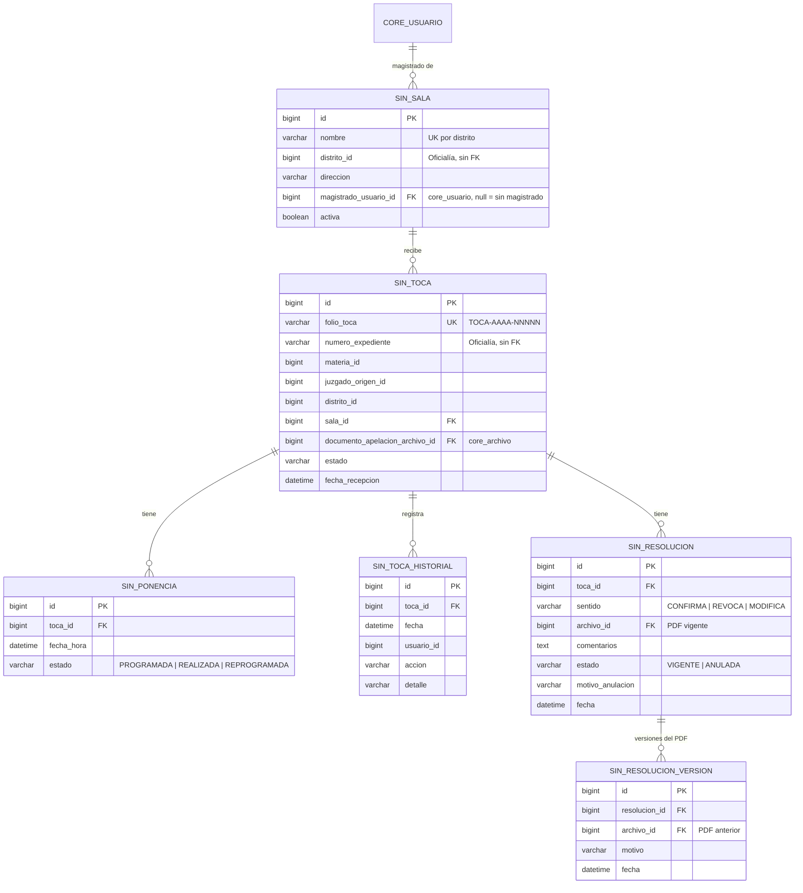
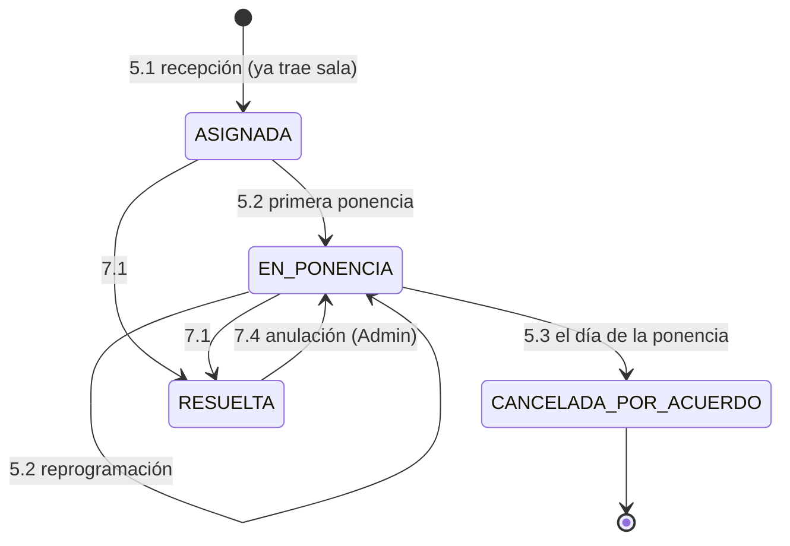

# Módulo de Segunda Instancia — SSI, Sistema de Gestión de Tocas

| Dato | Valor |
| :---- | :---- |
| Equipo | **Equipo 4** · rama `equipo-4` |
| Prefijo | Paquete `mx.edu.utez.sij.segunda` · URLs `/segunda/...` · vistas `front-end/WEB-INF/jsp/segunda/` · tablas `sin_` · roles `SEGUNDA_*` |
| Fuente | DFR SSI v1.0 (23/10/2026) |
| Líder | Modesto Cruz Bastián Azael |
| Integrantes (DFR) | López González Daniel · Jacobo Uriostegui Ángel Uriel · Ríos Peña Abraham · Copado Vargas Jorge Martín |
| Cliente | Narváez Figueroa José Christian |

> Sigue las reglas de `docs/ARQUITECTURA.md` y los contratos de `docs/CONTRATOS.md`.

---

## 1. Propósito

Atiende las demandas cuya resolución de primera instancia fue impugnada:

1. La demanda llega desde Oficialía con la sala ya elegida y se registra con un nuevo folio llamado **toca**. Conserva su número de expediente.
2. El magistrado de esa sala registra las ponencias y consulta el expediente completo (demanda, audiencias, actas y dictámenes).
3. El magistrado emite la resolución: confirma, revoca o modifica.

---

## 2. Requerimientos y quién los implementa

| RF | Requerimiento | Implementación |
| :---- | :---- | :---- |
| 1.1 – 1.2 | Inicio de sesión y recuperación de contraseña | **Núcleo** (3 intentos, bloqueo de 15 min, mensaje genérico al recuperar, sesión extendida configurable para `SEGUNDA_MAGISTRADO`) |
| 2.1 | Consulta de distritos | Segunda, leyendo `CatalogoJudicialApi.distritosActivos()` de Oficialía (solo lectura) |
| 3.1 – 3.4 | Registrar, consultar, editar y desactivar salas | Segunda |
| 4.1 – 4.5 | Registrar, consultar, asignar, editar y desactivar magistrados | Segunda (la cuenta se crea con `UsuarioService`; el correo de bienvenida lo envía el núcleo) |
| 5.1 | Recepción automática de la solicitud de segunda instancia | Segunda, con el contrato `RecepcionTocaApi` (lo llama Oficialía) |
| 5.2 | Registro de ponencia | Segunda |
| 5.3 | Cancelación de toca por acuerdo | Segunda |
| 6.1 | Visualizar expediente completo | Segunda, leyendo `ExpedienteApi` (Oficialía), `AudienciaConsultaApi` (Audiencias) y `DictamenConsultaApi` (Peritajes) |
| 6.2 | Historial de la toca | Segunda (tabla propia, inalterable) |
| 7.1 – 7.4 | Registrar, consultar, actualizar y anular resoluciones | Segunda |

---

## 3. Roles

| Rol | Puede |
| :---- | :---- |
| `SEGUNDA_ADMIN` | Salas, magistrados, consultar resoluciones e historial, anular resoluciones (7.4) |
| `SEGUNDA_MAGISTRADO` | Solo las tocas de **sus** salas: ponencias, expediente, cancelación por acuerdo y resolución |

---

## 4. Modelo de datos



Notas:
- **Distritos:** no se guardan aquí (RN 3). Se leen del catálogo de Oficialía y solo se guarda `distrito_id`.
- **Magistrados:** son usuarios del núcleo con rol `SEGUNDA_MAGISTRADO`. Su distrito (RF 4.1, opcional) se puede guardar en una tabla `sin_magistrado` si hace falta.
- **Magistrado por sala:** según RF 4.3, un magistrado puede tener **varias** salas, y cada sala muestra **un** magistrado. Por eso el magistrado va como columna en `sin_sala`.
- **Datos del expediente:** la información de la demanda **no se guarda** (RN 3); se consulta en vivo.

---

## 5. Estados de la toca



El DFR dice que la toca se crea "Pendiente de Asignación", pero también que llega con la sala ya asignada. Aquí se propone que nazca en `ASIGNADA` [Confirmar].

---

## 6. Reglas de negocio en el código

### 6.1 Salas (3.1 – 3.4) — `SalaService`
- **Registro:** obligatorio un distrito activo (de `CatalogoJudicialApi`) y una dirección.
- **Edición:** no se cambia el distrito si la sala ya tiene tocas asignadas.
- **Desactivar:** bloqueado si tiene tocas pendientes de resolución. Una sala inactiva no aparece en `SalaConsultaApi`.

### 6.2 Magistrados (4.1 – 4.5) — `MagistradoService`
- **Registro:**
  - `usuarioService.crear(nombre, correo, "SEGUNDA_MAGISTRADO")`, con correo único.
  - El DFR pide escribir una "contraseña temporal"; se sugiere que la genere el núcleo y la envíe en el correo de bienvenida.
- **Asignación a sala:** manual, y un magistrado puede tener varias salas.
- **Desactivar:**
  - Bloqueado si tiene tocas pendientes; primero se reasignan (ver pendiente 14).
  - Al desactivarlo, deja de aparecer en las asignaciones.

### 6.3 Recepción de la toca (5.1) — `RecepcionTocaService implements RecepcionTocaApi`
1. Valida que lleguen todos los datos obligatorios:
   - número de expediente,
   - materia,
   - documento de apelación,
   - juzgado de origen,
   - distrito,
   - sala.

   Si falta alguno: `ReglaNegocioException("Faltan datos obligatorios para generar la toca")` y registro en bitácora (el "log" del DFR).
2. Valida que la sala esté activa y tenga magistrado.
3. No revisa la procedencia: ya lo hizo Oficialía.
4. Crea la toca en `ASIGNADA` con folio `TOCA-AAAA-NNNNN` [Propuesta]. Registra el historial y avisa al magistrado (notificación + correo).
5. Devuelve el folio, que Oficialía guarda. Ese es el "200/201" del DFR.

### 6.4 Ponencias (5.2)
- Varias por toca; el historial no se borra.
- El magistrado ve cuántas ponencias tiene en la semana.

### 6.5 Cancelación por acuerdo (5.3)
- **Solo el día de la ponencia:** se compara `LocalDate.now()` con la fecha de alguna ponencia de la toca.
- Motivo obligatorio y documento de acuerdo opcional.
- La toca pasa a `CANCELADA_POR_ACUERDO`.

### 6.6 Expediente completo (6.1) — `ExpedienteSegundaService`
- **Datos que reúne:**
  - `expedienteApi.buscar(numero)`: la demanda;
  - `audienciaConsultaApi.audienciasDeExpediente(numero)` y `resolucion(numero)`: audiencias, actas y resolución;
  - `dictamenConsultaApi.dictamenesDeExpediente(numero)`: dictámenes.
- **Solo lectura.** Si una sección está vacía, muestra "Sin registros".
- **Documentos:** los PDF de otros módulos se descargan por una ruta de Segunda que primero valida que el archivo pertenezca a ese expediente.

### 6.7 Historial (6.2)
Cada evento (recepción, ponencia, cancelación, resolución, actualización, anulación) agrega un renglón a `sin_toca_historial`. No hay métodos para editar ni borrar. Se muestra como línea de tiempo.

### 6.8 Resoluciones (7.1 – 7.4)
- **Registrar:**
  - Sentido\* y PDF\* (`archivoService.guardar("SEGUNDA", archivo, [PDF], 10)`).
  - La toca pasa a `RESUELTA`.
  - Después ya no se reasigna ni se cancela.
- **Actualizar:** solo el PDF, nunca el sentido. El PDF anterior se guarda en `sin_resolucion_version` con el motivo.
- **Anular:**
  - Solo `SEGUNDA_ADMIN`, con motivo.
  - La resolución queda `ANULADA` y la toca vuelve a `EN_PONENCIA`, o a `ASIGNADA` si no tenía ponencias.
- **Confidencialidad (RN 5):** la resolución no es visible hasta que está registrada con su PDF.

---

## 7. Contratos

**Ofrece:** `SalaConsultaApi` y `RecepcionTocaApi` (los usa Oficialía).

**Necesita:**

| De | Contrato | Para qué |
| :---- | :---- | :---- |
| Oficialía | `CatalogoJudicialApi` | Distritos (2.1) y juzgados |
| Oficialía | `ExpedienteApi` | Datos de la demanda (6.1) |
| Audiencias | `AudienciaConsultaApi` | Audiencias, actas y resolución de primera instancia (6.1) |
| Peritajes | `DictamenConsultaApi` | Dictámenes (6.1) |
| Núcleo | `UsuarioService`, `SesionService`, `NotificacionService`, `ArchivoService`, `BitacoraService` | Cuentas, sesión, correo, PDF, registro |

---

## 8. Rutas (`/segunda`)

| Método | URL | Roles | Vista / acción |
| :---- | :---- | :---- | :---- |
| GET | `/segunda` | ADMIN, MAGISTRADO | Inicio según rol |
| GET | `/segunda/distritos` | ADMIN, MAGISTRADO | Consulta (2.1) |
| GET | `/segunda/salas` | ADMIN, MAGISTRADO | Listado con filtros (3.2) |
| GET / POST | `/segunda/salas/nueva` · `/segunda/salas/{id}` | ADMIN | Alta y edición (3.1, 3.3) |
| POST | `/segunda/salas/{id}/desactivar` | ADMIN | 3.4 |
| GET | `/segunda/magistrados` | ADMIN | Listado (4.2) |
| GET / POST | `/segunda/magistrados/nuevo` · `/segunda/magistrados/{id}` | ADMIN | Alta y edición (4.1, 4.4) |
| POST | `/segunda/magistrados/{id}/salas` | ADMIN | Asignar sala (4.3) |
| POST | `/segunda/magistrados/{id}/desactivar` | ADMIN | 4.5 |
| GET | `/segunda/tocas` | MAGISTRADO | Mis tocas pendientes |
| GET | `/segunda/tocas/{id}` | MAGISTRADO, ADMIN | Detalle con el expediente completo (6.1) |
| GET | `/segunda/tocas/{id}/historial` | MAGISTRADO, ADMIN | Línea de tiempo (6.2) |
| POST | `/segunda/tocas/{id}/ponencias` | MAGISTRADO | Registrar ponencia (5.2) |
| POST | `/segunda/tocas/{id}/cancelar-acuerdo` | MAGISTRADO | 5.3 |
| GET / POST | `/segunda/tocas/{id}/resolucion` | MAGISTRADO | Registrar (7.1) |
| POST | `/segunda/resoluciones/{id}/actualizar` | MAGISTRADO | Nuevo PDF (7.3) |
| POST | `/segunda/resoluciones/{id}/anular` | ADMIN | 7.4 |
| GET | `/segunda/resoluciones` | MAGISTRADO, ADMIN | Listado y descarga (7.2) |
| GET | `/segunda/tocas/{id}/archivos/{archivoId}` | MAGISTRADO, ADMIN | Descarga validada |

---

## 9. Estructura de carpetas

```text
segunda/
├── controller/   DistritoController, SalaController, MagistradoController, TocaController, ResolucionController
├── service/      SalaService, SalaConsultaService (implements SalaConsultaApi), MagistradoService,
│                 RecepcionTocaService (implements RecepcionTocaApi), TocaService, PonenciaService,
│                 ExpedienteSegundaService, ResolucionService, HistorialTocaService
├── repository/   SalaRepository, TocaRepository, PonenciaRepository, ResolucionRepository, ...
├── model/        Sala, Toca, EstadoToca (enum), Ponencia, Resolucion, SentidoResolucion (enum), ...
├── dto/          SalaForm, MagistradoForm, PonenciaForm, ResolucionForm
└── DatosInicialesSegunda.java
front-end/WEB-INF/jsp/segunda/  (salas/, magistrados/, tocas/, resoluciones/)   templates/correo/segunda/
```

---

## 10. Correcciones sugeridas al DFR

| Sección | Hoy dice | Sugerencia |
| :---- | :---- | :---- |
| 1.2 y 2.1 | "Sistema web independiente" que consume el "sistema externo" o el "sistema de primera instancia" vía API | "Módulo del Sistema Judicial Integral que consulta a Oficialía, Audiencias y Peritajes mediante interfaces internas" |
| 1.4 Referencias | BPMN, representación conceptual y manual "Pendiente" | Completarlos o quitarlos |
| Glosario: Materia | "civil, familiar, mercantil o judicial" | Revisar "judicial" (¿Penal?). Las materias vienen del catálogo de Oficialía (pendiente 2) |
| Glosario: Administrador | "puede reasignar tocas" | Coincide con 4.5 pero contradice la RN 7; definirlo (pendiente 14) |
| Glosario | API, Token de sesión | Ajustar: no hay API entre módulos; la sesión la maneja Spring Security |
| 2.2 Gestión de salas | "(número, ubicación, juzgado)" | Coincide con 3.1. Agregar Materia si Oficialía lo exige (pendiente 12) |
| RF 1.1 | Sesión configurable | Lo cubre el núcleo con `sij.sesion.minutos-por-rol.SEGUNDA_MAGISTRADO` |
| RF 4.1 | Contraseña temporal capturada | Generada por el sistema y enviada por correo |
| RF 5.1 | Estado inicial "Pendiente de Asignación" | "Asignada", porque ya llega con sala y magistrado |
| RF 5.1 | "Se devuelve código HTTP 200/201" | "El sistema devuelve el folio de la toca al módulo de Oficialía" |
| RF 7.1 | "Notificación por correo a las partes" | Las partes no tienen correo registrado: quitarlo o pedir a Oficialía que lo capture (pendiente 16) |
| RN 7 | Numeración salta del 5 al 7 | Renumerar |
| 3.3.4 | Modularizar "backend y frontend" | "Modularizar en capas MVC" |
| 3.3.6 | API REST JSON/XML | Interfaces internas |
| 3.3.8 | "Stack definido por la academia" | Java 21, Spring Boot 4 (MVC), JSP + JSTL, Bootstrap 5, Spring Security, Spring Data JPA, MySQL 8 |

## 11. Pendientes

- Reasignación de tocas al desactivar a un magistrado (pendiente 14).
- Materia de las salas (pendiente 12).
- Tamaño máximo de los PDF.
- Qué estado ve Oficialía cuando la toca se resuelve (pendiente 15).
